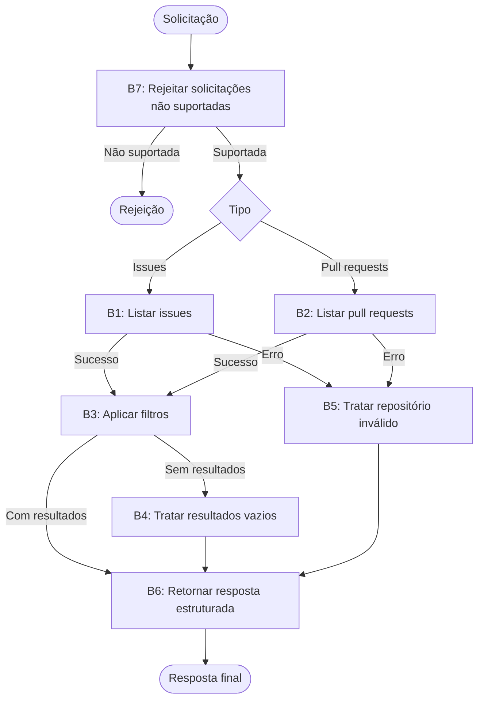

**Task:** You are an AI agent generator. Below is a design for an agent; please generate the agent accordingly. Note that the agent's tools should be generated alongside the agent's code.

**Contexto:** An AI agent is an entity that utilizes an LLM and tools to perform specific tasks autonomously.

**Output:** agent.py, requirements.txt, tests.py

**Contrato de interface com o benchmark:**

| Requisito de interface | Exemplo |
| --- | --- |
| Modelo | GPT-4o |
| Framework | LangGraph |
| GenAI Tool | ChatOpenAI |
| Tools | Every tool must be a LangChain tool (@tool, StructuredTool, or obtained from an MCP server via langchain-mcp-adapters) and must be executed exclusively through its interface (invoke/ainvoke, directly or via ToolNode), never by calling its implementation function directly. |
| Entrypoint | agent(repository: str, user_request: str, github_token: str) |
| Output | { "status": "success \| failure", "message": "Response message", "result": { "action": "list_issues \| list_pull_requests", "repository": "owner/repository", "items": [ { "number": 0, "title": "Item title", "state": "open \| closed" } ] } } |

**Requisitos:**

| Requisito | Significado | Especificação do agente | Critério de Corretude |
| --- | --- | --- | --- |
| Goal | Objetivo e comportamento principal do agente na voz ativa | The agent must list pull requests or issues from a repository, depending on the user request | O comportamento principal está declarado definindo quem faz, o que faz e o resultado? |
| Persona (Opcional) | A personalidade que o agente assume ao realizar as tarefas | A developer specialist in github | A especificação define uma persona e sua área de atuação? A persona é adequada/coerente com o Goal? |
| Inputs | Informação enviada para o agente | - Repository: identifier on format owner/repository  - user_request: Natural language instruction describing what the user wants to retrieve and how results should be filtered (e.g., "List open pull requests waiting for review" or "Show me all closed bug issues")  - github_token: A GitHub token with READ permission | A especificação define qual é a entrada esperada? |
| Constraints | Uma afirmação que restringe as ações que o agente (ou seus usuários/operadores) têm permissão de realizar. Descreve o que o agente deve, não deve, ou não pode fazer, ou define que apenas determinados papéis/condições autorizam uma certa ação. |  | A especificação declara explicitamente uma ação que o agente deve, não deve, ou só pode sob certas condições? A restrição está expressa em termos de ação/comportamento permitido ou proibido — não em termos de tecnologia, ferramenta ou biblioteca usada para implementar o agente? Quando a restrição envolve papel/autorização ("só X pode fazer Y"), a especificação define quem ou o que está autorizado? A restrição é verificável: é possível observar, no comportamento do agente, se ela foi violada ou respeitada? |
| Guardrails and Invariants | Regras externas ou condições que devem ser sempre respeitadas pelo agente durante sua execução. Podem vir de leis, regulamentações, políticas da empresa ou regras do domínio. Quando uma condição é um invariante, ela deve ser satisfeita antes e depois da execução de qualquer comportamento do agente. | The agent must invoke exactly one tool per execution — invoking both tools in a single run is not allowed | A especificação declara uma relação, propriedade ou condição do domínio que é (ou deve ser) sempre verdadeira, e não uma ação permitida/proibida? O invariante está conectado a uma entrada, saída, evento ou dado que o agente efetivamente manipula (não é conhecimento de domínio irrelevante ao escopo do agente)? É possível verificar, a qualquer momento durante a execução, se o invariante ainda é válido? |
| Quality attributes (non-functional requirements) | Características observáveis do comportamento do agente durante a execução, que não descrevem o que ele faz (isso é Goal/Behavior Requirements) nem o que ele nunca deve fazer (Constraints), mas quão bem ele faz — de forma consistente, segura, eficiente e confiável. Moldam diretamente a confiança e a experiência de quem depende do agente. | Not applicable | O atributo está descrito de forma observável/mensurável no comportamento (não é uma característica de implementação, ex: "usar cache" não é quality attribute, é constraint de implementação)? Existe um critério de aceitação verificável (limiar, taxa, ou condição de teste), e não apenas um adjetivo vago ("deve ser rápido" sem definir o quê é rápido)? Havendo trade-off entre atributos (ex: robustez vs. performance), a especificação deixa explícita a prioridade? |

**Tools:**

| Nome | Propósito | Entradas | Retorno | Falhas |
| --- | --- | --- | --- | --- |
| list_issues | Retrieve issues from a specific repository for subsequent filtering. | Repository identifier (owner/repository) and filters supported by the tool, such as state and labels. | List of issues with the data provided by the tool, including number, title, and status, when available. | Return empty list |
| list_pull_requests | Retrieve repository pull requests for listing and filtering code contributions, merge requests, and review-related requests. | Repository identifier and filters supported by the tool. | Pull requests returned by GitHub, including number, title, and state, when available. | Return empty list |

**Comportamentos:**

| Comportamento | Trigger | Input | Tools | Saída | Efeito no ambiente | Constraints |
| --- | --- | --- | --- | --- | --- | --- |
| B1 - Select and list issues or pull requests | The user requests a list of GitHub issues. | Repository identifier and natural-language request specifying the desired issues and optional filters. | Github MCP tool: `list_issues` | A structured response containing the matching issues, including their number, title, and state when available. | Read-only access to repository issues; no repository data is modified. | Must invoke list_issues exactly once and must not invoke list_pull_requests |
| B2 — Select and list pull requests | The user requests a list of GitHub pull requests. | Repository identifier and natural-language request specifying the desired pull requests and optional filters. | Github MCP tool: `list_pull_requests` | A structured response containing the matching pull requests, including their number, title, and state when available. | Read-only access to repository pull requests; no repository data is modified. | Must invoke list_pull_requests exactly once and must not invoke list_issues. |
| B3 — Apply filters | The user specifies criteria such as state, label, author, or date. | Repository identifier, requested item type, filtering criteria, and data returned by the selected tool. | The tool selected in B1 or B2; no additional tool invocation. | Only items satisfying the requested criteria are included in the response. | Filtering is performed on retrieved data; no repository data is modified. | Must apply all supported criteria correctly. Must not invoke the other tool to apply filters. |
| B4 — Handle empty results | The selected tool returns no items, or filtering produces no matches. | Repository identifier, requested item type, filters, and an empty result set. | The tool selected in B1 or B2; no additional tool invocation. | A structured response with an empty list, a success status, and an explanatory message. | No repository data is modified. | Must not treat an empty result set as an execution failure. |
| B5 — Handle invalid or inaccessible repositories | The repository does not exist or cannot be accessed. | Repository identifier and natural-language request. | The selected tool, if invoked, returns an error. | A structured response with a failure status and an explanatory message. | No repository data is modified. | Must not fabricate results or report success when the repository cannot be accessed. |
| B6 — Return a structured response | The agent finishes processing a supported request. | Selected action, repository identifier, and retrieved and filtered items, or an error. | No additional tool invocation. | A response containing status, message, and result, with action, repository, and filtered_issues or the corresponding pull-request items. | No additional environment changes. | Must follow the specified output schema and preserve the distinction between issues and pull requests. |
| B7 — Reject unsupported requests | The user requests an unsupported operation or asks to list issues and pull requests simultaneously. | Repository identifier and unsupported natural-language request. | None. | A message explaining the supported operations; a structured failure or rejection response. | No repository data is accessed or modified. | Must not invoke either listing tool. Each execution is limited to one item type and exactly one listing-tool invocation for supported requests. |

| Campo | Critério de corretude |
| --- | --- |
| Comportamento | Cada comportamento está especificado como um requisito individual e identificável, separado do Goal? Cada requisito é atômico o suficiente para ser testado isoladamente (dá pra escrever um caso de teste "dado X, o agente deve fazer Y")? A especificação cobre explicitamente o comportamento esperado diante de: entrada inválida, falha de ferramenta/tool call, ambiguidade, ausência de informação necessária? Os requisitos, somados, são suficientes para realizar o Goal declarado (nada essencial ficou implícito)? |
| Trigger | A condição ou evento que inicia o comportamento está explicitamente definido e é observável? |
| Input | A especificação define qual é a entrada esperada? |
| Tools | As ferramentas necessárias para o comportamento estão identificadas e seu propósito de uso está definido? |
| Expected Outcome | A especificação define qual alteração deve ocorrer no ambiente? A alteração esperada é observável e verificável após a execução do comportamento? |
| Efeito no ambiente | A especificação define qual ambiente o agente vai alterar?  A especificação define como será feita a alteração no ambiente? |
| Constraints | As restrições do comportamento estão explícitas, são verificáveis e coerentes com as restrições gerais? |

**Grafo comportamental:**

**Detalhes de implementação:**

| Item | Instruções |
| --- | --- |
| import load_dotenv | from dotenv import load_dotenv; load_dotenv() |
