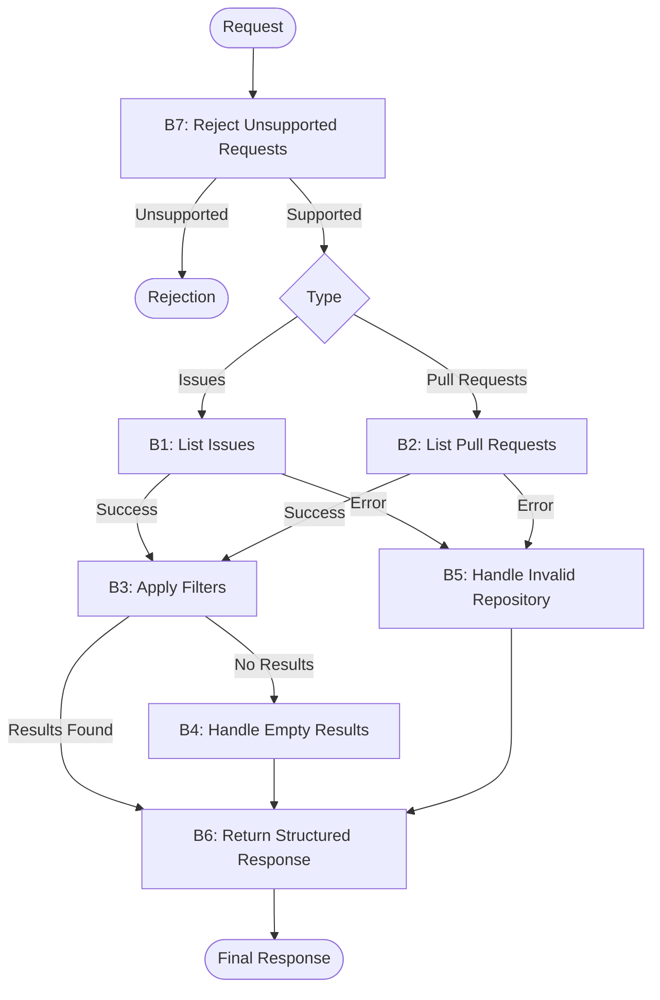

**Task:** You are an AI agent generator. Below is a design for an agent; please generate the agent accordingly. Note that the agent's tools should be generated alongside the agent's code.

**Context:** An AI agent is an entity that utilizes an LLM and tools to perform specific tasks autonomously.

**Output:** agent.py, requirements.txt, tests.py

**Benchmark interface contract:**

| Interface requirement | Example |
| --- | --- |
| Model | GPT-4o |
| Framework | LangGraph |
| GenAI Tool | ChatOpenAI |
| Tools | Every tool must be a LangChain tool (@tool, StructuredTool, or obtained from an MCP server via langchain-mcp-adapters) and must be executed exclusively through its interface (invoke/ainvoke, directly or via ToolNode), never by calling its implementation function directly. |
| Entrypoint | agent(repository: str, user_request: str) |
| Output | { "status": "success \| failure", "message": "Response message", "result": { "action": "list_issues \| list_pull_requests", "repository": "owner/repository", "items": [ { "number": 0, "title": "Item title", "state": "open \| closed" } ] } } |

**Requirements:**

| Requirement | Meaning | Agent specification | Correctness criterion |
| --- | --- | --- | --- |
| Goal | The agent's objective and main behavior, stated in the active voice | The agent must list pull requests or issues from a repository, depending on the user request | Does the main behavior state who acts, what they do, and the result? |
| Persona (Optional) | The personality the agent assumes when performing its tasks | A developer specialist in github | Does the specification define a persona and its area of activity? Is the persona appropriate for and consistent with the Goal? |
| Inputs | Information sent to the agent | - Repository: identifier on format owner/repository  - user_request: Natural language instruction describing what the user wants to retrieve and how results should be filtered (e.g., "List open pull requests waiting for review" or "Show me all closed bug issues") | Does the specification define the expected input? |
| Guardrails and Invariants | External rules or conditions the agent must always respect during execution. They may come from laws, regulations, company policies, or domain rules. An invariant must hold before and after any agent behavior. | - Data Scope Isolation: All items included in the final output must originate exclusively from the specified repository input.  - Environment Immutability: The execution must leave the target repository state completely unchanged before, during, and after any operation. | Does the specification state a relationship, property, or condition of the domain that is (or should be) always true, rather than a permitted/prohibited action? Is the invariant connected to an input, output, event, or piece of data the agent actually handles, rather than domain knowledge irrelevant to its scope? Can the invariant be checked at any point during execution? |
| Quality attributes (non-functional requirements) | Observable characteristics of the agent's behavior during execution that describe neither what it does (Goal/Behavior Requirements) nor what it must never do (Constraints), but how well it does it: consistently, safely, efficiently, and reliably. They directly shape the trust and experience of those who depend on the agent. | Not applicable | Is the attribute described in observable/measurable behavioral terms, rather than as an implementation characteristic (for example, "use a cache" is an implementation constraint, not a quality attribute)? Is there a verifiable acceptance criterion (a threshold, rate, or test condition), rather than just a vague adjective (such as "must be fast" without defining how fast)? Where attributes involve a trade-off (for example, robustness versus performance), does the specification make the priority explicit? |

**Tools:**

| Name | Purpose | Inputs | Return | Failures |
| --- | --- | --- | --- | --- |
| list_issues | Retrieve issues from a specific repository for subsequent filtering. | Repository identifier (owner/repository) and filters supported by the tool, such as state and labels. | List of issues with the data provided by the tool, including number, title, and status, when available. | Return empty list |
| list_pull_requests | Retrieve repository pull requests for listing and filtering code contributions, merge requests, and review-related requests. | Repository identifier and filters supported by the tool. | Pull requests returned by GitHub, including number, title, and state, when available. | Return empty list |

**Behaviors:**

| Behavior | Trigger | Input | Tools | Output | Environment effect | Constraints |
| --- | --- | --- | --- | --- | --- | --- |
| B1 - Select and list issues | The user requests a list of GitHub issues. | Repository identifier and natural-language request specifying the desired issues and optional filters. | Github MCP tool: `list_issues` | A structured response containing the matching issues, including their number, title, and state when available. | Read-only access to repository issues; no repository data is modified. | Must invoke list_issues exactly once and must not invoke list_pull_requests |
| B2 — Select and list pull requests | The user requests a list of GitHub pull requests. | Repository identifier and natural-language request specifying the desired pull requests and optional filters. | Github MCP tool: `list_pull_requests` | A structured response containing the matching pull requests, including their number, title, and state when available. | Read-only access to repository pull requests; no repository data is modified. | Must invoke list_pull_requests exactly once and must not invoke list_issues. |
| B3 — Apply filters | The user specifies criteria such as state, label, author, or date. | Repository identifier, requested item type, filtering criteria, and data returned by the selected tool. | The tool selected in B1 or B2; no additional tool invocation. | Only items satisfying the requested criteria are included in the response. | Filtering is performed on retrieved data; no repository data is modified. | Must apply all supported criteria correctly. Must not invoke the other tool to apply filters. |
| B4 — Handle empty results | The selected tool returns no items, or filtering produces no matches. | Repository identifier, requested item type, filters, and an empty result set. | The tool selected in B1 or B2; no additional tool invocation. | A structured response with an empty list, a success status, and an explanatory message. | No repository data is modified. | Must not treat an empty result set as an execution failure. |
| B5 — Handle invalid or inaccessible repositories | The repository does not exist or cannot be accessed. | Repository identifier and natural-language request. | The selected tool, if invoked, returns an error. | A structured response with a failure status and an explanatory message. | No repository data is modified. | Must not fabricate results or report success when the repository cannot be accessed. |
| B6 — Return a structured response | The agent finishes processing a supported request. | Selected action, repository identifier, and retrieved and filtered items, or an error. | No additional tool invocation. | A response containing status, message, and result, with action, repository, and filtered_issues or the corresponding pull-request items. | No additional environment changes. | Must follow the specified output schema and preserve the distinction between issues and pull requests. |
| B7 — Reject unsupported requests | The user requests an unsupported operation or asks to list issues and pull requests simultaneously. | Repository identifier and unsupported natural-language request. | None. | A message explaining the supported operations; a structured failure or rejection response. | No repository data is accessed or modified. | Must not invoke either listing tool. Each execution is limited to one item type and exactly one listing-tool invocation for supported requests. |

| Field | Correctness criterion |
| --- | --- |
| Behavior | Is each behavior specified as an individual, identifiable requirement, separate from the Goal? Is each requirement atomic enough to test in isolation (given X, the agent must do Y)? Does the specification explicitly cover invalid input, tool call failure, ambiguity, and missing required information? Together, are the requirements sufficient to achieve the declared Goal, with no essential behavior left implicit? |
| Trigger | Is the condition or event that starts the behavior explicitly defined and observable? |
| Input | Does the specification define the expected input? |
| Tools | Are the required tools identified and their intended use defined? |
| Expected Outcome | Does the specification define the expected change in the environment? Is that change observable and verifiable after the behavior runs? |
| Environment effect | Does the specification define which environment the agent changes and how that change is made? |
| Constraints | Do this behavior’s constraints state what the agent must, must not, or may only do under certain conditions? Are the responsible party and conditions clear? Are the constraints verifiable and consistent with this behavior’s other fields and the Goal? |

**Behavioral graph:**

**Implementation details:**

| Item | Instructions |
| --- | --- |
| import load_dotenv | from dotenv import load_dotenv; load_dotenv() |
