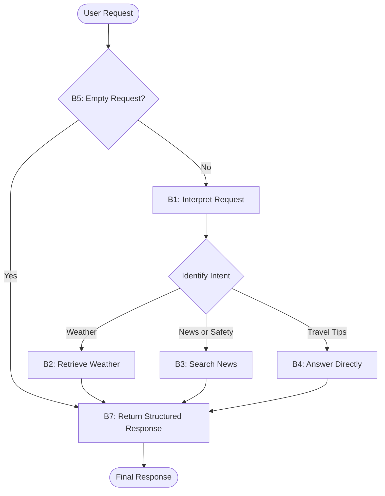

**Task:** You are an AI agent generator. Below is a design for an agent; please generate the agent accordingly. Note that the agent's tools should be generated alongside the agent's code.

**Contexto:** An AI agent is an entity that utilizes an LLM and tools to perform specific tasks autonomously.

**Output:** agent.py, requirements.txt, tests.py

**Contrato de interface com o benchmark:**

| Requisito de interface | Exemplo |
| --- | --- |
| Modelo | GPT-4o |
| Framework | LangGraph |
| GenAI Tool | ChatOpenAI |
| Tools | Every tool must be a LangChain tool (@tool, StructuredTool, or obtained from an MCP server via langchain-mcp-adapters) and must be executed exclusively through its interface (invoke/ainvoke, directly or via ToolNode), never by calling its implementation function directly. |
| Entrypoint | agent(user_request: str) |
| Output | { "status": "success \| failure", "user_request": "Original user request", "response": "Natural-language response" } |

**Requisitos:**

| Requisito | Significado | Especificação do agente | Critério de Corretude |
| --- | --- | --- | --- |
| Goal | Objetivo e comportamento principal do agente na voz ativa | Answer natural-language questions about travel destinations by selecting the appropriate action based on the user's intent. | O comportamento principal está declarado definindo quem faz, o que faz e o resultado? |
| Persona (Opcional) | A personalidade que o agente assume ao realizar as tarefas | Act as a travel destination assistant that helps users explore destinations before deciding to travel. | A especificação define uma persona e sua área de atuação? A persona é adequada/coerente com o Goal? |
| Inputs | Informação enviada para o agente | Receive a natural-language question about a travel destination through user_request: str. | A especificação define qual é a entrada esperada? |
| Constraints | Uma afirmação que restringe as ações que o agente (ou seus usuários/operadores) têm permissão de realizar. Descreve o que o agente deve, não deve, ou não pode fazer, ou define que apenas determinados papéis/condições autorizam uma certa ação. |  | A especificação declara explicitamente uma ação que o agente deve, não deve, ou só pode sob certas condições? A restrição está expressa em termos de ação/comportamento permitido ou proibido — não em termos de tecnologia, ferramenta ou biblioteca usada para implementar o agente? Quando a restrição envolve papel/autorização ("só X pode fazer Y"), a especificação define quem ou o que está autorizado? A restrição é verificável: é possível observar, no comportamento do agente, se ela foi violada ou respeitada? |
| Guardrails and Invariants | Regras externas ou condições que devem ser sempre respeitadas pelo agente durante sua execução. Podem vir de leis, regulamentações, políticas da empresa ou regras do domínio. Quando uma condição é um invariante, ela deve ser satisfeita antes e depois da execução de qualquer comportamento do agente. | - Return failure for empty or blank requests, timeouts, and unhandled exceptions.  - Do not fabricate weather data or news results.  - Always return the required output schema. | A especificação declara uma relação, propriedade ou condição do domínio que é (ou deve ser) sempre verdadeira, e não uma ação permitida/proibida? O invariante está conectado a uma entrada, saída, evento ou dado que o agente efetivamente manipula (não é conhecimento de domínio irrelevante ao escopo do agente)? É possível verificar, a qualquer momento durante a execução, se o invariante ainda é válido? |
| Quality attributes (non-functional requirements) | Características observáveis do comportamento do agente durante a execução, que não descrevem o que ele faz (isso é Goal/Behavior Requirements) nem o que ele nunca deve fazer (Constraints), mas quão bem ele faz — de forma consistente, segura, eficiente e confiável. Moldam diretamente a confiança e a experiência de quem depende do agente. | Not applicable | O atributo está descrito de forma observável/mensurável no comportamento (não é uma característica de implementação, ex: "usar cache" não é quality attribute, é constraint de implementação)? Existe um critério de aceitação verificável (limiar, taxa, ou condição de teste), e não apenas um adjetivo vago ("deve ser rápido" sem definir o quê é rápido)? Havendo trade-off entre atributos (ex: robustez vs. performance), a especificação deixa explícita a prioridade? |

**Tools:**

| Nome | Propósito | Entradas | Retorno | Falhas |
| --- | --- | --- | --- | --- |
| get_weather | Retrieve real-time weather conditions for a destination. | City name | Current weather data from the wttr.in API. | API request failure, timeout, or invalid city. |
| search_destination_news | Search for recent destination-related news, safety advisories, and current events. | Destination and search query | Recent search results from the Tavily Search API. | Missing or invalid API key, API request failure, or timeout. |

**Comportamentos:**

| Comportamento | Trigger | Input | Tools | Saída | Efeito no ambiente | Constraints |
| --- | --- | --- | --- | --- | --- | --- |
| B1 — Interpret Request | A non-empty request is received. | Natural-language question about a travel destination. | None | Identified intent: weather, news/safety, or travel tips. | None | Select the appropriate action based on the user's intent. |
| B2 — Retrieve Weather | The user asks about current weather, temperature, or weather conditions. | User request and identified city. | `get_weather` | Answer based on real weather data. | External request to the wttr.in API. | Invoke at most one tool per execution. |
| B3 — Search News and Advisories | The user asks about news, safety, travel advisories, or current events. | User request and identified destination. | `search_destination_news` | Answer based on real search results. | External request to the Tavily Search API. | Invoke at most one tool per execution; do not fabricate results. |
| B4 — Answer Directly | The user asks about itineraries, activities, local culture, food, or general travel tips. | Natural-language request. | None | Natural-language answer. | None | Do not invoke tools for these requests. |
| B5 — Handle Empty Request | The input is empty or contains only whitespace. | Empty or blank user_request. | None | Response with status: "failure". | None | Preserve the original input in user_request. |
| B6 — Handle Errors and Timeouts | An exception occurs or the execution time limit is exceeded. | Error during processing. | None | Response with status: "failure". | An external request may be interrupted. | Enforce the 30-second execution limit; do not propagate exceptions. |
| B7 — Return Structured Response | An answer is produced or an error occurs. | Original input, result, or error. | None | Object containing status, user_request, and response. | Returns the result to the caller. | Strictly comply with the specified output schema. |

| Campo | Critério de corretude |
| --- | --- |
| Comportamento | Cada comportamento está especificado como um requisito individual e identificável, separado do Goal? Cada requisito é atômico o suficiente para ser testado isoladamente (dá pra escrever um caso de teste "dado X, o agente deve fazer Y")? A especificação cobre explicitamente o comportamento esperado diante de: entrada inválida, falha de ferramenta/tool call, ambiguidade, ausência de informação necessária? Os requisitos, somados, são suficientes para realizar o Goal declarado (nada essencial ficou implícito)? |
| Trigger | A condição ou evento que inicia o comportamento está explicitamente definido e é observável? |
| Input | A especificação define qual é a entrada esperada? |
| Tools | As ferramentas necessárias para o comportamento estão identificadas e seu propósito de uso está definido? |
| Expected Outcome | A especificação define qual alteração deve ocorrer no ambiente? A alteração esperada é observável e verificável após a execução do comportamento? |
| Efeito no ambiente | A especificação define qual ambiente o agente vai alterar?  A especificação define como será feita a alteração no ambiente? |
| Constraints | As restrições do comportamento estão explícitas, são verificáveis e coerentes com as restrições gerais? |

**Grafo comportamental:**

**Detalhes de implementação:**

| Item | Instruções |
| --- | --- |
| Weather API | Must access https://wttr.in/{city}?format=j1 to retrieve real-time weather data |
| News search | Must use the Tavily Search API Client (TavilyClient) to search for recent news, safety advisories, and current events. |
| Environment variable | Must read TAVILY_API_KEY to authenticate Tavily requests. |
| Imports | from dotenv import load_dotenv; load_dotenv() |
