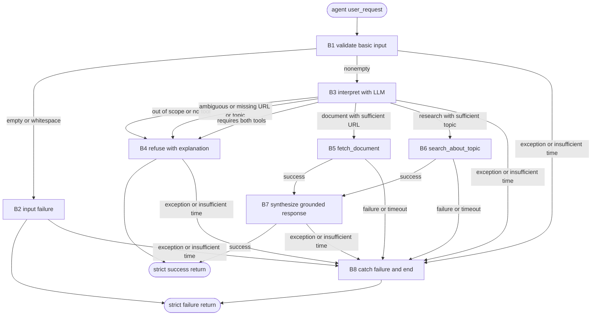

**Task:** You are an AI agent generator. Generate an agent according to this specification, including its tools.
**Context:** The essay assistant interprets natural-language requests to evaluate public documents or research information on a topic related to essay writing.
**Output:** `agent.py`, `requirements.txt`, `tests.py`

**Interface contract:**

| Interface requirement | Specification |
| --- | --- |
| Model | GPT-4o (`gpt-4o`). |
| Framework | LangGraph. |
| GenAI Tool | ChatOpenAI. |
| Tools | Exactly two LangChain tools: `fetch_document` and `search_about_topic`, defined with `@tool` or `StructuredTool`. Execute them exclusively through `invoke`/`ainvoke`, directly or through `ToolNode`, never by directly calling their Python implementations. |
| Entrypoint | `def agent(user_request: str) -> dict`. |
| Output | A dictionary with exactly the keys `status`, `user_request` and `response`, all with string values. `status` accepts only `"success"` or `"failure"`. `user_request` contains the original string, including whitespace. `response` contains the natural-language answer or an explanation of the refusal or failure. |

**Implementation details:**

| Implementation detail | Specification |
| --- | --- |
| Graph | `build_graph()` returns a `CompiledStateGraph`. The graph uses ChatOpenAI with `gpt-4o` to interpret the request, choose between a tool and refusal, and determine the arguments. |
| Semantic decision | The LLM receives the original text. Do not replace interpretation with regex, keyword lists or string matching. Code may detect an empty or whitespace-only string without changing the original. |
| External access | `fetch_document` makes a real HTTP GET request to a directly accessible public URL, without an API key. `search_about_topic` uses `TavilyClient`, authenticated through `TAVILY_API_KEY`. Model access uses `OPENAI_API_KEY`. |
| Execution control | Measure the global budget with a monotonic clock from entry into `agent()` until it returns. Include preparation, LLM, tools, network access and output composition. Limit each operation to the remaining time and reserve time to catch the failure and return the dictionary before 30 seconds. Separate 30-second timeouts for each operation do not meet the contract. Also limit automatic client retries; do not repeat the tool or execute another after a failure. |
| Failure handling | Catch exceptions throughout execution, including initialization, graph, LLM, tools and response composition. Produce the failure explanation without another LLM or tool call. |
| Tests | Unit tests may use mocks for isolated components. To prove integration with external services, tests must make real calls with configured credentials. No additional testing library is required. |

**Requirements:**

| Requirement | Meaning | Agent specification | Correctness criterion |
| --- | --- | --- | --- |
| Goal | Objective and main behavior of the agent in active voice | The essay assistant interprets the user's request, fetches a public document for reading, evaluation or feedback, or researches information on an essay topic, and responds based on the retrieved content. It refuses requests that cannot be fulfilled with a single available tool. | Does the main behavior state who acts, what the agent does and what result it produces? |
| Persona (Optional) | Personality and area of activity | Essay assistant using clear, direct language. | Does the specification define the personality and area of activity? Are they consistent with the Goal? |
| Inputs | Information sent to the agent | `user_request` is a natural-language string. Document retrieval requires a directly accessible public URL; research requires an identifiable topic in the request. The LLM interprets this information. An empty or whitespace-only string results in `failure`. Ambiguity or a missing required URL or topic results in an explanatory refusal with `success`, without tools. The contract covers string inputs; it does not define conversion or normalization of other input types. | Are the expected inputs, mandatory and optional information, and validity conditions explicit? |
| Guardrails and Invariants | Rules and conditions that hold throughout execution | Invoke at most one tool, once per execution, without chaining, parallel execution or fallback between tools. The LLM makes the semantic decision. Refusals neither execute tools nor answer the requested content. Requests requiring both tools are refused before any call. Functional calls use real services; do not invent documents, results or data to conceal failures. Output always follows the strict contract, including refusals and failures. Preserve `user_request` in full on every path. Do not enter infinite loops or depend on indefinite retries. | Do the guardrails have a clear scope? Are the invariants linked to the inputs, data or outputs the agent handles, and can they be verified before and after behaviors? |
| Quality attributes (non-functional requirements) | Observable characteristics of execution and results | Maximum total execution time of 30 seconds, including LLM and network access. Reserve a margin to return `failure` before the limit when there is insufficient time to finish. Exceeding 30 seconds constitutes an agent execution failure, even if a response is returned later. The response must reflect the actual document or search results obtained. Failures return an explanation instead of propagating exceptions. Prioritize the deadline and data integrity over task completion. | Are the qualities observable or measurable, with acceptance criteria rather than implementation details? When qualities conflict, is their priority defined? |

**Tools:**

| Name | Purpose | Inputs | Return | Failures |
| --- | --- | --- | --- | --- |
| `fetch_document(url: str)` | Fetch the textual content of a public document through HTTP GET, without an API key, for essay reading, evaluation or feedback. | `url`: directly accessible public URL identified by the LLM in the request. | Textual content/document actually retrieved from the URL. No additional return schema is imposed. | HTTP errors, network failures, timeouts or exceptions while retrieving or reading the document lead to B8. Do not research as an alternative. |
| `search_about_topic(topic: str)` | Research information, definitions or examples on an essay-related topic through `TavilyClient`. | `topic`: specific topic identified by the LLM in the request. Authentication through `TAVILY_API_KEY`. | Actual search results on the topic, without an additional mandatory schema. | Missing or invalid key, API error, network failure, timeout or another exception lead to B8. Do not fetch a document as an alternative. |

**Behaviors:**

| Behavior | Trigger | Input | Tools | Output | Environment effect | Constraints |
| --- | --- | --- | --- | --- | --- | --- |
| B1: Validate basic input. | Entry into `agent(user_request)`. | Original string. | None. | Route to B2 if empty or whitespace-only; otherwise, to B3. | Start the global budget and preserve the input. | Do not modify the original string. Do not call tools. |
| B2: Reject empty input. | B1 identifies an empty or whitespace-only string. | Original string. | None. | Dictionary with `status="failure"` and an explanation of the invalid input. | Return to the caller. | Preserve every received character in `user_request`; end without tools. |
| B3: Interpret intent and select a route. | B1 accepts nonempty input. | Original request and tool descriptions. | ChatOpenAI for reasoning; no LangChain tool at this stage. | Decision between B4, B5 and B6, with a sufficient argument for the selected tool. | Request to the LLM. | Use semantic decision-making. Resolve scope, ambiguity and required information before executing tools. LLM failure leads to B8. |
| B4: Refuse the request. | B3 identifies an out-of-scope request, a task without tools, ambiguity, missing required information or the need for both tools. | Request and reason for refusal. | No tool. | Dictionary with `status="success"` and an explanatory refusal. State that support is limited to document reading/evaluation or topic research in the context of essays. Identify missing information or ambiguity when applicable; if the request requires both tools, explain the one-tool limit. | Return to the caller. | Do not answer the requested content or execute tools. Refuse, for example, generic introduction tips that do not require a tool. Refusal counts as normal execution. |
| B5: Fetch a document. | B3 selects document reading, evaluation or feedback with a sufficient URL. | Identified `url` and original request. | `fetch_document` through the LangChain interface. | Actual document for B7 or failure for B8. | One real public HTTP GET request. | Execute a single invocation, without additional research, retries or simulated data. Respect the remaining budget. |
| B6: Research a topic. | B3 selects research for information, definitions or examples with a sufficient topic. | Identified `topic` and original request. | `search_about_topic` through the LangChain interface, using `TavilyClient`. | Actual results for B7 or failure for B8. | Real query to the Tavily API. | Execute a single invocation, without fetching a document, repeating the tool or simulating results. Respect the remaining budget. |
| B7: Respond based on the retrieved content. | B5 or B6 completes successfully. | Original request and actual return from the selected tool. | ChatOpenAI; no additional tool. | Dictionary with `status="success"`, original `user_request` and a natural-language `response` incorporating the retrieved content and addressing the request. | Return to the caller. | Do not invent document content or search results. Handle synthesis failures in B8. Do not execute another tool. |
| B8: Handle technical failure or budget exhaustion. | Exception at any stage, HTTP/API/key/LLM failure, timeout or insufficient remaining time to finish and return within the deadline. | Affected operation and available reason. | No new LLM or tool call. | Dictionary with `status="failure"`, original input and a textual explanation of the failure. | End and return without propagating an exception. | Do not fabricate data, continue the task, repeat a tool or execute a fallback. Return before 30 seconds; returning later constitutes an agent execution failure. |

**Behavior graph:**

| Field | Correctness criterion |
| --- | --- |
| Behavior | Is each behavior specified as an individual and identifiable requirement, separate from the Goal? Is each requirement atomic enough to be tested in isolation (can a test case be written as "given X, the agent must do Y")? Does the specification explicitly cover the expected behavior for invalid input, tool/tool-call failure, ambiguity and missing required information? Are the requirements together sufficient to achieve the stated Goal (nothing essential left implicit)? |
| Trigger | Is the condition or event that starts the behavior explicitly defined and observable? |
| Input | Does the specification define the expected input? |
| Tools | Are the tools required for the behavior identified and is their purpose defined? |
| Expected Outcome | Does the specification define what change must occur in the environment? Is the expected change observable and verifiable after the behavior executes? |
| Environment effect | Does the specification define which environment the agent will change? Does the specification define how the environment will be changed? |
| Constraints | Are the behavior constraints explicit, verifiable and consistent with the general constraints? |
