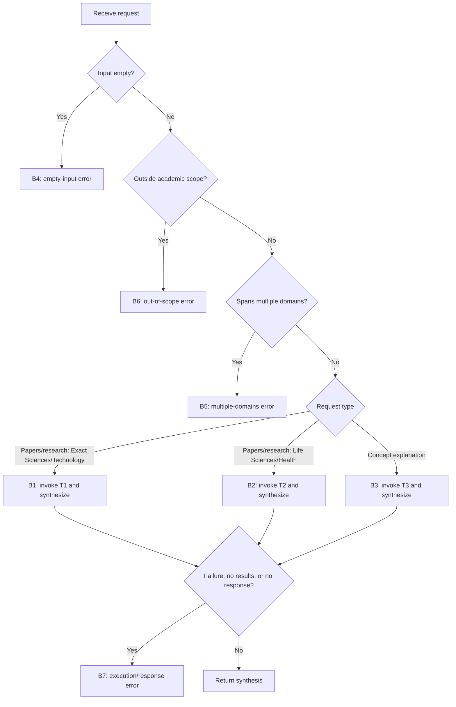

**Task:** You are an AI agent generator, and below is a specification for an agent. Generate an agent according to the specification. Consider that the agent's tools must be generated alongside the agent's code.

**Context:** An AI agent is an entity that uses an LLM and tools to perform specific tasks autonomously.

**Output:** `agent.py`, `requirements.txt`, `tests.py`.

**Interface Contract with the Benchmark:**

| Interface Requirement | Example |
| --- | --- |
| Model | GPT-4o |
| Framework | LangGraph |
| GenAI Tool | ChatOpenAI |
| Entrypoint | `agent(user_request: str)` |
| Output | `str` |
| Tools | Every tool must be a LangChain tool (`@tool`, `StructuredTool`, or one obtained from an MCP server via `langchain-mcp-adapters`) and must be executed exclusively through its interface (`invoke/ainvoke`, directly or via `ToolNode`), never by directly calling the function that implements it. |

**Implementation Details**

| Implementation Details | Description |
| --- | --- |
| `OPENAI_API_KEY` | OpenAI API access key. |

**Requirements:**

| Requirement | Meaning | Agent Specification | Correctness Criterion |
| --- | --- | --- | --- |
| **Goal** | The agent's primary objective and behavior, expressed in the active voice. | The agent must triage a user's academic request, select exactly one appropriate tool based on the subject domain (Exact Sciences/Technology, Life Sciences/Health, or General Concepts), and return a formatted summary of the results found, using an LLM as its reasoning engine. | Does the primary behavior clearly define who performs the task, what the agent does, and the expected outcome? |
| **Persona (Optional)** | The personality the agent assumes when performing tasks. | Not applicable. | Does the specification define a persona and its area of expertise? Is the persona appropriate and consistent with the goal? |
| **Inputs** | Information provided to the agent. | A natural-language request for academic papers or an explanation of a concept. | Does the specification define the expected input? |
| **Guardrails and Invariants** | External rules or conditions that must always be respected by the agent during execution. | (1) The output is always a string (`str`): either a synthesized response based on tool results or exactly one of the four standard error messages defined in the behaviors. (2) For every valid request, exactly one tool is executed. (3) The mapping between domains and tools is fixed: an explicit request for academic papers or research in Exact Sciences/Technology (e.g., artificial intelligence) uses `search_arxiv`; an explicit request for academic papers or research in Life Sciences/Health (e.g., medicine) uses `search_pubmed`; a request to explain or define a single concept uses `get_wikipedia_summary`, including a concept from either scientific domain. (4) Academic scope is limited to requests for papers, research, or factual explanations of established subjects in a recognized academic discipline, including humanities, arts, social sciences, Exact Sciences/Technology, and Life Sciences/Health. Personal advice, transactions, creative-generation requests, and other requests not seeking academic information are outside this scope. | Does the specification state relationships, properties, or conditions that must always hold, rather than allowed or prohibited actions? Is each invariant connected to an input, output, event, or data handled by the agent, and can its validity be verified during execution? |
| **Quality Attributes (Non-Functional Requirements)** | Observable characteristics of the agent's behavior during execution that describe how well it performs. | Not applicable. | Is each attribute described in an observable or measurable way? Is there a verifiable acceptance criterion? If there is a trade-off between attributes, does the specification explicitly state the priority? |

**Behaviors:**

| Behavior | Trigger | Input | Tools | Output | Environment Effect | Constraints |
| --- | --- | --- | --- | --- | --- | --- |
| **B1 — For Exact Sciences/Technology requests, invoke T1 exactly once and synthesize the retrieved papers into a natural-language response.** | Receipt of a valid, non-empty academic request that explicitly asks for papers or research in the Exact Sciences/Technology domain (e.g., artificial intelligence). | A natural-language request for academic papers or research. | T1 | A string containing a brief introduction and a list of papers, each with a title and a short summary. | None. | The agent must invoke only T1, exactly once, without invoking any other tool. The final response must be based exclusively on the data returned by T1, without inventing papers, titles, or information. |
| **B2 — For Life Sciences/Health requests, invoke T2 exactly once and synthesize the retrieved papers into a natural-language response.** | Receipt of a valid, non-empty academic request that explicitly asks for papers or research in the Life Sciences/Health domain (e.g., melanoma). | A natural-language request for academic papers or research. | T2 | A string containing a brief introduction and a list of papers, each with a title and a short summary. | None. | The agent must invoke only T2, exactly once, without invoking any other tool. The final response must be based exclusively on the data returned by T2, without inventing papers, titles, or information. |
| **B3 — For requests to explain general concepts, invoke T3 exactly once and synthesize the retrieved summary into a natural-language response.** | Receipt of a valid, non-empty academic request for an explanation or definition of a one or more concepts in the same domain, including a concept from Exact Sciences/Technology or Life Sciences/Health when the request does not explicitly ask for papers or research. | A natural-language request for an explanation of a concept. | T3 | A string containing a coherent explanatory paragraph about the concept. | None. | The agent must invoke only T3, exactly once, without invoking any other tool. The final response must be based exclusively on the data returned by T3, without inventing information. |
| **B4 — Handle empty input by returning the standard error message.** | Input is empty or consists only of whitespace. | An empty or whitespace-only string. | None. | The exact string: `Error: The user request cannot be empty.` | None. | Not applicable. |
| **B5 — Handle requests spanning multiple distinct domains by returning the standard error message.** | The request asks for information about more than one distinct domain in the same text (e.g., papers about artificial intelligence and melanoma in the same request). | A natural-language request spanning multiple domains. | None. | The exact string: `Error: The query spans multiple distinct domains. Please make one specific research request at a time.` | None. | Not applicable. |
| **B6 — Handle requests outside the academic scope by returning the standard error message.** | A non-empty request does not seek papers, research, or a factual explanation of an established subject in a recognized academic discipline; this includes personal advice, transactions, creative-generation requests, and other non-academic requests. | A natural-language request outside the academic scope. | None. | The exact string: `Error: Query outside of academic scope.` | None. | Not applicable. |
| **B7 — Handle failures when generating a response or unexpected execution errors by returning the standard error message.** | An exception occurs during execution, a tool call fails or returns no results, or the agent fails to produce a response. | A natural-language user request. | None. | The exact string: `Error: Unable to get response from agent.` | None. | Not applicable. |

**Behavioral Graph:**

**Tools:**

| Name | Purpose | Inputs | Return | Failures |
| --- | --- | --- | --- | --- |
| `search_arxiv` (T1) | Searches arXiv for papers in response to requests for papers or research in Exact Sciences/Technology. | The user's research query. | Raw data about the papers found. | If the call fails or returns no results, the agent returns `Error: Unable to get response from agent.` |
| `search_pubmed` (T2) | Searches PubMed for papers in response to requests for papers or research in Life Sciences/Health. | The user's research query. | Raw data about the papers found. | If the call fails or returns no results, the agent returns `Error: Unable to get response from agent.` |
| `get_wikipedia_summary` (T3) | Retrieves a Wikipedia topic summary in response to a request to explain or define a single concept. | The name or description of the concept provided by the user. | Raw data about the retrieved summary. | If the call fails or returns no results, the agent returns `Error: Unable to get response from agent.` |

**Correctness Criteria:**

| Field | Correctness Criterion |
| --- | --- |
| **Behavior** | Is each behavior specified as an individual, identifiable requirement, separate from the Goal? Is each requirement sufficiently atomic to be tested independently (i.e., can a test case be written in the form "given X, the agent must do Y")? Does the specification explicitly cover expected behavior for invalid input, tool-call failures, ambiguity, and missing information? Are the combined requirements sufficient to achieve the stated Goal, with no essential behavior left implicit? |
| **Trigger** | Is the condition or event that initiates the behavior explicitly defined and observable? |
| **Input** | Does the specification define the expected input? |
| **Tools** | Are the tools required for each behavior identified, with their purposes clearly defined? |
| **Expected Outcome** | Does the specification define the expected change in the environment? Is the expected outcome observable and verifiable after execution? |
| **Environment Effect** | Does the specification define which environment the agent will modify? Does it define how the modification will be performed? |
| **Constraints** | Are the constraints for each behavior explicit, verifiable, and consistent with the general constraints? |
