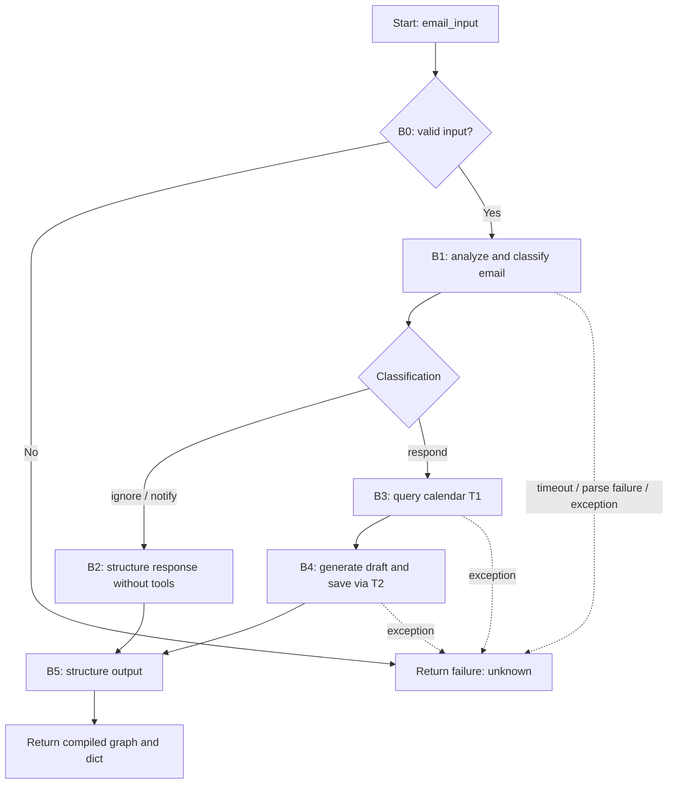

**Task:** You are an AI agent generator, and below is a specification for an agent. Generate an agent according to the specification. Consider that the agent's tools must be generated together with the agent's code.  
**Context:** An AI agent is an entity that uses an LLM and tools to autonomously perform specific tasks.  
**Output:** `agent.py`, `requirements.txt`, `tests.py` (without additional modules, packages, or subdirectories).

**Benchmark Interface Contract:**

| Interface Requirement | Example |
| --- | --- |
| Model | GPT-4o |
| Framework | LangGraph |
| GenAI Tool | ChatOpenAI |
| Tools | Every tool must be a LangChain tool (`@tool`, `StructuredTool`, or one obtained from an MCP server via `langchain-mcp-adapters`) and must be executed exclusively through its interface (`invoke`/`ainvoke`, directly or through `ToolNode`), never by directly calling the function that implements it. |
| Entrypoint | `agent(email_input: str) -> Tuple[Any, dict]`: the function must instantiate the graph (via `build_graph`), execute it with `email_input`, and capture returns/exceptions inside the block protected by B0. |
| Output | `Tuple[CompiledGraph, dict]`: the compiled LangGraph graph (built using `build_graph(...) -> CompiledGraph`) and a `dict` that follows the output schema defined in B5 (failure dictionary per B0/I3 on exception). |

**Implementation Details:**

| Implementation Detail | Specification |
| --- | --- |
| `OPENAI_API_KEY` | OpenAI API access key. |
| `NOTION_TOKEN` | Notion integration token used by the official `notion_client` SDK. |
| `NOTION_CALENDAR_DB_ID` | ID of the Calendar database in Notion. |
| `NOTION_DRAFTS_DB_ID` | ID of the Drafts database in Notion. |

**Requirements:**

| Requirement | Meaning | Agent Specification | Correctness Criterion |
| --- | --- | --- | --- |
| Goal | Main objective and behavior of the agent, expressed in the active voice | The agent must triage, classify, and process incoming emails as an executive assistant: it decides whether to ignore, notify, or respond. For emails that require a response, it checks availability in a Calendar database in Notion, generates a reply draft, and saves it to a Drafts database in Notion, returning a structured summary of the actions taken. | Is the main behavior stated by defining who performs the task, what they do, and the expected outcome? |
| Persona (Optional) | The personality the agent adopts when performing tasks | Executive assistant, with a professional, cordial, and objective tone. Email drafts must be written in a professional tone and signed as "Executive Assistant". | Does the specification define a persona and its area of responsibility? Is the persona appropriate and consistent with the Goal? |
| Inputs | Information provided to the agent | Raw text (body) of a received email, written in natural language (`email_input: str`). The system prompt must also receive the current date and time in ISO 8601 format as a temporal anchor for interpreting relative date expressions in T1 queries. | Does the specification define the expected input? |
| Guardrails and Invariants | External rules or conditions that must always be respected by the agent during execution. They may come from laws, regulations, company policies, or domain rules. An invariant must hold before and after the execution of any agent behavior. | (I1) The returned `classification` field must always be one of the following values: `ignore`, `notify`, `respond`, or `unknown`. (I2) The `actions_taken` field must contain strictly the registered function names (`"get_calendar_events"` and `"save_email_draft"`) only when `classification` is `respond`; for `ignore`, `notify`, and `unknown`, it must be an empty list. (I3) If `status` is `failure`, then `classification` must be `unknown` and `draft_response` must be `None`. (I4) The output must always conform to the exact schema: `action`, `classification`, `actions_taken`, `status`, `message`, and `draft_response`, with no additional keys. The `action` field must always be `"process_email"`. | Does the specification state a relationship, property, or domain condition that is or must always be true, rather than an allowed or prohibited action? Is the invariant connected to an input, output, event, or data that the agent actually handles? Is it possible to verify at any point during execution whether the invariant still holds? |
| Quality attributes (non-functional requirements) | Observable characteristics of the agent's behavior during execution. They describe how well it performs—not what it does (Goal/Behavior Requirements) or what it must never do (Constraints)—in terms of consistency, safety, efficiency, and reliability. | (QA1) **Schema compliance:** 100% of executions return a `dict` that conforms to the output schema, including failure cases. (QA2) **Classification accuracy:** `classification` must logically correspond to the email content (spam, marketing, and irrelevant cold emails → `ignore`; urgent financial updates and critical HR messages → `notify`; meeting requests, customer inquiries, and introductions → `respond`). (QA3) **Latency:** total execution time ≤ 30 seconds. (QA4) **Tool routing:** 100% of tool calls occur only when the classification is `respond`. (QA5) **Draft consistency:** the times proposed in `draft_response` must be consistent with the events returned by T1. In the event of a trade-off, schema compliance and correct routing take priority over the textual quality of the draft. | Is the attribute described in an observable or measurable way? Is there a verifiable acceptance criterion? If there is a trade-off between attributes, is the priority explicitly stated? |

**Tools:**

| Name | Purpose | Inputs | Return | Failures |
| --- | --- | --- | --- | --- |
| T1 — `get_calendar_events` | Queries the Calendar database in Notion (`NOTION_CALENDAR_DB_ID`) to check availability before drafting a reply. The title property is `"Name"` and the date property is `"Date"`. | Date range to query (start and end), inferred by the LLM node using the current date/time in ISO 8601 format as the anchor for relative expressions. | List of events in the period (title and date/time), or an empty list if there are no events. | Any exception or query failure must produce the failure response defined in B0. |
| T2 — `save_email_draft` | Creates a page in the Notion Drafts database (`NOTION_DRAFTS_DB_ID`) to persist the reply draft. The title property is `"Subject"` and the body is stored in the page's `children` blocks. | Draft title (subject) and body, generated by the LLM node. | Creation confirmation (e.g., the ID of the created page) or an error. | Any exception or failure to save must produce the failure response defined in B0. |

**Behaviors:**

| Behavior | Trigger | Input | Tools | Output | Environment Effect | Constraints |
| --- | --- | --- | --- | --- | --- | --- |
| **B0 — Empty Input / Failure Handling** | Empty input, input containing only whitespace, execution exceeding 30 seconds, failure to parse the LLM output, or an unexpected exception at any stage (including T1/T2 failures in B3/B4, where any intermediate `respond` is replaced by `unknown` per I3). | Empty or invalid input, or any input for which a failure occurs during execution. | None (or a tool call that raised an exception). | A `dict` with `action` set to `"process_email"`, `classification` set to `"unknown"`, `actions_taken` set to `[]`, `status` set to `"failure"`, `message` describing the failure, and `draft_response` set to `None`, returned together with the compiled graph. | None. | (C1) Exceptions must not propagate in the event of a timeout or parsing failure; the agent must return the failure dictionary specified for this behavior. |
| **B1 — Analyze the Email** | Receipt of a valid, non-empty `email_input`. | Raw email text. | None. | The classification (`ignore`, `notify`, or `respond`) recorded in the graph state. | None. | (C2) T1 and T2 must not be invoked during classification. |
| **B2 — Negative Classification** | B1 concludes with the classification `ignore` or `notify`. | Raw email text and its classification. | None. | A dictionary with `status` set to `"success"`, an empty `actions_taken` list, a `message` describing the decision, and `draft_response` set to `None`. | None. | (C2) When the classification is `ignore` or `notify`, no tools (T1/T2) must be executed. |
| **B3 — Positive Classification** | B1 concludes with the classification `respond`. | Raw email text; the LLM node infers the date range to query using the current date/time in ISO 8601 format as the anchor. | T1. | A list of events within the specified period, used as context for drafting the reply; the LLM node records `"get_calendar_events"` in `actions_taken`. | None (read-only operation). | (C2) T1 may only be invoked when the classification is `respond`. T2 must not be invoked during this behavior. |
| **B4 — Generate a Draft** | Completion of B3, after calendar events have been retrieved. | Raw email text and the events returned by T1; the LLM node generates the draft title and body. | T2. | A dictionary with `status` set to `"success"`, `actions_taken` containing strictly `["get_calendar_events", "save_email_draft"]`, a `message` summarizing the actions, and `draft_response` containing the draft text as a string. | Creates a page in the Notion Drafts database (`NOTION_DRAFTS_DB_ID`) with title property `"Subject"` and body in page `children` blocks containing the draft. | (C2) T2 may only be invoked when the classification is `respond`, after B3. T1 must not be invoked during this behavior. |
| **B5 — Structure the Output** | Completion of B2 or B4. | The final graph state (classification, actions, message, and draft). | None. | A `dict` containing the following keys: `action` (`"process_email"`), `classification`, `actions_taken` (list of strings, strictly `"get_calendar_events"` / `"save_email_draft"` or empty per I2), `status` (`"success"` or `"failure"`), `message` (string), and `draft_response` (string or `None`). This dictionary is returned as the second element of the tuple, with the compiled graph as the first element. | None. | (C2) No tools must be invoked during this behavior. |

**Behavioral Graph:**

| Field | Correctness Criterion |
| --- | --- |
| Behavior | Is each behavior specified as an individual, identifiable requirement, separate from the Goal? Is each requirement sufficiently atomic to be tested independently (i.e., can a test case be written in the form "given X, the agent must do Y")? Does the specification explicitly cover the expected behavior in the event of invalid input, tool-call failures, ambiguity, or missing required information? Are the requirements collectively sufficient to achieve the stated Goal, with nothing essential left implicit? |
| Trigger | Is the condition or event that initiates the behavior explicitly defined and observable? |
| Input | Does the specification define the expected input? |
| Tools | Are the tools required for the behavior identified, and is their purpose defined? |
| Expected Outcome | Does the specification define the change that must occur in the environment? Is the expected change observable and verifiable after execution? |
| Environment Effect | Does the specification define the environment the agent will modify? Does it define how the modification will be performed? |
| Constraints | Are the behavior's constraints explicit, verifiable, and consistent with the general constraints? |
