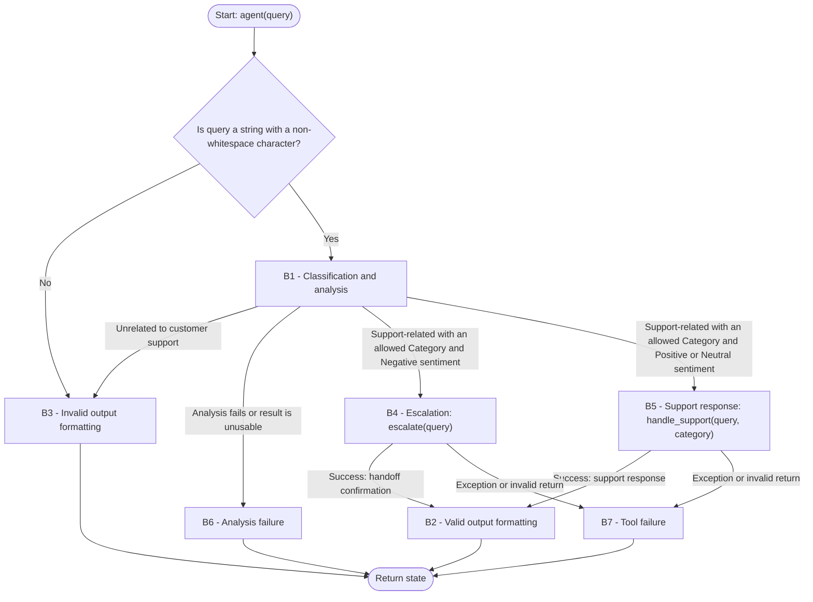

**Task:** you are an AI agent generator, and an agent specification is provided below. Generate an agent according to the specification. Consider that the agent's tools must be generated along with the agent's code.
**Context:** An AI agent is an entity that uses an LLM and tools to perform specific tasks autonomously.
**Output:** agent.py, requirements.txt, tests.py
**Benchmark interface contract:**

| Interface requirement | Example |
| --- | --- |
| Model | GPT-4o |
| Framework | LangGraph |
| GenAI Tool | ChatOpenAI |
| Entrypoint | agent(query) |
| Output | state: dict with a required response: str field |

**General requirements:**

| Requirement | Meaning | Agent specification | Correctness criterion |
| --- | --- | --- | --- |
| Goal | The agent's objective and main behavior, stated in the active voice | The agent analyzes customer support queries received in natural language. In a single LLM call, it categorizes the query as Technical, Billing, or General and analyzes the sentiment as Positive, Neutral, or Negative, returning a structured response. After a valid classification, it calls escalate when Sentiment is Negative, regardless of Category, or handle_support when Sentiment is Positive or Neutral. Once the selected tool succeeds, the structured response includes its exact return value in Response. | Does the main behavior state who acts, what they do, and the result? |
| Persona (Optional) | The personality the agent assumes when performing its tasks | The agent assumes the persona of a customer support query classifier, focused on analyzing and categorizing the input text and using the appropriate support tool or forwarding the query to human support. | Does the specification define a persona and its area of activity? Is the persona appropriate for and consistent with the Goal? |
| Inputs | Information sent to the agent | A string (query: str) containing the customer's message in natural language. The message must concern a product or service, its use, billing, or the provider's support information. Invalid inputs include None, values of other types, empty or whitespace-only strings, and text unrelated to customer support. | Does the specification define the expected input? |
| Policies/Invariants | Statements describing what is true about the domain or the agent's state at a given moment and must remain valid throughout execution. They describe relationships, properties, or conditions of the world/domain that form the basis of the agent's behavior. | - Every result considered valid must map Category to exactly one of: "Technical", "Billing", or "General".  - Every result considered valid must map Sentiment to exactly one of: "Positive", "Neutral", or "Negative".  - Technical covers product use and technical problems. Billing covers charges, payments and invoices. General covers other customer support requests. Category describes the main support request in the query.  - Positive expresses satisfaction or appreciation. Negative expresses dissatisfaction or frustration. Neutral expresses neither. Sentiment describes the overall tone of the query.  - In a successful result, Category and Sentiment are the values from B1.  - In an error result, state['response'] contains only the message defined in B3, B6 or B7, without a formatted classification. | Does the specification state a relationship, property, or condition of the domain that is (or should be) always true, rather than a permitted/prohibited action? Is the invariant connected to an input, output, event, or piece of data the agent actually handles, rather than domain knowledge irrelevant to its scope? Can the invariant be checked at any point during execution? |
| Quality attributes (non-functional requirements) | Observable characteristics of the agent's behavior during execution that describe neither what it does (Goal/Behavior Requirements) nor what it must never do (Constraints), but how well it does it: consistently, safely, efficiently, and reliably. They directly shape the trust and experience of those who depend on the agent. | Not applicable. | Is the attribute described in observable/measurable behavioral terms, rather than as an implementation characteristic (for example, "use a cache" is an implementation constraint, not a quality attribute)? Is there a verifiable acceptance criterion (a threshold, rate, or test condition), rather than just a vague adjective (such as "must be fast" without defining how fast)? Where attributes involve a trade-off (for example, robustness versus performance), does the specification make the priority explicit? |

**Tools:**

| Name | Purpose | Inputs | Return | Failures |
| --- | --- | --- | --- | --- |
| `handle_support` | The tool writes a support response for the customer, based on the query and category. | query: str, the original customer message, unchanged.  category: str, the Category from B1. | A non-empty string with the support response. | The tool raises an exception if it cannot generate a response. Exceptions and non-string, empty or whitespace-only returns trigger B7. |
| `escalate` | The tool forwards the query to human support. | query: str, the original customer message, unchanged. | A non-empty string confirming that the query was forwarded to human support. | The tool raises an exception if forwarding fails or cannot be confirmed. Exceptions and non-string, empty or whitespace-only returns trigger B7. |

**Runtime dependencies:**

The generator implements handle_support and escalate in agent.py and lists the packages needed by the agent and both tools in requirements.txt.

The runtime supplies OPENAI_API_KEY for ChatOpenAI. The agent follows B6 for missing or invalid LLM configuration, or B7 if the failure occurs inside handle_support.

The runtime provides the human support flow used by escalate. The agent calls this tool as described in Tools.

**Behaviors:**

| Behavior | Trigger | Input | Tools | Output | Environment Effect | Constraints |
| --- | --- | --- | --- | --- | --- | --- |
| **B1 — Classification and analysis** | The agent receives a string that is neither empty nor whitespace-only. | A string (`query: str`) containing the customer's message in natural language. | Not applicable. | Category classification and sentiment analysis. The call also determines whether the query concerns customer support. Unrelated queries are not classified. | Not applicable. | Given a valid input, the agent must classify the category and analyze the sentiment in a single LLM call. The agent must not use multiple steps or separate calls to extract Category and Sentiment. Both pieces of information must be identified in the same analytical step. The agent uses the same call to check whether the query concerns customer support. This analysis call runs exactly once per agent(query) execution, with no retries. Unrelated queries go to B3. Failed or invalid analysis goes to B6. |
| **B2 — Valid output formatting** | B4 or B5 has succeeded, and Category, Sentiment and the tool's result are available. | Valid input. Category and Sentiment from B1, plus the selected tool's unchanged result. | Not applicable. | String in this format: `Category: {category}\nSentiment: {sentiment}\nResponse: {tool_result}`. Each `\n` is a line break. `tool_result` is the unchanged string returned by the selected tool. The agent stores this string in state['response']. | Not applicable. | Given a valid input, the agent must return a dictionary with a response string containing the Category and Sentiment fields. The string also contains Response with the selected tool's unchanged result. The agent returns the dictionary only after the selected tool succeeds. Category, Sentiment and Response are labels in the string. The dictionary key is response. |
| **B3 — Invalid output formatting** | The input is None, a non-string value, an empty or whitespace-only string, or B1 identifies text unrelated to customer support. | Invalid input (empty, null, or unrelated to customer support). This also includes non-string values and whitespace-only strings. | Not applicable. | String containing the error message: "Error: could not classify the query". The agent stores this string in state['response']. | Not applicable. | Given an invalid input (empty, null, or unrelated to customer support), the agent must return a dictionary with response set to "Error: could not classify the query". It rejects None, non-string values, and empty or whitespace-only strings before any LLM call. It must not call either tool. |
| **B4 — Escalation** | B1 returns an allowed Category and Sentiment = "Negative" for a customer support query. | The original query. | `escalate` | The confirmation returned by escalate. | On success, escalate has forwarded the query to human support. | The agent calls escalate exactly once with the original query, unchanged, regardless of Category. If the call succeeds, the agent follows B2. If it fails, the agent follows B7. The agent must not call handle_support during the same agent(query) execution. |
| **B5 — Support response** | B1 returns an allowed Category and a Sentiment of "Positive" or "Neutral" for a customer support query. | The original query and Category from B1. | `handle_support` | The support response returned by handle_support. | Not applicable. | The agent calls handle_support exactly once with the original query, unchanged, and category set to the Category from B1. The tool may make one additional LLM call to write the response, but must not classify Category or Sentiment again. If the call succeeds, the agent follows B2. If it fails, the agent follows B7. The agent must not call escalate during the same agent(query) execution. |
| **B6 — Analysis failure** | The analysis call fails, does not determine whether the query is about customer support, or returns a support classification without exactly one allowed Category and one allowed Sentiment. | The original query and B1's error or invalid result. | Not applicable. | state: dict with response set to "Error: could not classify the query". | Not applicable. | The agent returns the error in state['response']. It must not retry the analysis, call either tool, or use a default Category or Sentiment to continue. |
| **B7 — Tool failure** | A tool call raises an exception or returns a non-string, empty or whitespace-only value. | The failed tool's name and the exception or invalid return. | No further tool calls. | state: dict with response set to "Error: could not execute handle_support" if handle_support fails, or "Error: could not execute escalate" if escalate fails. | Not applicable to error reporting. | The agent returns the matching error in state['response']. It must not retry the failed call, follow B2, or call the other tool. |

**Behavioral graph:**

