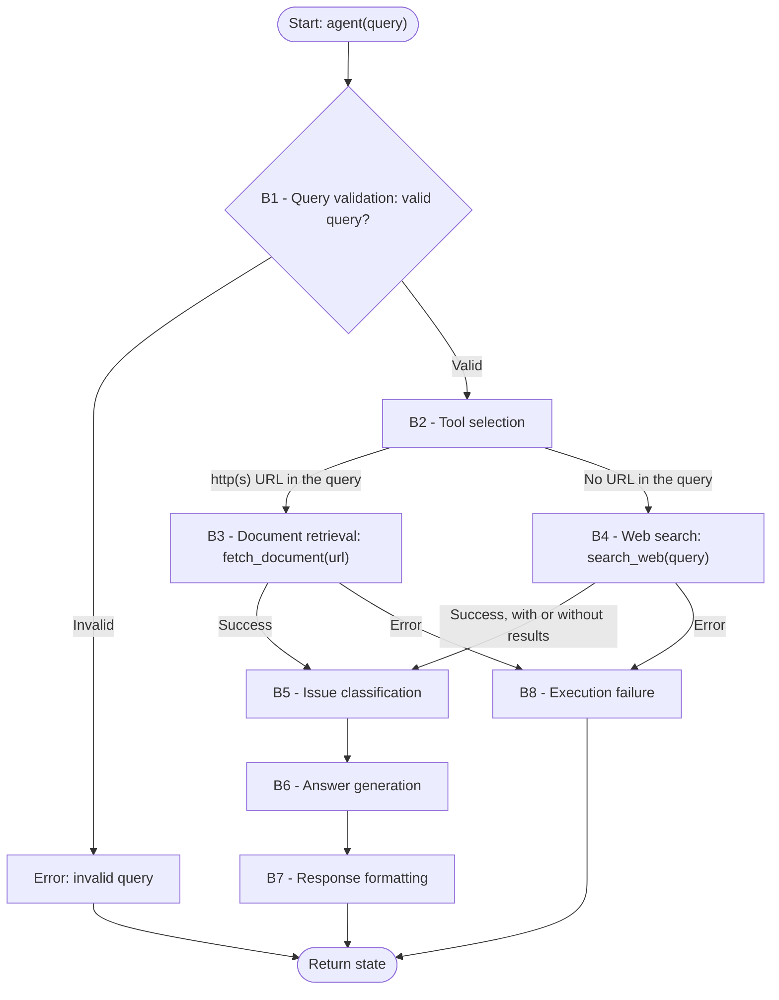

**Task:** you are an AI agent generator, and an agent specification is provided below. Generate an agent according to the specification. Consider that the agent's tools must be generated along with the agent's code.

**Context:** An AI agent is an entity that uses an LLM and tools to perform specific tasks autonomously.

**Output:** agent.py, requirements.txt, tests.py

**Interface contract with the benchmark:**

| Interface requirement | Example |
| --- | --- |
| Model | GPT-4o |
| Framework | LangGraph |
| GenAI Tool | ChatOpenAI |
| Tools | Every tool must be a LangChain tool (@tool, StructuredTool, or obtained from an MCP server via langchain-mcp-adapters) and must be executed exclusively through its interface (invoke/ainvoke, either directly or via ToolNode), never by directly calling the function that implements it. |
| Entrypoint | agent(query: str) |
| Output | state: dict with a required response: str field |

**General requirements:**

| Requirement | Meaning | Agent specification | Correctness criterion |
| --- | --- | --- | --- |
| Goal | The agent's main objective and behavior, in the active voice | The agent answers customer support queries received in natural language. Depending on the query, it reads a document indicated by a direct public URL or searches the public web, classifies the issue as Technical, Billing, or General, and returns a structured response with the tool used, the category, the exact documentation retrieved, and an answer grounded strictly in that documentation. | Is the main behavior stated, defining who does what and the result? |
| Persona (Optional) | The personality the agent assumes when performing tasks | The agent assumes the persona of a customer support specialist, focused on resolving customers questions based on documentation retrieved from public documents or from the web. | Does the specification define a persona and its area of activity? Is the persona appropriate/consistent with the Goal? |
| Inputs | Information sent to the agent | The agent receives a query containing a customer support query in natural language, which may include a direct public URL to a document. | Does the specification define the expected input? |
| Guardrails and Invariants | Statements describing what is true about the domain or the agent's state at a given moment and must remain valid throughout execution. They describe relationships, properties, or conditions of the world/domain that form the basis of the agent's behavior. | - Every result considered valid must map Category to exactly one of: "Technical", "Billing", or "General".  - Technical covers product use, integrations, and technical problems. Billing covers charges, payments, invoices, and account plans. General covers other customer support requests. Category describes the main support request in the query.  - In a valid result, Documentation is the exact raw text returned by the tool, or "None" when the tool returned an empty or whitespace-only text.  - In a valid result, Answer is grounded strictly in Documentation and does not rely on the agent's internal knowledge.  - In an error result, state['response'] contains only a message beginning with "Error:", without formatted fields. | Does the specification state a relationship, property, or domain condition that is (or must be) always true, rather than a permitted/forbidden action? Is the invariant connected to an input, output, event, or datum that the agent actually handles (not domain knowledge irrelevant to the agent's scope)? Is it possible to verify, at any moment during execution, whether the invariant still holds? |
| Quality attributes (non-functional requirements) | Observable characteristics of the agent's behavior during execution that describe neither what it does (that is Goal/Behavior Requirements) nor what it must never do (Constraints), but how well it does it — consistently, safely, efficiently, and reliably. They directly shape the trust and experience of those who depend on the agent. | Not applicable. | Is the attribute described in an observable/measurable way in the behavior (not an implementation characteristic, e.g., "use cache" is not a quality attribute, it is an implementation constraint)? Is there a verifiable acceptance criterion (threshold, rate, or test condition), and not just a vague adjective ("must be fast" without defining what is fast)? If there is a trade-off between attributes (e.g., robustness vs. performance), does the specification make the priority explicit? |

**Tools:**

| Name | Purpose | Inputs | Return | Failures |
| --- | --- | --- | --- | --- |
| `fetch_document` | Obtain, using the requests library, the content of a public document (e.g., a .txt file, export, or raw log) through a URL provided by the user in the query. | url: str, the first http(s) URL present in the query, extracted by the LLM. | The exact raw text of the document. If nothing is returned, the result is empty. | Timeout, inaccessible URL, or an unsuccessful response must return a message beginning with Error: followed by a message explaining the failure. |
| `search_web` | Obtain information from the public web, through Tavily, for customer support queries that do not contain a URL. | query: str, search query formulated by the LLM from the user's query. | Up to 5 results, each with title, URL, and content excerpt, concatenated as text. No results returns an empty text. | Missing credentials, a timeout, or an unhandled exception must return a message beginning with Error: followed by a message explaining the failure. |

**Behaviors:**

| Behavior | Trigger | Input | Tools | Output | Environment effect | Constraints |
| --- | --- | --- | --- | --- | --- | --- |
| **B1 — Query validation** | Receipt of the query. | User query. | Not applicable. | Boolean validity indicator. If invalid, a message beginning with `Error:` with a clear explanation, which the agent stores in state['response']. | Not applicable. | The query is invalid if it is None, a non-string value, empty or whitespace-only, highly offensive, or completely unrelated to customer support (including unintelligible text); otherwise it is valid. The agent rejects None, non-string values, and empty or whitespace-only strings before any LLM call. For the remaining queries, the classification is produced by the agent's LLM reasoning, not by fixed rules. A valid query leads to exactly one tool call; an invalid query leads to no tool call, to state['response'] beginning with `Error:`, and to no formatted response (B7). |
| **B2 — Tool selection** | Query classified as valid in B1. | User query. | Not applicable. | Selected tool (`fetch_document` or `search_web`) and, when `fetch_document` is selected, the URL extracted from the query. | Not applicable. | Exactly one tool is selected per execution. `fetch_document` is selected when the query contains at least one http(s) URL, and the URL passed to the tool is the first URL present in the query. Otherwise, `search_web` is selected. The selection and the URL extraction are produced by the agent's LLM reasoning over the query, not by fixed rules. No tool is called in this behavior; the selection is verified by the tool called in B3 or B4 and its arguments. |
| **B3 — Document retrieval** | `fetch_document` selected in B2. | URL extracted in B2. | `fetch_document` | Raw text of the document, possibly empty. | Not applicable. | `fetch_document` is called exactly once, with the URL extracted in B2, and `search_web` is not called. The returned text is preserved unchanged for use in B6 and B7. If the call raises an exception or returns a message beginning with `Error:`, the agent follows B8; otherwise, it follows B5. |
| **B4 — Web search** | `search_web` selected in B2. | User query. | `search_web` | Raw text of the search results, possibly empty. | Not applicable. | `search_web` is called exactly once, with a search query formulated from the user query, and `fetch_document` is not called. The agent may reformulate the user query into the search query. An empty result is not a failure. The returned text is preserved unchanged for use in B6 and B7. If the call raises an exception or returns a message beginning with `Error:`, the agent follows B8; otherwise, it follows B5. |
| **B5 — Issue classification** | B3 or B4 completed without error. | User query and the documentation retrieved in B3 or B4. | Not applicable. | Category: exactly one of `Technical`, `Billing`, or `General`. | Not applicable. | The category is exactly one of the three allowed values, follows the category definitions in the Guardrails, and is determined by analyzing the retrieved documentation together with the original query. When the query involves more than one category, the category is that of the main support request. When no documentation was retrieved, the category is determined from the original query. No tool is called. |
| **B6 — Answer generation** | B5 completed. | User query, documentation retrieved in B3 or B4, and Category from B5. | Not applicable. | Answer: a helpful, direct response to the customer's query. | Not applicable. | The answer addresses the customer's query directly and is grounded strictly in the retrieved documentation, without using the agent's internal knowledge. When no documentation was retrieved, the answer states that no documentation was found. When the retrieved documentation does not contain the information needed to answer the query, the answer states that the documentation does not address it. No tool is called. |
| **B7 — Response formatting** | B6 completed. | Tool called, Category from B5, documentation from B3 or B4, and Answer from B6. | Not applicable. | String in this format: `Tool: {tool}\n\nCategory: {category}\n\nDocumentation: {documentation}\n\nAnswer: {answer}`. Each `\n` is a line break. The agent stores this string in state['response']. | Not applicable. | All four fields are present, in this order. `Tool` contains only the tool actually called. `Category` is one of the three allowed values. `Documentation` is the exact raw text returned by the tool, never paraphrased or summarized, and is `None` when the tool returned an empty or whitespace-only text. The dictionary key is response. |
| **B8 — Execution failure** | A tool returns a message beginning with `Error:`, or an exception occurs during execution (timeout, missing credentials, or model failure). | Failure message or exception received. | Not applicable. | state: dict with response set to a message beginning with `Error:` explaining the failure. | Not applicable. | The agent does not terminate with an unhandled exception, the message begins with `Error:`, the agent stores it in state['response'], no further tool is called, and no formatted response (B7) is generated. |

| Field | Correctness criterion |
| --- | --- |
| Behavior | Is each behavior specified as an individual, identifiable requirement, separate from the Goal? Is each requirement atomic enough to be tested in isolation (can you write a test case "given X, the agent must do Y")? Does the specification explicitly cover the expected behavior in the face of: invalid input, tool/tool call failure, ambiguity, absence of necessary information? Are the requirements, taken together, sufficient to achieve the stated Goal (nothing essential left implicit)? |
| Trigger | Is the condition or event that starts the behavior explicitly defined and observable? |
| Input | Does the specification define the expected input? |
| Tools | Are the tools needed for the behavior identified, and is their purpose of use defined? |
| Expected Outcome | Does the specification define what change must occur in the environment? Is the expected change observable and verifiable after the behavior is executed? |
| Environment effect | Does the specification define which environment the agent will change? Does the specification define how the change to the environment will be made? |
| Constraints | Do this behavior's constraints state what the agent must, must not, or may only do under certain conditions? Are the party responsible and the conditions clear? Are the constraints verifiable and consistent with the other fields of this behavior and with the Goal? |

**Behavioral graph:**

**Implementation details:**

| Item | Instructions |
| --- | --- |
| Environment variables | The runtime supplies OPENAI_API_KEY for ChatOpenAI and TAVILY_API_KEY for the Tavily API. The agent follows B8 for missing or invalid credentials. |