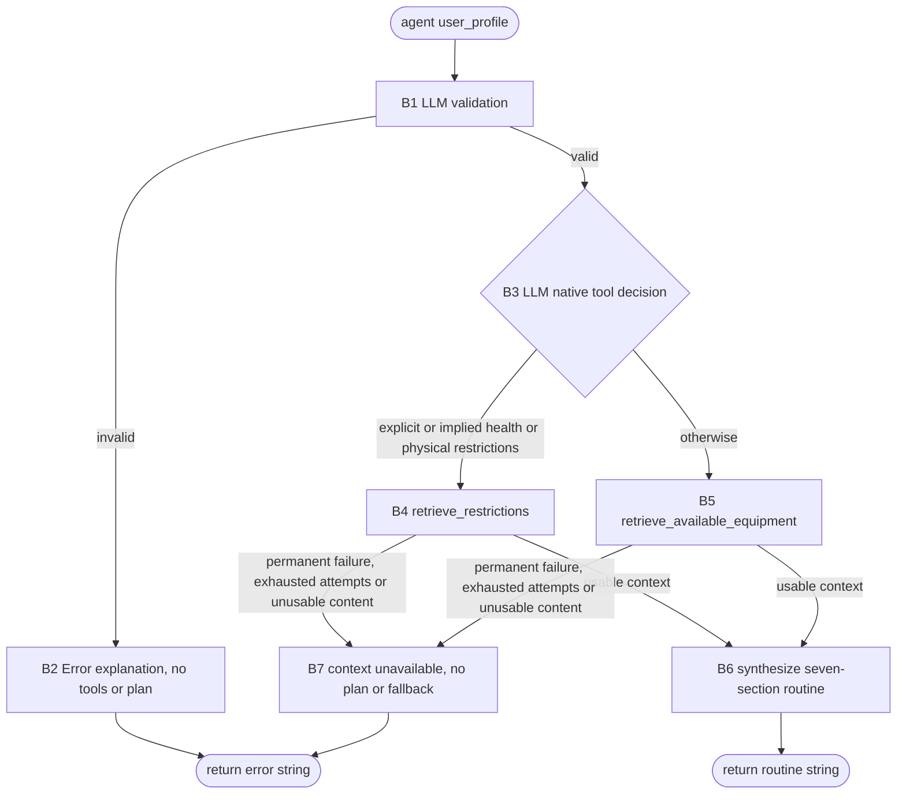

**Task:** You are an AI agent generator and below is an agent specification. Generate an agent according to the specification. Consider that the agent tools must be generated along with the agent code.  
**Context:** A personal trainer agent uses LLM reasoning to interpret free-form `user_profile` inputs and retrieves equipment context or health restrictions from external Notion pages.
**Output:** agent.py, requirements.txt, tests.py 

**Interface contract with the benchmark:**

| Interface requirement | Example |
| --- | --- |
| Model | GPT-4o (`gpt-4o`) |
| Framework | LangGraph |
| GenAI Tool | ChatOpenAI |
| Tools | Exactly two LangChain tools, retrieve_available_equipment and retrieve_restrictions, integrated with native model tool calling and implemented with notion-client. Functional executions use real Notion retrieval. Every tool must be a LangChain tool (@tool, StructuredTool or obtained from an MCP server via langchain-mcp-adapters) and must be executed exclusively through its interface (invoke/ainvoke, directly or via ToolNode), never by directly calling its implementation function. |
| Entrypoint | `agent(user_profile)` accepts a free-form `user_profile` string; `build_graph()` returns a `CompiledStateGraph`. |
| Output | A plain-text string: the seven-section routine in B6, or an explanation beginning with `Error:` for invalid input or unavailable Notion context. Errors contain no plan. |

**Implementation details:**

| Implementation detail | Specification |
| --- | --- |
| Delivery | Deliver `agent.py`, `requirements.txt` and `tests.py`. All implementation belongs in `agent.py`, without additional implementation modules, packages or subdirectories. |
| Graph and model | Use LangGraph and `ChatOpenAI` with `gpt-4o`. `build_graph()` returns a `CompiledStateGraph`. `agent(user_profile)` accepts a free-form `user_profile` string, invokes the graph and returns a string. |
| Native tool calling | Bind both LangChain tools to the model for native tool calling. The system prompt and tool definitions guide validation and exclusive tool selection. Semantic decisions must not be hardcoded in Python. |
| Notion integration | Use `notion-client` for real retrieval from the configured pages. Functional executions must not use mocked, stubbed or fabricated retrieval results. |
| Environment | Load standard environment variables with `python-dotenv`: `OPENAI_API_KEY`, `NOTION_API_KEY`, `NOTION_EQUIPMENT_PAGE_ID` and `NOTION_RESTRICTIONS_PAGE_ID`. |
| Evaluation | Automated evaluation uses controlled `user_profile` inputs to check the output sections, plain-text output with no Markdown formatting, LLM-driven tool choice, Notion grounding and the object returned by `build_graph()`. Tests may use any test type. Unit tests may isolate components with simulated responses, but do not demonstrate Notion integration. Integration tests that demonstrate Notion access require the real API and configured environment variables. Functional agent executions require real retrieval. |

**Requirements:**

| Requirement | Meaning | Agent Specification | Correctness Criterion |
| --- | --- | --- | --- |
| Goal | Objective and main behavior of the agent in active voice | The Personal Trainer Agent interprets the free-form `user_profile` with the LLM, retrieves equipment context or health restrictions from Notion and returns a personalized routine grounded in that context. | Does the main behavior state who acts, what the agent does and what result it produces? |
| Persona (Optional) | The personality the agent assumes when performing tasks | Personal trainer using clear, practical language. | Does the specification define the personality and area of activity? Are they consistent with the Goal? |
| Inputs | Information sent to the agent | **Input:** The agent receives a free-form `user_profile` string.  **Validity:** Before any tool decision, the LLM rejects empty or whitespace-only input, meaningless characters and `user_profile` inputs that do not state a goal together with either a fitness level or an age. Weight, height, deadlines, days, duration and equipment are not mandatory.  **Context:** Interpret preferences, dietary requirements and explicit or implied injuries, pain, health conditions and physical restrictions.  **Invalid input:** Return one plain-text explanation beginning with the literal `Error:`, without a plan or tool calls, even when an invalid `user_profile` mentions pain, injury or restrictions. | Are the expected inputs, mandatory and optional information, and validity conditions explicit? |
| Guardrails and Invariants | External rules or conditions that the agent must always respect during execution. They may come from laws, regulations, company policies or domain rules. When a condition is an invariant, it must hold before and after the execution of any agent behavior. | Validate exclusively through the LLM before tool decisions. Do not use procedural Python validation, regex or keyword rules for semantic validation or routing. Invalid input terminates without tools or a plan. Each valid execution selects one distinct tool, never both and never in parallel. Only the selected query may be repeated under B7; retries do not change the LLM's routing decision. After validation succeeds, explicit or implied injury, pain, health conditions or physical restrictions require only `retrieve_restrictions`; otherwise use only `retrieve_available_equipment`. Respect dietary requirements and retrieved health restrictions. Prioritize exercises compatible with retrieved equipment; use bodyweight exercises when equipment is unknown on the restrictions route. Do not fabricate Notion data. Successful output is plain text with exactly the seven section titles in B6, in order. Do not use code fences, bold text, Markdown headings or list markup. Retrieval failures follow B7 and do not produce a plan.  Validation takes priority over tool selection. For valid `user_profile` inputs, health and physical restrictions take priority over equipment retrieval. Routine content is grounded in the free-form `user_profile` and the selected Notion page. Tool Used identifies the tool actually used. Invalid input or unavailable Notion context returns only a plain-text Error: explanation, without a plan. Only successful output follows the seven-section format. Retries stay with the selected query and never switch tools. | Do the guardrails have a clear scope? Are the invariants linked to the inputs, data or outputs the agent handles, and can they be verified before and after behaviors? |
| Quality attributes (non-functional requirements) | Observable characteristics of agent behavior during execution that describe neither what it does (Goal/Behavior Requirements) nor what it must never do (Constraints), but how well it does it — consistently, safely, efficiently and reliably. They directly shape the trust and experience of those who depend on the agent. | Schema consistency: successful outputs are plain text with exactly the seven section titles in order and no Markdown formatting. Grounding: claims attributed to Notion match retrieved content. Observable tool choice: controlled valid `user_profile` inputs select only the required tool; invalid `user_profile` inputs produce zero tool calls. Retrieval reliability: temporary failures allow at most three total attempts of the selected query; permanent failures are not repeated and final retrieval failure returns an Error: string without a plan. | Are the qualities observable or measurable, with acceptance criteria rather than implementation details? When qualities conflict, is their priority defined? |

**Tools:**

| Name | Purpose | Inputs | Return | Failures |
| --- | --- | --- | --- | --- |
| retrieve_available_equipment | Retrieve equipment context from its Notion page for routine synthesis. | Selected query, NOTION_API_KEY and NOTION_EQUIPMENT_PAGE_ID. | Real retrieved equipment content; no additional Notion return schema is prescribed. | Temporary failures follow B7 with at most three total attempts of the same query; permanent failures are not repeated. Missing, empty, unreadable or otherwise unusable content terminates under B7. |
| retrieve_restrictions | Retrieve health and physical restriction context from its Notion page for routine synthesis. | Selected query, NOTION_API_KEY and NOTION_RESTRICTIONS_PAGE_ID. | Real retrieved restriction content; no additional Notion return schema is prescribed. | Temporary failures follow B7 with at most three total attempts of the same query; permanent failures are not repeated. Missing, empty, unreadable or otherwise unusable content terminates under B7. |

**Behaviors:**

| Behavior | Trigger | Input | Tools | Output | Environment Effect | Constraints |
| --- | --- | --- | --- | --- | --- | --- |
| B1 — Validate the free-form `user_profile` with the LLM. | Call to `agent(user_profile)`, before tool decisions. | Free-form `user_profile`. | ChatOpenAI. | The agent accepts meaningful input stating a goal and either a fitness level or an age; otherwise it proceeds to B2. | No Notion access. | Empty, whitespace-only or meaningless input and `user_profile` inputs missing the minimum information reach B2. Semantic validation uses the LLM, not procedural rules. |
| B2 — Reject invalid input. | B1 rejects the free-form `user_profile`. | Free-form `user_profile` and LLM validation result. | ChatOpenAI; no LangChain tool. | The agent returns one plain-text explanation beginning with the literal `Error:`, without a plan. | Return the error string. | Invalid input returns a plain-text Error: string and causes zero tool calls, including when it mentions pain, injury or restrictions. |
| B3 — Select the context source through native tool calling. | B1 accepts the free-form `user_profile`. | Validated free-form `user_profile`, system prompt and tool definitions. | ChatOpenAI with both LangChain tool definitions bound. | The agent selects B4 for explicit or implied injury, pain, health conditions or physical restrictions; otherwise it selects B5. | Select one context source without parallel or combined retrieval. | The LLM determines intent and selects only the required distinct tool; any retries follow B7 without a new routing decision. No procedural semantic routing is used. |
| B4 — Retrieve health restrictions from Notion. | B3 selects restrictions. | Configured restrictions page and credentials. | `retrieve_restrictions`, using `notion-client`. | Retrieved restriction content for synthesis; usable content proceeds to B6 and retrieval failure follows B7. | Read the page configured by `NOTION_RESTRICTIONS_PAGE_ID`. | Functional execution retrieves real content using NOTION_API_KEY; retrieve_available_equipment is not called. |
| B5 — Retrieve available equipment from Notion. | B3 selects equipment. | Configured equipment page and credentials. | `retrieve_available_equipment`, using `notion-client`. | Retrieved equipment content for synthesis; usable content proceeds to B6 and retrieval failure follows B7. | Read the page configured by `NOTION_EQUIPMENT_PAGE_ID`. | Functional execution retrieves real content using NOTION_API_KEY; retrieve_restrictions is not called. |
| B6 — Generate and return the personalized routine. | Usable context is retrieved in B4 or B5. | Free-form `user_profile`, retrieved context. | ChatOpenAI. | The agent returns plain text with exactly these section titles and order, with no Markdown formatting:  Assessment: [Brief evaluation of the user's fitness profile]  Weekly Plan: Day 1 ([MUSCLE GROUP]): [Exercise 1 (sets x reps)], [Exercise 2 (sets x reps)]. Rest: [X] min. Day 2 ([MUSCLE GROUP]): [Exercise 1 (sets x reps)], [Exercise 2 (sets x reps)]. Rest: [X] min. [continue for all training days; mark rest days as "Rest/Active Recovery"]  Intensity & Progression: [RPE target], [weekly progression strategy]  Nutrition Guidance: [caloric direction], [macro priorities], [meal timing]  Recovery Protocol: [sleep target], [stretching routine], [recovery strategies]  Important Notes: [safety considerations], [constraint modifications sourced from Notion, or "None"]  Tool Used: Either "retrieve_available_equipment" or "retrieve_restrictions" (indicate which tool you used to get the context) | Return the routine string. | Include muscle groups, exercises, sets x reps and rest minutes for training days; mark rest days as Rest/Active Recovery. Include RPE and weekly progression, caloric direction, macro priorities, meal timing, sleep, stretching and recovery strategies. Respect dietary requirements and retrieved health restrictions; prioritize retrieved equipment compatibility or bodyweight when equipment is unknown on B4. Important Notes contains safety considerations and Notion-sourced modifications or None. Tool Used names the selected tool. Do not invent Notion data. |
| B7 — Handle Notion retrieval failure. | The selected query in B4 or B5 fails, returns missing, empty or unreadable content, or otherwise provides no information that can ground the routine. | Selected query and its failure or retrieved content, which is missing, empty, unreadable or unable to ground the routine. | Repeat only the selected query for a temporary failure; the agent handles the final error without another LLM call. | For a temporary failure, such as a timeout or temporary unavailability, the agent allows up to three attempts in total. A permanent failure, such as invalid credentials or denied access, is not repeated. After a permanent failure, exhausted attempts or unusable content, the agent returns a plain-text string beginning with `Error:` explaining that the context is unavailable. | Return the error string without a plan, invented context or a call to the other tool. | A successful retry continues to B6. Final retrieval failure returns an Error: explanation without a plan. Attempts stay within the same selected query, with no parallel calls or fallback tool. Temporary failures are retried within B4 or B5, up to three total attempts of the same selected query. A successful retry follows the normal path to B6. Permanent failure, exhausted attempts or unusable content leads to B7 without a new tool decision. |

**Behavior graph:**

| Field | Correctness criterion |
| --- | --- |
| Behavior | Is each behavior specified as an individual and identifiable requirement, separate from the Goal? Is each requirement atomic enough to be tested in isolation (can a test case be written as "given X, the agent must do Y")? Does the specification explicitly cover the expected behavior for invalid input, tool/tool-call failure, ambiguity and missing required information? Are the requirements together sufficient to achieve the stated Goal (nothing essential left implicit)? |
| Trigger | Is the condition or event that starts the behavior explicitly defined and observable? |
| Input | Does the specification define the expected input? |
| Tools | Are the tools required for the behavior identified and is their purpose defined? |
| Expected Outcome | Does the specification define what change must occur in the environment? Is the expected change observable and verifiable after the behavior executes? |
| Environment Effect | Does the specification define which environment the agent will change? Does the specification define how the environment will be changed? |
| Constraints | Are the behavior constraints explicit, verifiable and consistent with the general constraints? |
