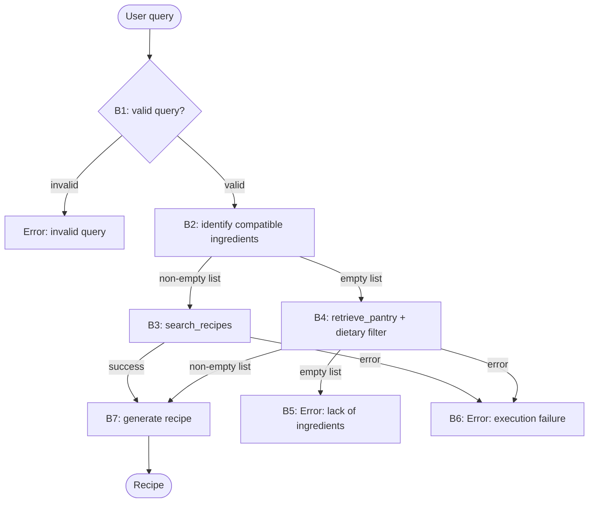

**Task:** you are an AI agent generator, and below is the specification of an agent. Generate an agent according to the specification. Consider that the agent's tools must be generated together with the agent code.

**Context:** An AI agent is an entity that uses an LLM and tools to perform specific tasks autonomously.

**Output:** agent.py, requirements.txt, tests.py

**Interface contract with the benchmark:**

| Interface requirement | Example |
| --- | --- |
| Model | GPT-4o |
| Framework | LangGraph |
| GenAI Tool | ChatOpenAI |
| Tools | Every tool must be a LangChain tool (@tool, StructuredTool, or obtained from an MCP server via langchain-mcp-adapters) and must be executed exclusively through its interface (invoke/ainvoke, either directly or via ToolNode), never by directly calling the function that implements it. |
| Entrypoint | agent(query: str) |
| Output | response: str |

**Implementation details:**

| Implementation detail | Specification |
| --- | --- |
| Environment variables | The agent must access the environment variables when necessary. Available keys: NOTION\_PAGE\_ID, TAVILY\_API\_KEY, NOTION\_API\_KEY, OPENAI\_API\_KEY  |

**Requirements:**

| Requirement | Meaning | Agent specification | Correctness criterion |
| --- | --- | --- | --- |
| Goal | The agent's main objective and behavior, in the active voice | The agent acts as a generator of personalized recipes, adapted to use the ingredients provided in the user's query or in their pantry and to respect the user's dietary preferences and restrictions. It returns the complete recipe with ingredients, equipment, instructions, and storage recommendations. | Is the main behavior stated, defining who does what and the result? |
| Persona (Optional) | The personality the agent assumes when performing tasks | The agent assumes the persona of a **chef**, whose role is to create personalized recipes. | Does the specification define a persona and its area of activity? Is the persona appropriate/consistent with the Goal? |
| Inputs | Information sent to the agent | The agent receives a _query (in natural language)_ from the user, containing preferences and, optionally, specific ingredients and dietary restrictions. | Does the specification define the expected input? |
| Guardrails and Invariants | External rules or conditions that must always be respected by the agent during its execution. They may come from laws, regulations, company policies, or domain rules. When a condition is an invariant, it must be satisfied before and after the execution of any agent behavior. | • A dietary restriction implies all of its derived ingredients, even those not mentioned by the user. • An ingredient mentioned under negation, absence, or hypothesis is not an available ingredient. | Does the specification state a relationship, property, or domain condition that is (or must be) always true, rather than a permitted/forbidden action? Is the invariant connected to an input, output, event, or datum that the agent actually handles (not domain knowledge irrelevant to the agent's scope)? Is it possible to verify, at any moment during execution, whether the invariant still holds? |
| Quality attributes (non-functional requirements) | Observable characteristics of the agent's behavior during execution that describe neither what it does (that is Goal/Behavior Requirements) nor what it must never do (Constraints), but how well it does it — consistently, safely, efficiently, and reliably. They directly shape the trust and experience of those who depend on the agent. | Not applicable. | Is the attribute described in an observable/measurable way in the behavior (not an implementation characteristic, e.g., "use cache" is not a quality attribute, it is an implementation constraint)? Is there a verifiable acceptance criterion (threshold, rate, or test condition), and not just a vague adjective ("must be fast" without defining what is fast)? If there is a trade-off between attributes (e.g., robustness vs. performance), does the specification make the priority explicit? |

**Tools:**

| Name | Purpose | Inputs | Return | Failures |
| --- | --- | --- | --- | --- |
| retrieve\_pantry | Obtain the ingredients available in the user's pantry, through a Notion page. | None. | The complete list of pantry ingredients. An empty pantry returns an empty list. | Missing credentials, an inaccessible page, or a timeout must return a message beginning with `Error:` followed by a message explaining the failure. |
| search\_recipes | Obtain recipes from the web, through **tavily**, as a preparation **reference** for the ingredients identified in the query. The recipes found are neither a source of base ingredients nor the final recipe. | Ingredients identified in the query. | Up to 5 results, each with title, URL, and content excerpt. No results returns an empty list. | Missing credentials, an inaccessible page, or a timeout must return a message beginning with `Error:` followed by a message explaining the failure. |

**Behaviors:**

| Behavior | Trigger | Input | Tools | Output | Environment effect | Constraints |
| --- | --- | --- | --- | --- | --- | --- |
| **B1 — Query validation** The agent classifies the query as invalid (empty, offensive, or unrelated to food/cooking) or valid (any query that meets none of the invalidity criteria), and stops the execution if it is invalid. | Receipt of the query. | User query. | None. | Boolean validity indicator. If invalid, a message beginning with `Error:` with the explanation. | None. | The indicator matches the expected classification. If invalid, the message begins with `Error:`, no tool is called, and no recipe is generated. |
| **B2 — Ingredient identification** The agent identifies the ingredients mentioned in the query and retains only those compatible with the declared dietary restrictions. | Query classified as valid in B1. | User query. | None. | List of identified ingredients that are compatible with the dietary restrictions; if no ingredient is identified or compatible, an empty list. | None. | The list equals the expected set, taking into account regional variants, inflected forms, excluding ingredients mentioned under negation, absence, or hypothesis, and excluding ingredients incompatible with the declared dietary restrictions. |
| **B3 — Reference recipe search** The agent searches for recipes that serve as a preparation reference for the ingredients identified in the query. | List of ingredients from B2 is not empty. | List of ingredients from B2. | `search_recipes` | Up to five results, each with title, URL, and content excerpt, possibly none. | None. | `search_recipes` is called exactly once, with the list of ingredients from B2, and `retrieve_pantry` is not called. |
| **B4 — Pantry lookup** The agent retrieves the ingredients available in the user's pantry and retains only those compatible with the dietary restrictions declared in the query. | List of ingredients from B2 is empty (query without ingredients or without compatible ingredients). | User query. | `retrieve_pantry` | List of pantry ingredients compatible with the dietary restrictions, possibly empty. | None. | `retrieve_pantry` is called exactly once, and `search_recipes` is not called. |
| **B5 — Lack of ingredients** The agent stops the execution when the pantry provides no ingredient compatible with the dietary restrictions. | List from B4 is empty (empty pantry or no compatible ingredients). | List from B4. | None. | Message beginning with `Error:` explaining the absence of compatible ingredients. | None. | The message begins with `Error:` and no recipe is generated. |
| **B6 — Execution failure** The agent handles tool or model failures without aborting the execution. | A tool returns a message beginning with `erro:`, or an exception occurs during execution (timeout, missing credentials, or model failure). | Failure message or exception received. | None. | Message beginning with `Error:` explaining the failure. | None. | The agent does not terminate with an unhandled exception, the message begins with `Error:`, and no recipe is generated. |
| **B7 — Recipe generation** The agent uses its culinary knowledge to turn the compatible ingredients into a complete recipe, taking the user's preferences into account and using the reference recipes, when available. | B3 executed successfully, or B4 returned at least one ingredient compatible with the dietary restrictions. | User query, compatible ingredients (from B2 or B4), and results from B3, when available. | None. | Recipe with the fields: • **Title:** recipe title; • **Ingredients:** list of ingredients with their quantities; • **Equipment:** list of required equipment; • **Instructions:** step-by-step preparation instructions; • **Storage:** storage recommendations. | None. | All fields are present and non-empty; no ingredient in the recipe violates the dietary restrictions declared in the query; the recipe contains at least one ingredient identified in B2 or, when B2 returned an empty list, at least one ingredient returned by B4. |

**Behavioral graph:**

| Field | Correctness criterion |
| --- | --- |
| Behavior | Is each behavior specified as an individual, identifiable requirement, separate from the Goal? Is each requirement atomic enough to be tested in isolation (can you write a test case "given X, the agent must do Y")? Does the specification explicitly cover the expected behavior in the face of: invalid input, tool/tool call failure, ambiguity, absence of necessary information? Are the requirements, taken together, sufficient to achieve the stated Goal (nothing essential left implicit)? |
| Trigger | Is the condition or event that starts the behavior explicitly defined and observable? |
| Input | Does the specification define the expected input? |
| Tools | Are the tools needed for the behavior identified, and is their purpose of use defined? |
| Expected Outcome | Does the specification define what change must occur in the environment? Is the expected change observable and verifiable after the behavior is executed? |
| Environment effect | Does the specification define which environment the agent will change? Does the specification define how the change to the environment will be made? |
| Constraints | Are the behavior's constraints explicit, verifiable, and consistent with the general constraints? |
