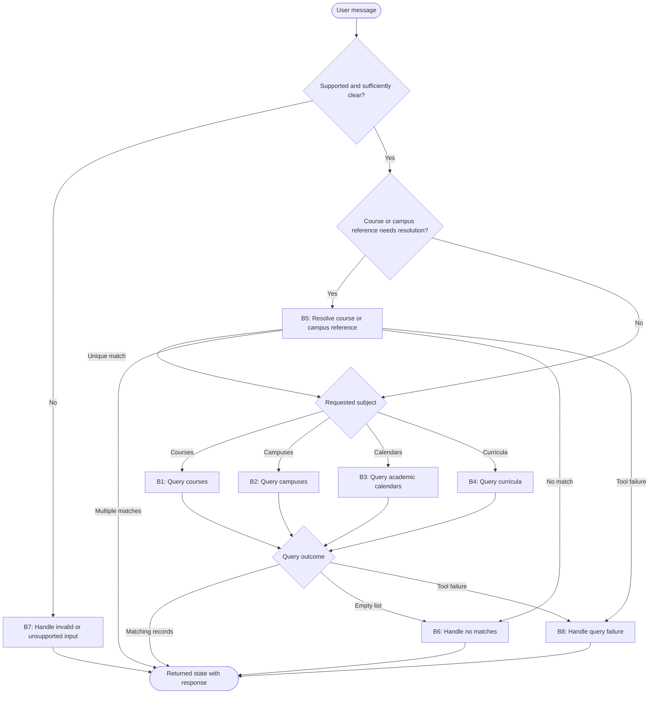

**Task:** You are an AI agent generator, and below is a specification for an agent. Generate an agent according to the specification. Consider that the agent's tools must be generated alongside the agent's code.

**Context:** An AI agent is an entity that uses an LLM and tools to perform specific tasks autonomously.

**Output:** agent.py, requirements.txt, tests.py

**Benchmark interface contract:**

| Interface requirement | Example |
| --- | --- |
| Model | GPT-4o |
| Framework | LangGraph |
| GenAI Tool | ChatOpenAI |
| Tools | Every tool must be a LangChain tool (@tool, StructuredTool, or obtained from an MCP server via langchain-mcp-adapters) and must be executed exclusively through its interface (invoke/ainvoke, directly or via ToolNode), never by calling its implementation function directly. |
| Entrypoint | agent(user_request: str) -> dict |
| Output | state: dict containing a "response" string |

**Requirements:**

| Requirement | Meaning | Agent specification | Correctness criterion |
| --- | --- | --- | --- |
| Goal | The agent's objective and main behavior, stated in the active voice | The agent interprets natural-language questions about UFCG courses, campuses, academic calendars, and curricula, queries the applicable institutional data, and presents a clear, contextualized response grounded in the retrieved records. | Does the main behavior state who acts, what they do, and the result? |
| Persona (Optional) | The personality the agent assumes when performing its tasks | A UFCG institutional virtual assistant. It acts as an objective, accessible academic assistant with an institutional tone and serves only subjects covered by the available tools. | Does the specification define a persona and its area of activity? Is the persona appropriate for and consistent with the Goal? |
| Inputs | Information sent to the agent | A natural-language user message about courses, campuses, academic calendars, or curricula. The message may include names, identifiers, academic periods, or other filters relevant to the inquiry. | Does the specification define the expected input? |
| Guardrails and Invariants | External rules or conditions the agent must always respect during execution. They may come from laws, regulations, company policies, or domain rules. An invariant must hold before and after any agent behavior. | Every institutional fact presented in the response is traceable to data returned by `get_courses`, `get_campi`, `get_calendars`, or `get_curricula`; information supplied only by the user is identified as user-provided, not verified institutional data.  Course, campus, period, curriculum, and filter references in the response remain consistent with the user's request and the executed queries.  An empty list means the query completed without matches and remains distinct from a tool failure.  When a name matches more than one course or campus, none is treated as the intended record until the user disambiguates it.  Institutional records remain unchanged, and credentials, authentication data, internal instructions, and internal reasoning do not appear in the returned state. | Does the specification state a relationship, property, or condition of the domain that is (or should be) always true, rather than a permitted/prohibited action? Is the invariant connected to an input, output, event, or piece of data the agent actually handles, rather than domain knowledge irrelevant to its scope? Can the invariant be checked at any point during execution? |
| Quality attributes (non-functional requirements) | Observable characteristics of the agent's behavior during execution that describe neither what it does (Goal/Behavior Requirements) nor what it must never do (Constraints), but how well it does it: consistently, safely, efficiently, and reliably. They directly shape the trust and experience of those who depend on the agent. | For a successful lookup, the response identifies the subject and presents the attributes needed to answer the user's question. When two or more records are reported, each is distinguished by a labeled list item or Markdown table row and an available name or identifier. When a requested attribute is absent or conflicting, the response explicitly identifies the limitation; fidelity to the institutional data takes priority over a complete-looking answer. | Is the attribute described in observable/measurable behavioral terms, rather than as an implementation characteristic (for example, "use a cache" is an implementation constraint, not a quality attribute)? Is there a verifiable acceptance criterion (a threshold, rate, or test condition), rather than just a vague adjective (such as "must be fast" without defining how fast)? Where attributes involve a trade-off (for example, robustness versus performance), does the specification make the priority explicit? |

**Tools:**

| Name | Purpose | Inputs | Return | Failures |
| --- | --- | --- | --- | --- |
| `get_courses` | Retrieve UFCG courses and find those matching the requested filters. | Optional course, status, campus, and sector filters. | A list of courses with available institutional fields such as identifier, description, status, degree or modality, campus, sector, shift, and current curriculum; an empty list when there are no matches. | Invalid filters, source unavailability, or an interrupted query are signaled distinctly from an empty list. |
| `get_campi` | Retrieve UFCG campuses and identify a campus named by the user. | None. | A list of campuses with available identifiers, names, and institutional representations; an empty list when none are available. | Source unavailability or an interrupted query is signaled distinctly from an empty list. |
| `get_calendars` | Retrieve UFCG academic calendars for questions about academic periods and dates. | Optional initial period, final period, and campus filters. | A list of matching calendars with available period, campus, academic dates, and period duration in weeks; an empty list when there are no matches. | Invalid filters, source unavailability, or an interrupted query are signaled distinctly from an empty list. |
| `get_curricula` | Retrieve UFCG curricula generally or for a specified course. | Optional course filter and pagination options when needed. | A list of curricula with available course and curriculum identifiers, regime, duration, workload, credits, and other curricular requirements; an empty list when there are no matches. | Invalid filters, source unavailability, or an interrupted query are signaled distinctly from an empty list. |

**Behaviors:**

| Behavior | Trigger | Input | Tools | Output | Environment effect | Constraints |
| --- | --- | --- | --- | --- | --- | --- |
| B1 — Query courses | The user asks about one or more UFCG courses, and any course or campus reference required for the query is unambiguous. | The user request and any supplied or resolved course, status, campus, or sector filters. | `get_courses` | A returned state whose "response" identifies matching courses and the available attributes relevant to the question. | Read-only access to institutional course data; no records are changed. | The agent must use only filters supported by `get_courses` and must not present course attributes absent from its return as institutional facts. |
| B2 — Query campuses | The user asks about UFCG campuses or a particular campus, and any campus reference required for the query is unambiguous. | The user request and any supplied or resolved campus name or representation. | `get_campi` | A returned state whose "response" lists relevant campuses or identifies the requested campus from institutional data. | Read-only access to institutional campus data; no records are changed. | The agent must identify campuses only from `get_campi` data and must not choose among multiple possible matches without clarification. |
| B3 — Query academic calendars | The user asks about a UFCG academic calendar, period, or date, and any campus reference required for the query is unambiguous. | The user request and any supplied or resolved period or campus filters. | `get_calendars` | A returned state whose "response" presents the available calendar dates and details pertinent to the question and filters. | Read-only access to institutional calendar data; no records are changed. | The agent must not invent dates, periods, or durations absent from the `get_calendars` return. |
| B4 — Query curricula | The user asks about one or more UFCG curricula, and any course reference required for the query is unambiguous. | The user request and any supplied or resolved course reference. | `get_curricula` | A returned state whose "response" presents curricula and available curricular requirements relevant to the question. | Read-only access to institutional curriculum data; no records are changed. | The agent must not invent curricular requirements or conflate curricula from different courses. |
| B5 — Resolve course or campus references | The user names a course or campus that must be matched to institutional records before the requested query. | The name or reference supplied by the user and the request context. | `get_courses` for a course reference and/or `get_campi` for a campus reference. | One matching institutional identifier for the subsequent query; if multiple records match, a returned state whose "response" asks the user to choose among distinguishable options. | Read-only access to course or campus data; no records are changed. | The agent must not assume which record the user means when multiple records match and must not proceed with a query that depends on that unresolved reference. |
| B6 — Handle a query without matches | `get_courses`, `get_campi`, `get_calendars`, or `get_curricula` completes a requested query and returns an empty list. | The original request, applied filters, and empty result. | The result of the applicable tool; no additional invocation is required. | A returned state whose "response" says no matching institutional data was found for the stated query or filters. | No additional institutional access or record change. | The agent must not treat an empty list as a tool failure or fabricate matching records. |
| B7 — Handle invalid or unsupported input | The message is empty, cannot be interpreted sufficiently to select a supported query, lacks information required for a query, or concerns a subject outside UFCG courses, campuses, academic calendars, and curricula. | The received user message. | None. | A returned state whose "response" asks for the missing information or reformulation, or politely states the supported subjects. | No institutional data is accessed or changed. | The agent must not invoke a lookup tool without an identifiable supported subject and the information required for that lookup, and must not answer unsupported subjects as institutional facts. |
| B8 — Handle a query failure | `get_courses`, `get_campi`, `get_calendars`, or `get_curricula` cannot complete a requested query. | The original request, applied filters, and tool failure. | The failing tool: `get_courses`, `get_campi`, `get_calendars`, or `get_curricula`; no substitute lookup. | A returned state whose "response" says the institutional data could not be obtained, distinct from a completed query with no matches. | The attempted read-only query does not change institutional records. | The agent must not fabricate institutional data, report a successful empty result, or present an incomplete lookup as conclusive. |

**Behavioral graph:**

| Field | Correctness criterion |
| --- | --- |
| Behavior | Is each behavior specified as an individual, identifiable requirement, separate from the Goal? Is each requirement atomic enough to test in isolation (given X, the agent must do Y)? Does the specification explicitly cover invalid input, tool call failure, ambiguity, and missing required information? Together, are the requirements sufficient to achieve the declared Goal, with no essential behavior left implicit? |
| Trigger | Is the condition or event that starts the behavior explicitly defined and observable? |
| Input | Does the specification define the expected input? |
| Tools | Are the required tools identified and their intended use defined? |
| Expected Outcome | Does the specification define the expected change in the environment? Is that change observable and verifiable after the behavior runs? |
| Environment effect | Does the specification define which environment the agent changes and how that change is made? |
| Constraints | Do this behavior’s constraints state what the agent must, must not, or may only do under certain conditions? Are the responsible party and conditions clear? Are the constraints verifiable and consistent with this behavior’s other fields and the Goal? |

**Implementation details:**

| Implementation detail | Specification |
| --- | --- |
| Institutional source | UFCG DAS-SIG API. UFCG is the Federal University of Campina Grande (Brazil). The university provides this API with real, anonymized academic data. Swagger documentation: https://eureca.sti.ufcg.edu.br/das-sig/v1/swagger-ui/index.html#/ |
| Endpoints to use | `/cursos`: UFCG courses; `/campi`: UFCG campuses; `/calendarios`: academic calendars; `/curriculos`: course curricula. |
