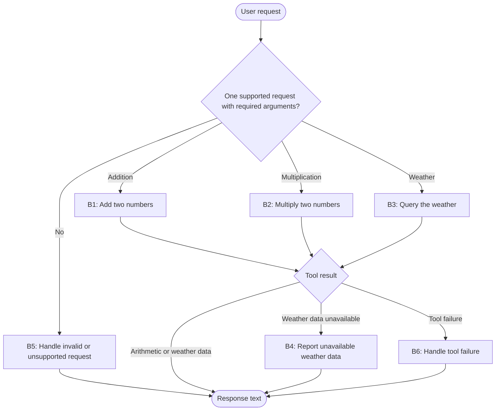

**Task:** You are an AI agent generator, and below is a specification for an agent. Generate an agent according to the specification. Consider that the agent's tools must be generated alongside the agent's code.

**Context:** An AI agent is an entity that uses an LLM and tools to perform specific tasks autonomously.

**Output:** agent.py, requirements.txt, tests.py

**Benchmark interface contract:**

| Interface requirement | Example |
| --- | --- |
| Model | GPT-4o |
| Framework | LangGraph |
| GenAI Tool | ChatOpenAI |
| Tools | Every tool must be a LangChain tool (@tool, StructuredTool, or obtained from an MCP server via langchain-mcp-adapters) and must be executed exclusively through its interface (invoke/ainvoke, directly or via ToolNode), never by calling its implementation function directly. |
| Entrypoint | agent(user_request: str) -> str |
| Output | Text with the weather or math response |

**Requirements:**

| Requirement | Meaning | Agent specification | Correctness criterion |
| --- | --- | --- | --- |
| Goal | The agent's objective and main behavior, stated in the active voice | The agent interprets natural-language requests for addition, multiplication, or weather, uses the appropriate tool, and responds with the calculation or weather information requested. | Does the main behavior state who acts, what they do, and the result? |
| Persona (Optional) | The personality the agent assumes when performing its tasks | An assistant specializing in basic arithmetic and simple weather inquiries. | Does the specification define a persona and its area of activity? Is the persona appropriate for and consistent with the Goal? |
| Inputs | Information sent to the agent | A natural-language request for addition or multiplication of two identifiable numbers, or a weather inquiry containing one identifiable location. | Does the specification define the expected input? |
| Guardrails and Invariants | External rules or conditions the agent must always respect during execution. They may come from laws, regulations, company policies, or domain rules. An invariant must hold before and after any agent behavior. | The arithmetic information in the response corresponds to the return from the selected arithmetic tool for the two numbers identified in the request.  The weather information in the response corresponds to the return from `get_weather` for the identified location, and any location named in the response is the one used in the query.  A location absent from `get_weather` data, including a location represented only by digits, remains valid for a weather query and produces an unavailable-data response. | Does the specification state a relationship, property, or condition of the domain that is (or should be) always true, rather than a permitted/prohibited action? Is the invariant connected to an input, output, event, or piece of data the agent actually handles, rather than domain knowledge irrelevant to its scope? Can the invariant be checked at any point during execution? |
| Quality attributes (non-functional requirements) | Observable characteristics of the agent's behavior during execution that describe neither what it does (Goal/Behavior Requirements) nor what it must never do (Constraints), but how well it does it: consistently, safely, efficiently, and reliably. They directly shape the trust and experience of those who depend on the agent. | Not applicable. | Is the attribute described in observable/measurable behavioral terms, rather than as an implementation characteristic (for example, "use a cache" is an implementation constraint, not a quality attribute)? Is there a verifiable acceptance criterion (a threshold, rate, or test condition), rather than just a vague adjective (such as "must be fast" without defining how fast)? Where attributes involve a trade-off (for example, robustness versus performance), does the specification make the priority explicit? |

**Tools:**

| Name | Purpose | Inputs | Return | Failures |
| --- | --- | --- | --- | --- |
| `add` | Add the two numbers identified in an addition request. | Two numbers, a and b. | The numeric sum a + b. | An inability to complete the operation is signaled as a tool failure, not as a valid numeric result. |
| `multiply` | Multiply the two numbers identified in a multiplication request. | Two numbers, a and b. | The numeric product a × b. | An inability to complete the operation is signaled as a tool failure, not as a valid numeric result. |
| `get_weather` | Obtain deterministic weather information for the requested location. | A location identified in the user's request. | Text with the weather information and the queried location. When there is no data for the location, returns an indication of unavailability. | An inability to complete the query is signaled in a way distinguishable from a valid return with no weather data available. |

**Behaviors:**

| Behavior | Trigger | Input | Tools | Output | Environment effect | Constraints |
| --- | --- | --- | --- | --- | --- | --- |
| B1 — Add two numbers | The input is a valid addition request containing exactly two identifiable numbers. | The user's request and the two identified numbers. | `add` | Text containing the sum of the requested numbers. | None; the calculation does not change the environment. | The agent must call `add` with the two numbers from the request and must not calculate or invent the result independently. |
| B2 — Multiply two numbers | The input is a valid multiplication request containing exactly two identifiable numbers. | The user's request and the two identified numbers. | `multiply` | Text containing the product of the requested numbers. | None; the calculation does not change the environment. | The agent must call `multiply` with the two numbers from the request and must not calculate or invent the result independently. |
| B3 — Query the weather and respond | The input is a valid weather request containing one identifiable location. | The user's request and the identified location. | `get_weather` | On a weather-data result, text about the weather at the requested location, based on the tool's return. | None; the query does not change the environment. | The agent must call `get_weather` with the location from the request and must not supply weather information from its own knowledge, external sources, or fabricated data. |
| B4 — Report unavailable weather data | `get_weather` returns no weather data for a valid location, including one represented only by digits. | The identified location and the return from `get_weather`. | `get_weather` | Text stating that weather data is unavailable for the requested location. | None; the query does not change the environment. | The agent must not fill unavailable weather information with invented data or data from another source. |
| B5 — Handle an invalid or unsupported request | The input is empty, vague, or ambiguous; lacks the two numbers or one location required by its request type; combines request types; or asks for an unsupported operation. | The request received from the user. | None. | Text explaining why the request cannot be completed and asking for the required numbers or location when applicable. | None; no tool is invoked and the environment is unchanged. | The agent must not invoke `add`, `multiply`, or `get_weather` when the request type or required arguments cannot be identified unambiguously, and must not answer unsupported operations. |
| B6 — Handle a tool failure | The selected tool cannot complete a valid addition, multiplication, or weather request. | The selected request type, identified arguments, and tool failure. | The selected tool: `add`, `multiply`, or `get_weather`. | Text explaining that the requested calculation or weather query could not be completed. | None; the attempted operation does not change the environment. | The agent must not present a fabricated result, invoke another tool as a substitute, or treat a weather-query failure as a valid no-data return. |

**Behavioral graph:**

| Field | Correctness criterion |
| --- | --- |
| Behavior | Is each behavior specified as an individual, identifiable requirement, separate from the Goal? Is each requirement atomic enough to test in isolation (given X, the agent must do Y)? Does the specification explicitly cover invalid input, tool call failure, ambiguity, and missing required information? Together, are the requirements sufficient to achieve the declared Goal, with no essential behavior left implicit? |
| Trigger | Is the condition or event that starts the behavior explicitly defined and observable? |
| Input | Does the specification define the expected input? |
| Tools | Are the required tools identified and their intended use defined? |
| Expected Outcome | Does the specification define the expected change in the environment? Is that change observable and verifiable after the behavior runs? |
| Environment effect | Does the specification define which environment the agent changes and how that change is made? |
| Constraints | Do this behavior’s constraints state what the agent must, must not, or may only do under certain conditions? Are the responsible party and conditions clear? Are the constraints verifiable and consistent with this behavior’s other fields and the Goal? |
