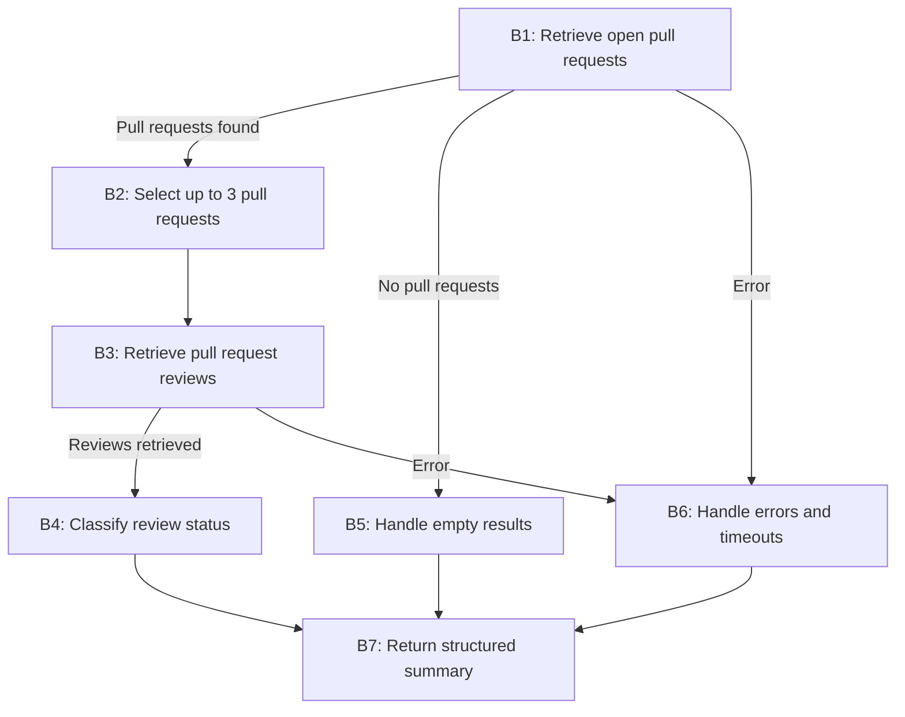

**Task:** You are an AI agent generator. Below is a design for an agent; please generate the agent accordingly. Note that the agent's tools should be generated alongside the agent's code.

**Context:** An AI agent is an entity that utilizes an LLM and tools to perform specific tasks autonomously.

**Output:** agent.py, requirements.txt, tests.py

**Benchmark interface contract:**

| Interface requirement | Example |
| --- | --- |
| Model | GPT-4o |
| Framework | LangGraph |
| GenAI Tool | ChatOpenAI |
| Tools | Every tool must be a LangChain tool (@tool, StructuredTool, or obtained from an MCP server via langchain-mcp-adapters) and must be executed exclusively through its interface (invoke/ainvoke, directly or via ToolNode), never by calling its implementation function directly. |
| Entrypoint | agent(repository: str, user_request: str) |
| Output | { "status": "success \| failure", "message": "Response message", "result": { "repository": "owner/repository", "groups": { "group_name": [ { "number": 0, "title": "Item title" } ] } }, "note": "Optional note" } |

**Requirements:**

| Requirement | Meaning | Agent specification | Correctness criterion |
| --- | --- | --- | --- |
| Goal | The agent's objective and main behavior, stated in the active voice | The agent retrieves open pull requests from a repository, inspects their review status, classifies them as needs_review or reviewed, and returns a structured summary. | Does the main behavior state who acts, what they do, and the result? |
| Persona (Optional) | The personality the agent assumes when performing its tasks | The agent acts as a developer who specializes in GitHub repository management and pull request reviews. | Does the specification define a persona and its area of activity? Is the persona appropriate for and consistent with the Goal? |
| Inputs | Information sent to the agent | - The user provides a repository identifier (owner/repo)  - a natural-language request  - a GitHub token with read permissions. | Does the specification define the expected input? |
| Guardrails and Invariants | External rules or conditions the agent must always respect during execution. They may come from laws, regulations, company policies, or domain rules. An invariant must hold before and after any agent behavior. | The agent does not modify repository data or fabricate pull request review information. | Does the specification state a relationship, property, or condition of the domain that is (or should be) always true, rather than a permitted/prohibited action? Is the invariant connected to an input, output, event, or piece of data the agent actually handles, rather than domain knowledge irrelevant to its scope? Can the invariant be checked at any point during execution? |
| Quality attributes (non-functional requirements) | Observable characteristics of the agent's behavior during execution that describe neither what it does (Goal/Behavior Requirements) nor what it must never do (Constraints), but how well it does it: consistently, safely, efficiently, and reliably. They directly shape the trust and experience of those who depend on the agent. | Not applicable | Is the attribute described in observable/measurable behavioral terms, rather than as an implementation characteristic (for example, "use a cache" is an implementation constraint, not a quality attribute)? Is there a verifiable acceptance criterion (a threshold, rate, or test condition), rather than just a vague adjective (such as "must be fast" without defining how fast)? Where attributes involve a trade-off (for example, robustness versus performance), does the specification make the priority explicit? |

**Tools:**

| Name | Purpose | Inputs | Return | Failures |
| --- | --- | --- | --- | --- |
| list_pull_requests | Retrieve open pull requests from a repository. | Repository identifier (owner/repo) and filters, such as state and sort order. | List of pull requests, including number, title, state, and update date when available. | Return an empty list if no pull requests match the request; return an error if the repository is invalid or inaccessible. |
| get_pull_request_reviews | Retrieve reviews associated with a specific pull request. | Repository identifier (owner/repo) and pull request number. | List of reviews, including review state (e.g., APPROVED, CHANGES_REQUESTED, or COMMENTED) when available. | Return an empty list if no reviews exist; return an error if the pull request cannot be accessed. |

**Behaviors:**

| Behavior | Trigger | Input | Tools | Output | Environment effect | Constraints |
| --- | --- | --- | --- | --- | --- | --- |
| B1 — Retrieve open pull requests | The user requests information about pull request review status. | Repository identifier and natural-language request. | github MCP: `list_pull_requests` | List of open pull requests, including number, title, state, and update date when available. | Reads pull request data without modifying the repository. | Must retrieve real data and prioritize the most recently updated pull requests. |
| B2 — Select pull requests for analysis | The agent retrieves open pull requests. | Retrieved pull requests and their update dates. | None | A deterministic subset of at most three pull requests. | No repository changes. | Must select no more than three pull requests deterministically. |
| B3 — Retrieve pull request reviews | The agent selects pull requests for analysis. | Repository identifier and selected pull request numbers. | github MCP: `get_pull_request_reviews` | Review records for each selected pull request. | Reads review data without modifying the repository. | Must retrieve actual reviews and must not fabricate review records. |
| B4 — Classify review status | The agent retrieves review records. | Pull request details and associated reviews. | None | Each pull request is classified as needs_review or reviewed. | No repository changes. | Must classify a PR as reviewed if at least one review is APPROVED or CHANGES_REQUESTED; otherwise, classify it as needs_review. |
| B5 — Handle empty results | The MCP tool returns no open pull requests. | Repository identifier and empty pull request list. | Github MCP: `list_pull_requests` | Successful response with empty needs_review and reviewed groups. | No repository changes. | Must treat the absence of pull requests as a successful execution, not as a failure. |
| B6 — Handle invalid repositories or execution failures | The repository is invalid or inaccessible, or execution times out. | Repository identifier and tool error or timeout. | Github MCP tool selected | Failure response with an explanatory message. | No repository changes. | Must not fabricate results or report success after a failure; must catch TimeoutError within the 30-second execution limit. |
| B7 — Return a structured summary | The agent completes classification or handles an empty result set | Repository identifier, classified pull requests, and execution status. | None | Structured response containing repository, status, needs_review, reviewed, summary message, and the note that at most three pull requests were analyzed. | No additional environment changes. | Must follow the output contract and return both classification groups, including empty groups when necessary. |

| Field | Correctness criterion |
| --- | --- |
| Behavior | Is each behavior specified as an individual, identifiable requirement, separate from the Goal? Is each requirement atomic enough to test in isolation (given X, the agent must do Y)? Does the specification explicitly cover invalid input, tool call failure, ambiguity, and missing required information? Together, are the requirements sufficient to achieve the declared Goal, with no essential behavior left implicit? |
| Trigger | Is the condition or event that starts the behavior explicitly defined and observable? |
| Input | Does the specification define the expected input? |
| Tools | Are the required tools identified and their intended use defined? |
| Expected Outcome | Does the specification define the expected change in the environment? Is that change observable and verifiable after the behavior runs? |
| Environment effect | Does the specification define which environment the agent changes and how that change is made? |
| Constraints | As restrições do comportamento estão explícitas, são verificáveis e coerentes com as restrições gerais? |

**Behavioral graph:**

**Implementation details:**

| Item | Instruções |
| --- | --- |
| Imports | from dotenv import load_dotenv; load_dotenv() |
