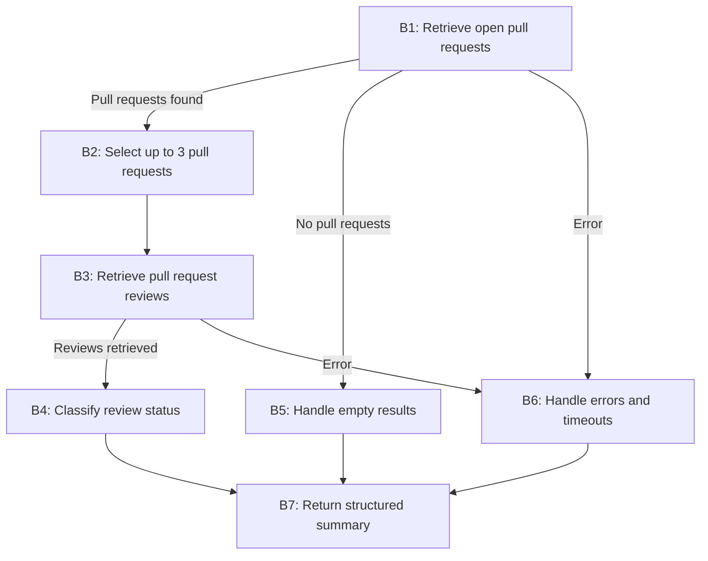

**Task:** You are an AI agent generator. Below is a design for an agent; please generate the agent accordingly. Note that the agent's tools should be generated alongside the agent's code.

**Contexto:** An AI agent is an entity that utilizes an LLM and tools to perform specific tasks autonomously.

**Output:** agent.py, requirements.txt, tests.py

**Contrato de interface com o benchmark:**

| Requisito de interface | Exemplo |
| --- | --- |
| Modelo | GPT-4o |
| Framework | LangGraph |
| GenAI Tool | ChatOpenAI |
| Tools | Every tool must be a LangChain tool (@tool, StructuredTool, or obtained from an MCP server via langchain-mcp-adapters) and must be executed exclusively through its interface (invoke/ainvoke, directly or via ToolNode), never by calling its implementation function directly. |
| Entrypoint | agent(repository: str, user_request: str, github_token: str) |
| Output | { "status": "success \| failure", "message": "Response message", "result": { "repository": "owner/repository", "groups": { "group_name": [ { "number": 0, "title": "Item title" } ] } }, "note": "Optional note" } |

**Requisitos:**

| Requisito | Significado | Especificação do agente | Critério de Corretude |
| --- | --- | --- | --- |
| Goal | Objetivo e comportamento principal do agente na voz ativa | The agent retrieves open pull requests from a repository, inspects their review status, classifies them as needs_review or reviewed, and returns a structured summary. | O comportamento principal está declarado definindo quem faz, o que faz e o resultado? |
| Persona (Opcional) | A personalidade que o agente assume ao realizar as tarefas | The agent acts as a developer who specializes in GitHub repository management and pull request reviews. | A especificação define uma persona e sua área de atuação? A persona é adequada/coerente com o Goal? |
| Inputs | Informação enviada para o agente | - The user provides a repository identifier (owner/repo)  - a natural-language request  - a GitHub token with read permissions. | A especificação define qual é a entrada esperada? |
| Constraints | Uma afirmação que restringe as ações que o agente (ou seus usuários/operadores) têm permissão de realizar. Descreve o que o agente deve, não deve, ou não pode fazer, ou define que apenas determinados papéis/condições autorizam uma certa ação. |  | A especificação declara explicitamente uma ação que o agente deve, não deve, ou só pode sob certas condições? A restrição está expressa em termos de ação/comportamento permitido ou proibido — não em termos de tecnologia, ferramenta ou biblioteca usada para implementar o agente? Quando a restrição envolve papel/autorização ("só X pode fazer Y"), a especificação define quem ou o que está autorizado? A restrição é verificável: é possível observar, no comportamento do agente, se ela foi violada ou respeitada? |
| Guardrails and Invariants | Regras externas ou condições que devem ser sempre respeitadas pelo agente durante sua execução. Podem vir de leis, regulamentações, políticas da empresa ou regras do domínio. Quando uma condição é um invariante, ela deve ser satisfeita antes e depois da execução de qualquer comportamento do agente. | - The agent invokes exactly one of list_issues or list_pull_requests per execution, based on the user's intent.  - The agent does not modify repository data or fabricate pull request review information. | A especificação declara uma relação, propriedade ou condição do domínio que é (ou deve ser) sempre verdadeira, e não uma ação permitida/proibida? O invariante está conectado a uma entrada, saída, evento ou dado que o agente efetivamente manipula (não é conhecimento de domínio irrelevante ao escopo do agente)? É possível verificar, a qualquer momento durante a execução, se o invariante ainda é válido? |
| Quality attributes (non-functional requirements) | Características observáveis do comportamento do agente durante a execução, que não descrevem o que ele faz (isso é Goal/Behavior Requirements) nem o que ele nunca deve fazer (Constraints), mas quão bem ele faz — de forma consistente, segura, eficiente e confiável. Moldam diretamente a confiança e a experiência de quem depende do agente. | Not applicable | O atributo está descrito de forma observável/mensurável no comportamento (não é uma característica de implementação, ex: "usar cache" não é quality attribute, é constraint de implementação)? Existe um critério de aceitação verificável (limiar, taxa, ou condição de teste), e não apenas um adjetivo vago ("deve ser rápido" sem definir o quê é rápido)? Havendo trade-off entre atributos (ex: robustez vs. performance), a especificação deixa explícita a prioridade? |

**Tools:**

| Nome | Propósito | Entradas | Retorno | Falhas |
| --- | --- | --- | --- | --- |
| list_pull_requests | Retrieve open pull requests from a repository. | Repository identifier (owner/repo) and filters, such as state and sort order. | List of pull requests, including number, title, state, and update date when available. | Return an empty list if no pull requests match the request; return an error if the repository is invalid or inaccessible. |
| get_pull_request_reviews | Retrieve reviews associated with a specific pull request. | Repository identifier (owner/repo) and pull request number. | List of reviews, including review state (e.g., APPROVED, CHANGES_REQUESTED, or COMMENTED) when available. | Return an empty list if no reviews exist; return an error if the pull request cannot be accessed. |

**Comportamentos:**

| Comportamento | Trigger | Input | Tools | Saída | Efeito no ambiente | Constraints |
| --- | --- | --- | --- | --- | --- | --- |
| B1 — Retrieve open pull requests | The user requests information about pull request review status. | Repository identifier and natural-language request. | github MCP: `list_pull_requests` | List of open pull requests, including number, title, state, and update date when available. | Reads pull request data without modifying the repository. | Must retrieve real data and prioritize the most recently updated pull requests. |
| B2 — Select pull requests for analysis | The agent retrieves open pull requests. | Retrieved pull requests and their update dates. | None | A deterministic subset of at most three pull requests. | No repository changes. | Must select no more than three pull requests deterministically. |
| B3 — Retrieve pull request reviews | The agent selects pull requests for analysis. | Repository identifier and selected pull request numbers. | github MCP: `get_pull_request_reviews` | Review records for each selected pull request. | Reads review data without modifying the repository. | Must retrieve actual reviews and must not fabricate review records. |
| B4 — Classify review status | The agent retrieves review records. | Pull request details and associated reviews. | None | Each pull request is classified as needs_review or reviewed. | No repository changes. | Must classify a PR as reviewed if at least one review is APPROVED or CHANGES_REQUESTED; otherwise, classify it as needs_review. |
| B5 — Handle empty results | The MCP tool returns no open pull requests. | Repository identifier and empty pull request list. | Github MCP: `list_pull_requests` | Successful response with empty needs_review and reviewed groups. | No repository changes. | Must treat the absence of pull requests as a successful execution, not as a failure. |
| B6 — Handle invalid repositories or execution failures | The repository is invalid or inaccessible, or execution times out. | Repository identifier and tool error or timeout. | Github MCP tool selected | Failure response with an explanatory message. | No repository changes. | Must not fabricate results or report success after a failure; must catch TimeoutError within the 30-second execution limit. |
| B7 — Return a structured summary | The agent completes classification or handles an empty result set | Repository identifier, classified pull requests, and execution status. | None | Structured response containing repository, status, needs_review, reviewed, summary message, and the note that at most three pull requests were analyzed. | No additional environment changes. | Must follow the output contract and return both classification groups, including empty groups when necessary. |

| Campo | Critério de corretude |
| --- | --- |
| Comportamento | Cada comportamento está especificado como um requisito individual e identificável, separado do Goal? Cada requisito é atômico o suficiente para ser testado isoladamente (dá pra escrever um caso de teste "dado X, o agente deve fazer Y")? A especificação cobre explicitamente o comportamento esperado diante de: entrada inválida, falha de ferramenta/tool call, ambiguidade, ausência de informação necessária? Os requisitos, somados, são suficientes para realizar o Goal declarado (nada essencial ficou implícito)? |
| Trigger | A condição ou evento que inicia o comportamento está explicitamente definido e é observável? |
| Input | A especificação define qual é a entrada esperada? |
| Tools | As ferramentas necessárias para o comportamento estão identificadas e seu propósito de uso está definido? |
| Expected Outcome | A especificação define qual alteração deve ocorrer no ambiente? A alteração esperada é observável e verificável após a execução do comportamento? |
| Efeito no ambiente | A especificação define qual ambiente o agente vai alterar?  A especificação define como será feita a alteração no ambiente? |
| Constraints | As restrições do comportamento estão explícitas, são verificáveis e coerentes com as restrições gerais? |

**Grafo comportamental:**

**Detalhes de implementação:**

| Item | Instruções |
| --- | --- |
| Imports | from dotenv import load_dotenv; load_dotenv() |
