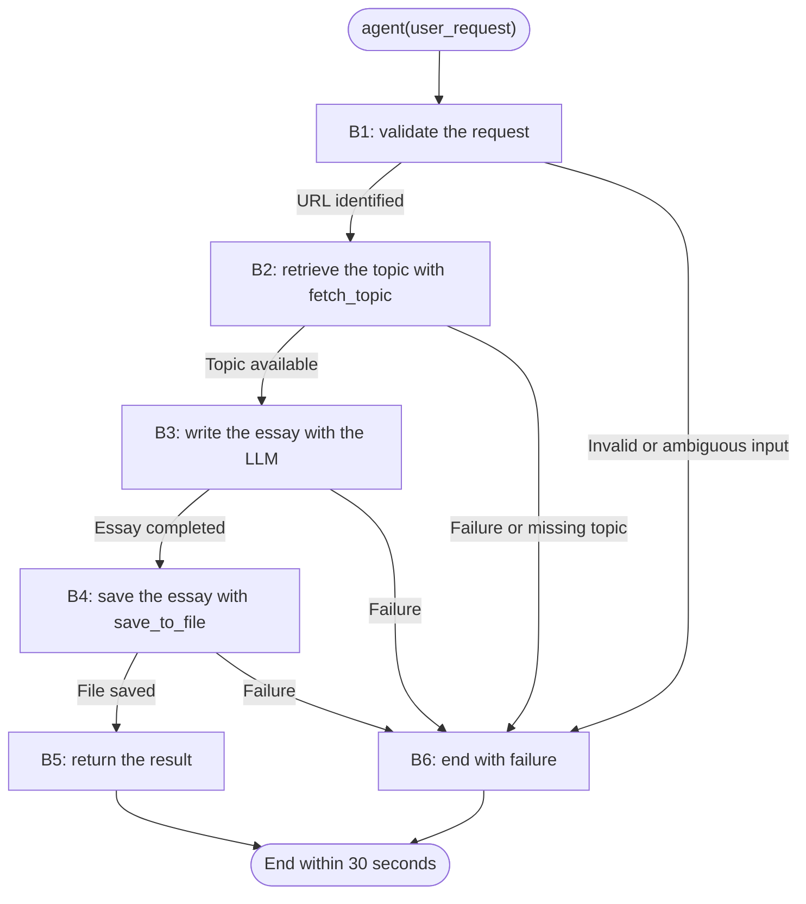

**Task:** you are an AI agent generator, and an agent specification follows. Generate an agent that meets the specification. Generate the agent's tools along with its code.  
**Context:** An AI agent is an entity that uses an LLM and tools to perform specific tasks autonomously.  
**Output:** agent.py, requirements.txt, tests.py 

**Interface contract with the benchmark:**

| Interface requirement | Example |
| --- | --- |
| Model | GPT-4o |
| Framework | LangGraph |
| GenAI Tool | ChatOpenAI |
| Tools | Every tool must be a LangChain tool (@tool, StructuredTool, or obtained from an MCP server via langchain-mcp-adapters) and must be executed exclusively through its interface (invoke/ainvoke, directly or via ToolNode), never by directly calling its underlying implementation function. |
| Entrypoint | agent(user_request: str) -> dict; exactly one parameter, with no additional parameters. |
| Output | state: dict; always exactly the keys `status`, `user_request` and `response`, on success and failure. |

**Implementation details:**

| Implementation detail | Specification |
| --- | --- |
| Identification | Spec v1.0: Essay Writer Agent. |
| Output contract | The `state` dictionary corresponds to the `response_dict` in `agent(user_request: str) -> response_dict`. Every return must be a dictionary with exactly `status`, `user_request` and `response`. On success, return `{"status": "success", "user_request": user_request, "response": content,}`. `user_request` preserves the original request, including whitespace, on every path; `content` includes the retrieved topic, the full essay content, and the absolute path returned by `save_to_file`, with no additional internal structure required. Success requires completing retrieval, writing, and saving. On failure, return `{"status": "failure", "user_request": user_request, "response": error_message}`, where `error_message` is a useful explanation of the error. Never propagate exceptions. |
| Graph construction | Implement a LangGraph `StateGraph` and expose `build_graph(...) -> CompiledGraph`. The returned object must be a valid compiled graph. |
| Reasoning and writing | Use `ChatOpenAI` with the `gpt-4o` model to reason about the request, select tools, emit tool calls and write the essay. The LLM decides whether and when to call each tool based on the current state, for example through `ChatOpenAI.bind_tools`. The graph validates and enforces the required order; it must not call tools deterministically without an LLM decision. Invalid input and failures terminate without forcing tool calls. |
| Document retrieval | Define the tool `fetch_topic(url: str)`. It must use the `requests` library to make a real HTTP GET request to `https://docs.google.com/document/d/{ID}/export?format=txt`, using the ID from the supplied public URL, and return the actual retrieved content. Retrieval requires no API key. |
| Saving | Define the tool `save_to_file(content: str, topic: str)`, where `content` is the essay and `topic` is a short topic description. It must actually write the essay to the local file system and return the absolute path of the saved file. |
| Authenticity | The tools must perform their actual external operations: an HTTP request and a local file write, respectively. Mocks, stubs, or fabricated data must not replace these operations. |
| Mandatory order | The LLM selects and emits tool calls; the graph validates those calls and enforces `fetch_topic` before essay writing and `save_to_file` only after the essay is written from the retrieved content. Do not bypass LLM selection with deterministic tool calls. Invalid input and failures terminate without forcing the sequence. |
| Execution limit | Complete the `agent()` call and return a dictionary within 30 seconds, including on failure. Do not use infinite loops or indefinite retries. All exceptions must be caught. |
| Delivery | Keep the entire agent and tool implementation in a single `agent.py`. Also deliver `requirements.txt` with the dependencies and `tests.py` with tests of any kind. These are the three required files; do not create additional modules, packages, subdirectories, configuration files, manifests, or project scaffolding. |
| Evaluation | Execute the agent with multiple essay requests and check empty inputs, grounding in the retrieved topic, ENEM structure, the valid path returned by `save_to_file`, and the graph object returned by `build_graph`. Failure to meet any authenticity or contract requirement results in functional failure. |

**Requirements:**

| Requirement | Meaning | Agent Specification | Correctness Criterion |
| --- | --- | --- | --- |
| Goal | The agent's objective and main behavior in the active voice | The agent retrieves the topic and supporting texts from a public Google Doc, writes a complete ENEM-style argumentative essay, saves the text locally, and returns the topic, essay, and file path. | Does the main behavior state who acts, what the agent does, and what result it produces? |
| Persona (Optional) | The personality the agent adopts when performing tasks | An ENEM essay writing assistant with a professional, objective and respectful manner. Uses clear, formal language when presenting arguments and explaining errors. | Does the specification define the personality and area of work? Are they consistent with the Goal? |
| Inputs | Information sent to the agent | `user_request` is a natural language string containing the URL of a public Google Doc with the topic, for example: `"Write an essay which the theme is available at: https://..."`. The supplied URL must be used for retrieval. Empty or whitespace-only input must result in `"status": "failure"`. | Are the expected inputs, required and optional information, and validity conditions explicit? |
| Guardrails and Invariants | External rules or conditions the agent must always respect during execution. They may come from laws, regulations, company policies, or domain rules. When a condition is an invariant, it must hold before and after the execution of any agent behavior. | The LLM selects tools and emits calls based on the current state; the graph validates and enforces retrieval before writing and saving only after writing. Never replace LLM selection with deterministic tool calls or force calls after invalid input or failure. Ground the essay in the retrieved topic. Use the tools through the LangChain interface, with real operations. Always return exactly `status`, `user_request` and `response`, preserving the original request on every path and providing a useful error message in `response` on failure. The introduction presents the topic and thesis; the development contains at least 2 paragraphs with arguments and evidence; the conclusion restates the thesis and proposes an intervention. | Do the guardrails have a clear scope? Are the invariants tied to the inputs, data, or outputs the agent handles, and can they be checked before and after the behaviors? |
| Quality attributes (non-functional requirements) | Observable characteristics of the agent's behavior during execution that describe how well it performs, consistently, safely, efficiently, and reliably. What it does belongs in Goal/Behavior Requirements, and what it must never do belongs in Constraints. These qualities directly shape the trust and experience of those who depend on the agent. | Always return a dictionary within 30 seconds, without propagating exceptions or relying on indefinite retries. The limit and exception handling apply to every graph step. If the workflow cannot be completed, return failure within the limit. Measure execution time and check the return value in successful and failed runs. Exceeding the limit constitutes functional failure. | Are the qualities observable or measurable, with acceptance criteria rather than implementation details? When qualities conflict, is their priority defined? |

**Tools:**

| Name | Purpose | Inputs | Return | Failures |
| --- | --- | --- | --- | --- |
| `fetch_topic` | Implement `fetch_topic(url: str)` to retrieve the topic and supporting texts from a public Google Doc using `requests` for a real HTTP GET, without an API key. Execute the LLM-emitted call through the LangChain interface after graph validation. | `url`: document URL contained in `user_request`, selected by the LLM. | Actual topic and supporting texts obtained from the `https://docs.google.com/document/d/{ID}/export?format=txt` endpoint. | If retrieval fails or does not provide enough information to identify the topic, return the failure dictionary with the original request and a useful error message, without forcing another tool call. |
| `save_to_file` | Implement `save_to_file(content: str, topic: str)` to save the essay to a real local file. Execute the LLM-emitted call through the LangChain interface after graph validation. | `content`: essay content; `topic`: short topic description. The LLM supplies both arguments after writing the essay. | Absolute path of the saved file. | If saving fails, return the failure dictionary with the original request and a useful error message, without claiming successful persistence or forcing another tool call. |

**Behaviors:**

| Behavior | Trigger | Input | Tools | Output | Environment Effect | Constraints |
| --- | --- | --- | --- | --- | --- | --- |
| B1: validate the request | Call to `agent()` | `user_request` | None | Request ready for retrieval or a return value with `"status": "failure"`. | None. | Reject empty or blank input. If the required URL is missing or cannot be identified unambiguously, return failure. |
| B2: retrieve the topic | Request with an identified URL; the LLM decides to retrieve and emits the tool call | Public Google Doc URL selected by the LLM | `fetch_topic` through its LangChain interface | Retrieved topic and supporting texts. | Real HTTP GET request using `requests` to the Google Docs export endpoint. | Validate the LLM-emitted `fetch_topic(url: str)` call before execution; do not substitute a deterministic tool call. No API key is required. Do not write before successful retrieval. Failure or the absence of an identifiable topic leads to B6 without forcing further calls. |
| B3: write the essay | Retrieval completed with a topic available | Request, retrieved topic, and supporting texts | None; use the LLM | Complete ENEM-style essay. | None. | Use `ChatOpenAI` with `gpt-4o`. The graph permits writing only after successful retrieval. Include an introduction with the topic and thesis, a development with at least 2 paragraphs of arguments and evidence, and a conclusion that restates the thesis and proposes an intervention. The LLM decides whether and when to save based on the completed essay and current state; it emits the saving call rather than the graph calling the tool deterministically. |
| B4: save the essay | Essay completed; the LLM decides to save and emits the tool call | Essay as `content` and short topic description as `topic`, supplied by the LLM | `save_to_file` through its LangChain interface | Absolute path of the saved file. | Actual write of the essay to a local file. | Validate the LLM-emitted `save_to_file(content: str, topic: str)` call and execute only after B3. Do not substitute a deterministic tool call or force saving on failure. Failure leads to B6. |
| B5: return the result | Saving completed | Topic, essay, and path returned by the tool | None | Success dictionary following the output contract. | None. | Include the original request and return the essay content, not just the path. |
| B6: end with failure | Invalid input, missing or ambiguous required information, tool failure, LLM error, or another exception that prevents completion | Request and available result from the failed step | None | Dictionary with exactly `status`, `user_request` and `response`: `status` is `"failure"`, `user_request` preserves the original request and `response` contains a useful error message. | No additional effect required. | Catch exceptions and finish within the total 30 seconds. Do not propagate exceptions, force further tool calls or replace missing data with fabricated results. |

**Behavior graph:**

| Field | Correctness criterion |
| --- | --- |
| Behavior | Is each behavior specified as an individual, identifiable requirement, separate from the Goal? Is each requirement atomic enough to test independently (can a test case be written as "given X, the agent must do Y")? Does the specification explicitly cover the expected behavior for invalid input, tool/tool call failure, ambiguity, and missing required information? Together, are the requirements sufficient to achieve the stated Goal (with nothing essential left implicit)? |
| Trigger | Is the condition or event that starts the behavior explicitly defined and observable? |
| Input | Does the specification define the expected input? |
| Tools | Are the tools needed for the behavior identified, and is their intended use defined? |
| Expected Outcome | Does the specification define what change must occur in the environment? Is the expected change observable and verifiable after the behavior executes? |
| Environment Effect | Does the specification define which environment the agent will change? Does the specification define how the environment will be changed? |
| Constraints | Are the behavior's constraints explicit, verifiable, and consistent with the general constraints? |
