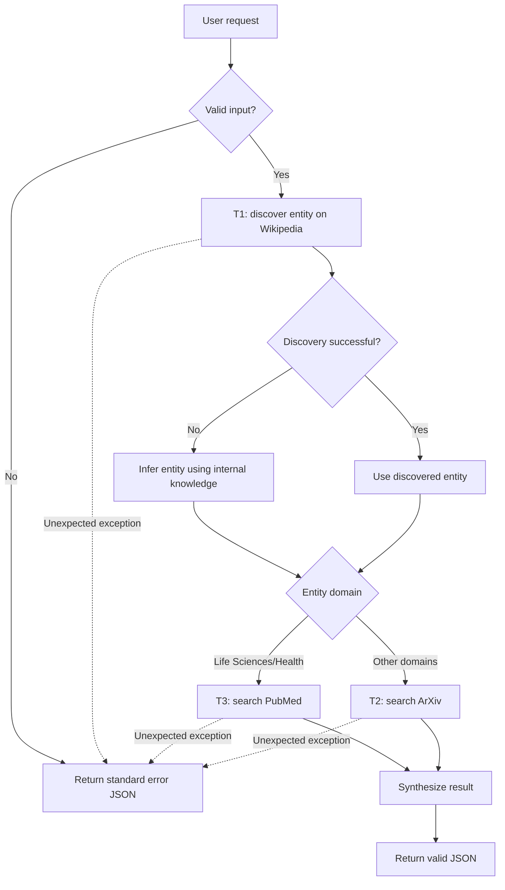

**Task:** You are an AI agent generator, and below is an agent specification. Generate an agent according to the specification. Consider that the agent's tools must be generated together with the agent's code.

**Context:** An AI agent is an entity that uses an LLM and tools to perform specific tasks autonomously.

**Output:** `agent.py`, `requirements.txt`, `tests.py` (without additional modules, packages, or subdirectories).

**Benchmark Interface Contract:**

| Interface Requirement | Example |
| --- | --- |
| Model | GPT-4o |
| Framework | LangGraph |
| GenAI Tool | ChatOpenAI |
| Tools | Every tool must be a LangChain tool (`@tool`, `StructuredTool`, or obtained from an MCP server via `langchain-mcp-adapters`) and must be executed exclusively through its interface (`invoke`/`ainvoke`, directly or via `ToolNode`), never by directly calling the function that implements it. |
| Entrypoint | `agent(user_request: str)` |
| Output | `str` containing exclusively a valid JSON object |

**Implementation Details:**

| Implementation Detail | Specification |
| --- | --- |
| Environment variable | `OPENAI_API_KEY`: OpenAI API access key. |

**Requirements:**

| Requirement | Meaning | Agent Specification | Correctness Criterion |
| --- | --- | --- | --- |
| Goal | Main objective and behavior of the agent in active voice | The agent must conduct a multi-stage investigative research process: first, discover a specific entity (gene, scientist, theorem, etc.) using a general knowledge tool; then use that entity to query the appropriate academic database; and finally return a synthesis. | Is the main behavior defined, specifying who performs the task, what they do, and the result? |
| Persona (Optional) | The personality the agent assumes when performing tasks | Research investigative assistant with a professional, objective, and direct tone. Conducts the investigation methodically in stages and reports only the final structured result, without comments, opinions, or conversational text. | Does the specification define a persona and its area of expertise? Is the persona appropriate and consistent with the Goal? |
| Inputs | Information provided to the agent | Complex natural language text that requires multi-stage investigation. | Does the specification define the expected input? |
| Guardrails and Invariants | External rules or conditions that must always be respected by the agent during execution. They may come from laws, regulations, company policies, or domain rules. An invariant must hold before and after every agent behavior. | (I1) The academic database used in Stage 2 must correspond to the domain of the entity discovered in Stage 1: Life Sciences/Health entities (e.g., genes, diseases) use `search_pubmed`; Exact Sciences/Technology entities use `search_arxiv`. If the entity belongs to any other domain (e.g., Humanities, Arts), the agent must default to `search_arxiv`. | Does the invariant state a domain relationship, property, or condition that must always hold, rather than an allowed or prohibited action? Is it connected to input, output, events, or data that the agent manipulates? Can it be verified during execution? |
| Quality attributes (non-functional requirements) | Observable characteristics of the agent's behavior during execution that do not describe what it does (Goal/Behavior Requirements) or what it must never do (Constraints), but how well it does it—consistently, safely, efficiently, and reliably. They directly shape the trust and experience of those who depend on the agent. | (QA1) Data chaining accuracy: the search term used in Stage 2 must exactly match the entity discovered in Stage 1—case-insensitive and ignoring leading/trailing whitespace—instead of the original generic topic provided by the user. | Is the attribute described in an observable and measurable way? Is there a verifiable acceptance criterion? If attributes conflict, is the priority explicit? |

**Tools:**

| Name | Purpose | Inputs | Return | Failures |
| --- | --- | --- | --- | --- |
| `get_wikipedia_summary` (T1) | Retrieve a topic summary from the Wikipedia REST API (`https://en.wikipedia.org/api/rest_v1/page/summary/{topic}`). Used in Stage 1 (Discovery) to identify the specific entity mentioned in the user's request. | Topic to query. | Topic summary text, or an error/no-result response if the topic is not found. | API error or topic not found; in these cases, apply behavior B2. |
| `search_arxiv` (T2) | Search for papers on ArXiv (`http://export.arxiv.org/api/query`, using the `arxiv` package or `requests`). Used in Stage 2 (In-depth Research) when the discovered entity belongs to Exact Sciences/Technology or another domain without a designated specialized database. | Discovered/inferred entity. | List of papers, each with `title` and `summary`. | Query failures must be handled as tool failures, without directly calling the function that implements the tool. |
| `search_pubmed` (T3) | Search for papers on PubMed via the NCBI E-utilities API (`esearch.fcgi` to obtain `idlist` and `esummary.fcgi` to obtain summaries, using `requests`). Used in Stage 2 (In-depth Research) when the discovered entity belongs to Life Sciences/Health. | Discovered/inferred entity. | List of papers, each with `title` and `summary`. | Query failures must be handled as tool failures, without directly calling the function that implements the tool. |

**Behaviors:**

| Behavior | Trigger | Input | Tools | Output | Environment Effect | Constraints |
| --- | --- | --- | --- | --- | --- | --- |
| **B1 — Discover the specific entity mentioned in the user's request via Wikipedia (Stage 1).** | Receipt of a valid (non-empty) request that mentions or implies a specific entity to be discovered. | Complex natural language text. | T1. | The discovered entity, extracted from the summary returned by the tool and used as input for Stage 2. | None. | The investigation must begin with `get_wikipedia_summary` (Discovery). No In-depth Research stage may occur before this stage is complete. |
| **B2 — If Wikipedia discovery fails or the topic is not found, infer the entity using the LLM's internal knowledge and proceed to Stage 2 without aborting.** | T1 returns an error or no result for the requested topic. | Complex natural language text. | T1. | The entity inferred by the LLM (string), used as input for Stage 2 instead of the tool result. | None. | If `get_wikipedia_summary` fails or the topic is not found, the agent must not abort; it must infer the entity using its internal knowledge and proceed to Stage 2. |
| **B3 — Query the appropriate academic database (ArXiv or PubMed) using the discovered entity (Stage 2).** | Completion of Stage 1 (B1 or B2) with a discovered or inferred entity. | The discovered/inferred entity. | T2 or T3. | The list of papers returned by the academic database, each with a title and source/summary, for use in Stage 3. | None. | In-depth Research must use `search_arxiv` or `search_pubmed` only after B1 or B2 has produced an entity. |
| **B4 — Synthesize the final result in JSON (Stage 3).** | Completion of Stage 2 (B3) with a list of retrieved papers. | The discovered/inferred entity, the user's original request, and the retrieved papers. | None. | A string containing exclusively a valid JSON object, without conversational text or Markdown, with the keys `topic`, `discovered_entity`, and `papers`; `papers` is a list of objects containing a title and source/summary. | None. | The final output must not contain conversational filler text or Markdown formatting; it must consist exclusively of the JSON object string. |
| **B5 — If the input is empty, validation fails, or an unexpected exception occurs during execution, return the standard error JSON.** | Empty input or input consisting only of whitespace; input validation error; or an unhandled exception during any execution stage. | Empty or invalid input, or any input during which an exception occurs. | None (or a tool call that raised an exception). | The exact string: `{"status": "error", "message": "Execution failed or invalid request."}` | None. | The response must exactly match the specified error JSON. |

**Behavioral Graph:**

| Field | Correctness Criterion |
| --- | --- |
| Behavior | Is each behavior specified as an individual, identifiable requirement, separate from the Goal? Is each requirement sufficiently atomic to be tested in isolation (can a test case be written as "given X, the agent must do Y")? Does the specification explicitly cover the expected behavior in the event of invalid input, tool failure, ambiguity, or missing necessary information? Are the requirements, taken together, sufficient to achieve the stated Goal (has anything essential been left implicit)? |
| Trigger | Is the condition or event that initiates the behavior explicitly defined and observable? |
| Input | Does the specification define the expected input? |
| Tools | Are the tools required for the behavior identified, and is their purpose of use defined? |
| Expected Outcome | Does the specification define what change should occur in the environment? Is the expected change observable and verifiable after execution? |
| Environment Effect | Does the specification define which environment the agent will modify? Does the specification define how the change will be made? |
| Constraints | Are the constraints for each behavior explicit, verifiable, and consistent with the general constraints? |