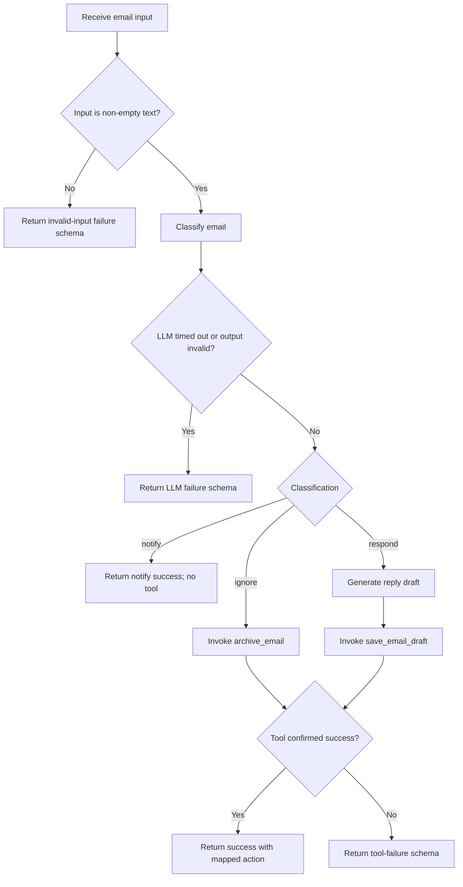

**Task:** You are an AI agent generator. Generate an agent according to the specification below. The agent's tools must be generated together with its code.

**Context:** An AI agent is an entity that uses an LLM and tools to perform specific tasks autonomously.

**Output:** `agent.py`, `requirements.txt`, `tests.py`

**Benchmark Interface Contract:**

| Interface requirement | Specification |
| --- | --- |
| Model | GPT-4o |
| Framework | LangGraph |
| GenAI tool | ChatOpenAI |
| Tools | Every tool must be a LangChain tool (`@tool`, `StructuredTool`, or obtained from an MCP server via `langchain-mcp-adapters`) and must be executed exclusively through its interface (`invoke`/`ainvoke`, directly or via `ToolNode`), never by directly calling the function that implements it. |
| Entrypoint | `agent(email_input: str)` |
| Output | `Tuple[CompiledGraph, dict]` |

**Implementation Details:**

| Environment variable | Description |
| --- | --- |
| `OPENAI_API_KEY` | OpenAI API access key. |
| `NOTION_TOKEN` | Notion integration token used by the official `notion_client` SDK. |
| `NOTION_DRAFTS_DB_ID` | ID of the Drafts database in Notion. |

**Requirements:**

| Requirement | Meaning | Agent specification | Correctness criterion |
| --- | --- | --- | --- |
| Goal | Main objective and behavior of the agent, expressed in active voice. | The agent must act as an executive assistant: triage each incoming email, classify it as `ignore`, `notify`, or `respond`, execute the mapped tool for `ignore` or `respond`, execute no tool for `notify`, and return the processing result. | Does the goal state who performs the task, what they do, and the result? |
| Persona (Optional) | The personality the agent assumes while performing tasks. | An executive email assistant with a professional, objective, and direct tone. | Is the persona and its area of expertise defined and consistent with the goal? |
| Inputs | Information provided to the agent. | Text containing the raw body of the received email. | Is the expected input defined? |
| Guardrails and Invariants | External rules or conditions that must always be respected during execution, including invariants that must hold before and after each behavior. | **Constraints:** (1) Execute at most one tool per email. (2) For `notify`, execute no tool. (3) The tool must correspond exactly to the classification: `ignore` → `archive_email`; `respond` → `save_email_draft`. (4) Do not execute any other tool. (5) Do not report a tool action as successful if the tool failed. **Invariants:** (1) `action` is always `"process_email"`. (2) `classification` is one of `ignore`, `notify`, `respond`, or `unknown`. (3) On failure, `classification` is `unknown`. (4) `draft_response` is a non-empty string only when classification is `respond` and status is `success`; otherwise it is `null`. (5) `actions_taken` contains exactly the executed tool name when status is `success` and classification is `ignore` or `respond`; otherwise it is empty. (6) Any entry in `actions_taken` is the tool mapped to the classification. | Are the permitted and prohibited actions explicit, observable, and verifiable? Do invariants describe always-true properties of the agent's data or state? |
| Quality attributes (non-functional requirements) | Observable characteristics describing how well the agent performs. | The `message` field must contain no more than two sentences and justify the classification and action taken. | Is the attribute measurable and verifiable? |

**Tools:**

| Name | Purpose | Inputs | Return | Failures |
| --- | --- | --- | --- | --- |
| `archive_email` | Silently archive an email classified as `ignore`. | The email body or the identifier/content needed to identify the email to archive. | A confirmation string. | Tool/API error or timeout; the agent must report failure and must not claim that the email was archived. |
| `save_email_draft` | Save the generated reply draft for an email classified as `respond` to the Notion **Drafts** database. | The email body and generated reply draft. | A confirmation string. | Notion/API error, timeout, or missing configuration; the agent must report failure and must not claim that the draft was saved. |

**Behaviors:**

| Behavior | Trigger | Input | Tools | Output | Environment Effect | Constraints |
| --- | --- | --- | --- | --- | --- | --- |
| **B1 — Classify an irrelevant email as `ignore` and archive it.** | A valid, non-empty email is identified as spam, marketing, or an irrelevant cold email. | Text containing the email body. | `archive_email` (T1). | `{"action":"process_email","classification":"ignore","actions_taken":["archive_email"],"status":"success","message":"string (at most 2 sentences)","draft_response":null}` | The email is archived through T1. | Execute only T1, at most once. Return success and include T1 in `actions_taken` only after T1 succeeds. |
| **B2 — Classify an urgent or critical email as `notify` without taking an external action.** | A valid email is identified as urgent or critical (for example, a financial update or critical HR message) but does not require a direct response. | Text containing the email body. | None. | `{"action":"process_email","classification":"notify","actions_taken":[],"status":"success","message":"string (at most 2 sentences)","draft_response":null}` | None. | Do not execute any tool. |
| **B3 — Classify an email requiring a direct response as `respond`, generate a draft, and save it.** | A valid email is identified as requiring a direct response (for example, a meeting request, customer inquiry, or introduction). | Text containing the email body. | `save_email_draft` (T2). | `{"action":"process_email","classification":"respond","actions_taken":["save_email_draft"],"status":"success","message":"string (at most 2 sentences)","draft_response":"non-empty string"}` | The generated reply draft is saved to the Notion **Drafts** database through T2. | Execute only T2, at most once. Include a non-empty `draft_response`; report success and include T2 in `actions_taken` only after T2 succeeds. |
| **B4 — Return the standard failure result when LLM processing fails.** | The LLM request times out or its output cannot be parsed into the required structured response. | Text containing the email body. | None. | `{"action":"process_email","classification":"unknown","actions_taken":[],"status":"failure","message":"string describing the failure","draft_response":null}` | None. | Do not execute any tool; use the failure schema and do not present an unverified classification or action as successful. |
| **B5 — Return the standard failure result for invalid input.** | Input is empty, whitespace-only, or is not text. | Empty input, whitespace-only input, or non-text input. | None. | `{"action":"process_email","classification":"unknown","actions_taken":[],"status":"failure","message":"string indicating that the input is invalid","draft_response":null}` | None. | Do not execute any tool. |
| **B6 — Return the standard failure result when an action tool fails.** | T1 or T2 raises an error, times out, or otherwise does not confirm completion. | A valid email classified as `ignore` or `respond`. | The single mapped tool (T1 or T2). | `{"action":"process_email","classification":"unknown","actions_taken":[],"status":"failure","message":"string describing the tool failure","draft_response":null}` | No successful environment change is asserted. A tool may have an external partial effect before reporting failure; the agent must not claim completion without confirmation. | Make no second or alternative tool call. Do not claim success or include a tool in `actions_taken`. |

**Behavioral Graph:**

| Field | Correctness criterion |
| --- | --- |
| Behavior | Is each behavior an individual, identifiable requirement separate from the goal? Is it atomic enough to test independently? Does it explicitly cover invalid input, tool failure, ambiguity, and missing necessary information? Are the behaviors sufficient to achieve the goal? |
| Trigger | Is the condition or event that initiates the behavior explicit and observable? |
| Input | Is the expected input defined? |
| Tools | Are the tools required for the behavior identified, and is their purpose defined? |
| Expected outcome | Is the expected environment change specified and verifiable after execution? |
| Environment effect | Is the environment the agent modifies defined, including how the change is made? |
| Constraints | Are behavioral restrictions explicit, verifiable, and consistent with the general guardrails? |
