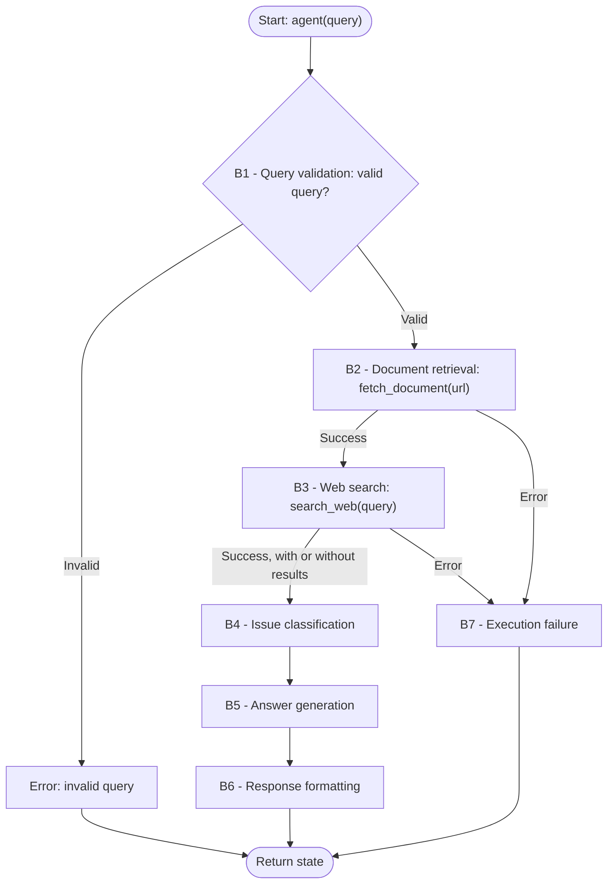

**Task:** you are an AI agent generator, and an agent specification is provided below. Generate an agent according to the specification. Consider that the agent's tools must be generated along with the agent's code.

**Context:** An AI agent is an entity that uses an LLM and tools to perform specific tasks autonomously.

**Output:** agent.py, requirements.txt, tests.py

**Interface contract with the benchmark:**

| Interface requirement | Example |
| --- | --- |
| Model | GPT-4o |
| Framework | LangGraph |
| GenAI Tool | ChatOpenAI |
| Tools | Every tool must be a LangChain tool (@tool, StructuredTool, or obtained from an MCP server via langchain-mcp-adapters) and must be executed exclusively through its interface (invoke/ainvoke, either directly or via ToolNode), never by directly calling the function that implements it. |
| Entrypoint | agent(query: str) |
| Output | state: dict with a required response: str field |

**General requirements:**

| Requirement | Meaning | Agent specification | Correctness criterion |
| --- | --- | --- | --- |
| Goal | The agent's main objective and behavior, in the active voice | The agent answers customer support queries that contain a URL to an error log or configuration file. It first reads the document indicated by the URL, then searches the public web for solutions based on the document's findings, classifies the issue as Technical, Billing, or General, and returns a structured response with the category, the exact documentation retrieved, and an answer grounded strictly in that documentation. | Is the main behavior stated, defining who does what and the result? |
| Persona (Optional) | The personality the agent assumes when performing tasks | The agent assumes the persona of a customer support specialist, focused on troubleshooting customers' problems based on the documents they provide and on documentation retrieved from the web. | Does the specification define a persona and its area of activity? Is the persona appropriate/consistent with the Goal? |
| Inputs | Information sent to the agent | A string (query: str) containing a customer support query in natural language, with a description of the problem and a direct public URL to an error log or configuration file. Invalid inputs include None, non-string values, empty or whitespace-only strings, highly offensive text, text without an http(s) URL, and text unrelated to customer support. | Does the specification define the expected input? |
| Guardrails and Invariants | Statements describing what is true about the domain or the agent's state at a given moment and must remain valid throughout execution. They describe relationships, properties, or conditions of the world/domain that form the basis of the agent's behavior. | - Every result considered valid must map Category to exactly one of: "Technical", "Billing", or "General".  - Technical covers product use, integrations, and technical problems. Billing covers charges, payments, invoices, and account plans. General covers other customer support requests. Category describes the main support request in the query.  - In a valid result, Documentation follows the composition defined in B6: the exact raw text returned by the tools, or "None" when both tools returned an empty or whitespace-only text.  - In a valid result, Answer is grounded strictly in Documentation and does not rely on the agent's internal knowledge.  - In an error result, state['response'] contains only a message beginning with "Error:", without formatted fields. | Does the specification state a relationship, property, or domain condition that is (or must be) always true, rather than a permitted/forbidden action? Is the invariant connected to an input, output, event, or datum that the agent actually handles (not domain knowledge irrelevant to the agent's scope)? Is it possible to verify, at any moment during execution, whether the invariant still holds? |
| Quality attributes (non-functional requirements) | Observable characteristics of the agent's behavior during execution that describe neither what it does (that is Goal/Behavior Requirements) nor what it must never do (Constraints), but how well it does it — consistently, safely, efficiently, and reliably. They directly shape the trust and experience of those who depend on the agent. | Not applicable. | Is the attribute described in an observable/measurable way in the behavior (not an implementation characteristic, e.g., "use cache" is not a quality attribute, it is an implementation constraint)? Is there a verifiable acceptance criterion (threshold, rate, or test condition), and not just a vague adjective ("must be fast" without defining what is fast)? If there is a trade-off between attributes (e.g., robustness vs. performance), does the specification make the priority explicit? |

**Tools:**

| Name | Purpose | Inputs | Return | Failures |
| --- | --- | --- | --- | --- |
| `fetch_document` | Obtain, using the requests library, the content of a public document (e.g., an error log or configuration file) through a URL provided by the user in the query. | url: str, the first http(s) URL present in the query, extracted by the LLM. | The exact raw text of the document. If nothing is returned, the result is empty. | Timeout, inaccessible or invalid URL, or an unsuccessful response must return a message beginning with `Error: fetch_document failed:` followed by a message explaining the failure. |
| `search_web` | Obtain technical solutions or documentation from the public web, through Tavily, based on the findings of the document returned by `fetch_document`. | query: str, search query formulated by the LLM from the content of the document returned by `fetch_document`. | Up to 5 results, each with title, URL, and content excerpt, concatenated as text. No results returns an empty text. | Missing credentials, a timeout, or an unhandled exception must return a message beginning with `Error: search_web failed:` followed by a message explaining the failure. |

**Behaviors:**

| Behavior | Trigger | Input | Tools | Output | Environment effect | Constraints |
| --- | --- | --- | --- | --- | --- | --- |
| **B1 — Query validation** | Receipt of the query. | User query. | Not applicable. | Boolean validity indicator. If invalid, a message beginning with `Error:` with a clear explanation, which the agent stores in state['response']. | Not applicable. | The query is invalid if it is None, a non-string value, empty or whitespace-only, highly offensive, does not contain an http(s) URL, or is completely unrelated to customer support; otherwise it is valid. The only checks performed before the LLM call are the rejection of None, non-string values, and empty strings; every other query, including whitespace-only strings, is passed unchanged to the LLM, which classifies whitespace-only strings as invalid and decides whether the query is offensive, unrelated, or lacks an http(s) URL, without keyword lists, regular expressions, or string matching. A query that contains an http(s) URL is not invalid on the grounds of the URL being malformed or inaccessible; that case is handled in B7. A valid query leads to the execution of B2; an invalid query leads to no tool call, to state['response'] beginning with `Error:`, and to no formatted response (B6). |
| **B2 — Document retrieval** | Query classified as valid in B1. | User query. | `fetch_document` | Raw text of the document, possibly empty. | Not applicable. | `fetch_document` is the first tool called and is called exactly once, with the first http(s) URL present in the query. The URL extraction and the tool call are produced by the agent's LLM reasoning, not by fixed rules. `search_web` is not called before `fetch_document` has returned. The returned text is preserved unchanged for use in B3, B4, B5, and B6. If the call raises an exception or returns a message beginning with `Error: fetch_document failed:`, the agent follows B7; otherwise, it follows B3, even when the document itself begins with `Error:`. |
| **B3 — Web search** | B2 completed without error. | Content of the document returned in B2. | `search_web` | Raw text of the search results, possibly empty. | Not applicable. | `search_web` is called exactly once, only after `fetch_document` has returned, and never in parallel with it. The search query contains at least one term (error code, error message, or identifier) that appears in the document returned in B2 and does not appear in the user query. When the document is empty or whitespace-only, the search query is formulated from the user query. An empty result is not a failure: the agent proceeds to B4 using only the document content. The returned text is preserved unchanged for use in B5 and B6. If the call raises an exception or returns a message beginning with `Error: search_web failed:`, the agent follows B7; otherwise, it follows B4, even when the search results begin with `Error:`. |
| **B4 — Issue classification** | B3 completed without error. | User query, the document returned in B2, and the search results returned in B3. | Not applicable. | Category: exactly one of `Technical`, `Billing`, or `General`. | Not applicable. | The category is exactly one of the three allowed values, follows the category definitions in the Guardrails, and is determined by analyzing the user query together with the retrieved documentation. When the query involves more than one category, the category is that of the main support request. No tool is called. |
| **B5 — Answer generation** | B4 completed. | User query, the document returned in B2, the search results returned in B3, and Category from B4. | Not applicable. | Answer: a helpful, direct response to the customer's query. | Not applicable. | The answer addresses the customer's query directly and is grounded strictly in the document returned in B2 and, when available, in the search results returned in B3, without using the agent's internal knowledge. When the search results are empty, the answer is based solely on the document. When neither the document nor the search results contain the information needed to answer the query, the answer states that the documentation does not address it. No tool is called. |
| **B6 — Response formatting** | B5 completed. | Category from B4, the document returned in B2, the search results returned in B3, and Answer from B5. | Not applicable. | String in this format: `Category: {category}\n\nDocumentation: {documentation}\n\nAnswer: {answer}`. Each `\n` is a line break. The agent stores this string in state['response']. | Not applicable. | All three fields are present, in this order. `Category` is one of the three allowed values. `Documentation` is the exact raw text returned by `fetch_document`, followed by a blank line and the exact raw text returned by `search_web`, never paraphrased or summarized; a tool that returned an empty or whitespace-only text contributes nothing, and `Documentation` is `None` when both did. The dictionary key is response. |
| **B7 — Execution failure** | A tool returns a message beginning with `Error: fetch_document failed:` or `Error: search_web failed:`, or an exception occurs during execution (timeout, missing credentials, or model failure). | Failure message or exception received. | Not applicable. | state: dict with response set to a message beginning with `Error:` explaining the failure. | Not applicable. | The agent does not terminate with an unhandled exception, the message begins with `Error:`, the agent stores it in state['response'], no further tool is called, and no formatted response (B6) is generated. When `fetch_document` fails, `search_web` is not called. An http(s) URL present in the query that cannot be fetched (malformed, inaccessible, or unsuccessful response) leads to this behavior, not to B1. |

| Field | Correctness criterion |
| --- | --- |
| Behavior | Is each behavior specified as an individual, identifiable requirement, separate from the Goal? Is each requirement atomic enough to be tested in isolation (can you write a test case "given X, the agent must do Y")? Does the specification explicitly cover the expected behavior in the face of: invalid input, tool/tool call failure, ambiguity, absence of necessary information? Are the requirements, taken together, sufficient to achieve the stated Goal (nothing essential left implicit)? |
| Trigger | Is the condition or event that starts the behavior explicitly defined and observable? |
| Input | Does the specification define the expected input? |
| Tools | Are the tools needed for the behavior identified, and is their purpose of use defined? |
| Expected Outcome | Does the specification define what change must occur in the environment? Is the expected change observable and verifiable after the behavior is executed? |
| Environment effect | Does the specification define which environment the agent will change? Does the specification define how the change to the environment will be made? |
| Constraints | Do this behavior's constraints state what the agent must, must not, or may only do under certain conditions? Are the party responsible and the conditions clear? Are the constraints verifiable and consistent with the other fields of this behavior and with the Goal? |

**Behavioral graph:**

**Implementation details:**

| Item | Instructions |
| --- | --- |
| Environment variables | The runtime supplies OPENAI_API_KEY for ChatOpenAI and TAVILY_API_KEY for the Tavily API. The agent follows B7 for missing or invalid credentials. |