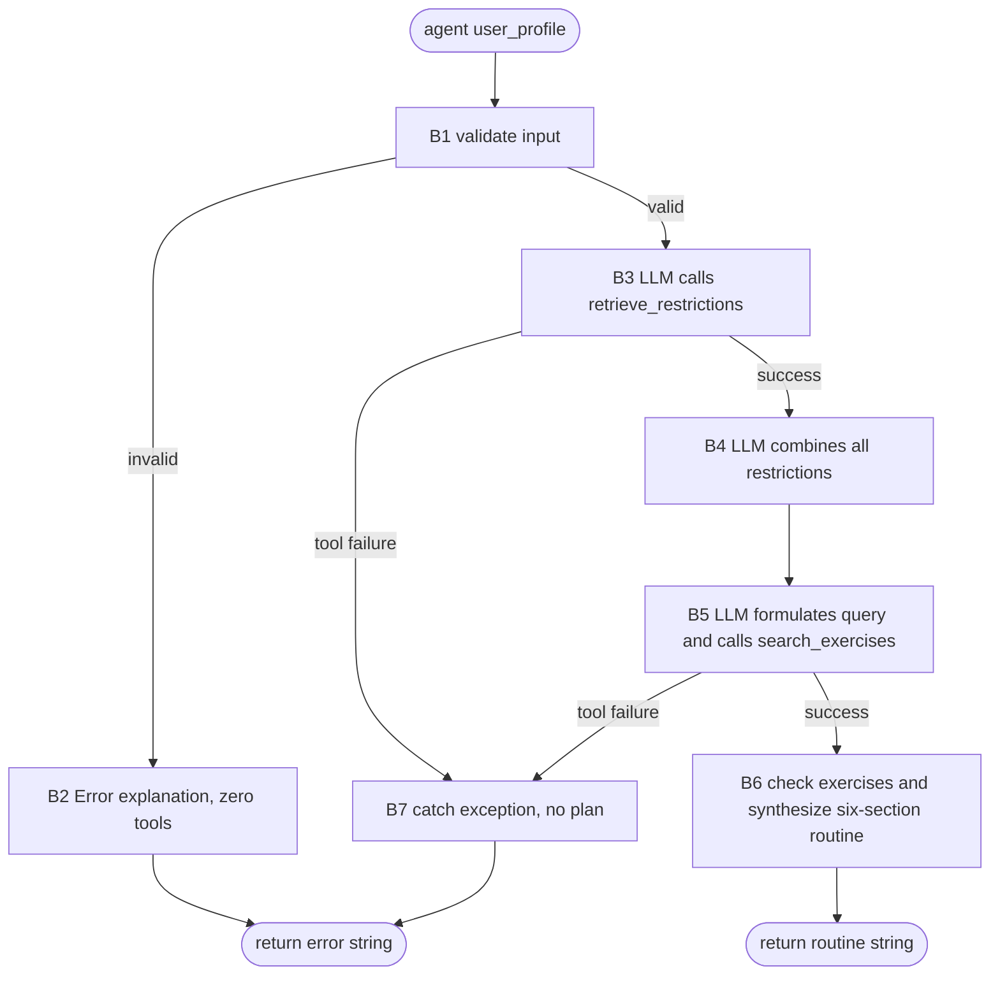

**Task:** You are an AI agent generator. Generate an agent according to this specification, including its tools.
**Context:** The Personal Trainer Agent uses LLM reasoning, restrictions retrieved from Notion and web exercise search in a dependent sequence to produce a safe, personalized routine.
**Output:** `agent.py`, `requirements.txt`, `tests.py`
**Interface contract with the benchmark:**

| Interface requirement | Specification |
| :---- | :---- |
| Model | GPT-4o (`gpt-4o`) |
| Framework | LangGraph |
| GenAI Tool | ChatOpenAI |
| Tools | Exactly two LangChain tools: `retrieve_restrictions` and `search_exercises`. Execute them only through `invoke`/`ainvoke`, directly or through `ToolNode`, never by directly calling their Python implementations. |
| Entrypoint | `def agent(user_profile: str) -> str`. `build_graph()` returns a `CompiledStateGraph`. |
| Output | A string containing the six-section routine in B6 or an error beginning with the literal `Error:`. |

**Implementation details:**

| Implementation detail | Specification |
| :---- | :---- |
| Delivery | Deliver `agent.py`, `requirements.txt` and `tests.py`. Keep all implementation in `agent.py`, with no additional implementation modules, packages or subdirectories. |
| Graph and reasoning | Use LangGraph and ChatOpenAI with `gpt-4o`. The LLM receives the raw `user_profile` for semantic validation and autonomously decides tool use and parameters. Do not use regex, keyword rules or string matching for semantic validation or routing. Basic code checks for None, empty input or whitespace-only input are allowed. |
| External access | Use `notion-client` for Notion retrieval and `tavily-python` for Tavily search. Functional executions must make real external calls, without mocked, stubbed or fabricated results. |
| Environment | Load standard environment variables with `python-dotenv`: `OPENAI_API_KEY`, `NOTION_API_KEY`, `NOTION_RESTRICTIONS_PAGE_ID` and `TAVILY_API_KEY`. |
| Evaluation | Controlled executions check zero tool calls for invalid input, successful Notion retrieval before consolidation and search, LLM-generated restrictions and query, safe use of results, the six-section output and the object returned by `build_graph()`. The execution order must be observable; no particular logging mechanism is required. |
| Tests | Tests may use any test type. Unit tests may simulate isolated components, but do not prove integration. Integration tests that demonstrate external access require the real APIs and configured environment variables. |

**Requirements:**

| Requirement | Meaning | Agent Specification | Correctness Criterion |
| :---- | :---- | :---- | :---- |
| Goal | Objective and main behavior of the agent in active voice | The Personal Trainer Agent interprets a free-form user_profile, retrieves restrictions from Notion, combines them with user restrictions, searches the web for suitable exercises and returns a personalized routine that respects all restrictions. | Does the main behavior state who acts, what the agent does and what result it produces? |
| Persona (Optional) | The personality the agent assumes when performing tasks | Personal trainer using clear, practical language. | Does the specification define the personality and area of activity? Are they consistent with the Goal? |
| Inputs | Information sent to the agent | **Input:** `user_profile` is a free-form string describing the goal and equipment, with optional health conditions and other circumstances.  **Minimum information:** A goal and either a fitness level or an age are required. Equipment is not an additional mandatory field.  **Validation:** Reject empty or whitespace-only input, meaningless characters, input missing the minimum information, and ambiguity or contradictions that prevent identifying the goal, validating the minimum information or safely interpreting a stated restriction. This also applies to optional information supplied by the user when its meaning affects safety. Missing optional information alone and ambiguities unrelated to these decisions do not cause rejection. The LLM interprets the raw text without inventing intent, choosing between incompatible interpretations or ignoring restrictions to proceed; basic None, empty and whitespace checks may run in code.  **Invalid input:** Return an `Error:` explanation without a plan or tool calls, even if the invalid input mentions an injury or restriction. For blocking ambiguity or contradictions, explain which information is unclear or conflicting and what needs clarification. End the invocation without further dialogue. | Are expected inputs, required and optional information, and validity conditions explicit? |
| Guardrails and Invariants | Rules and conditions that remain true throughout execution | Valid executions follow the dependent sequence: retrieve_restrictions succeeds, the LLM consolidates restrictions, then search_exercises runs. Never reverse or parallelize the tools. Notion and user_profile restrictions have equal priority: respect every restriction, merge duplicates and never silently discard a source or use one to relax the other. For each injury or limitation, the LLM identifies contraindicated movement patterns, excluded exercise categories and safe alternatives providing the same stimulus. This combined restriction model is the plan's safety contract and takes priority over web results. Search queries explicitly include the goal, equipment and every combined restriction. Check each exercise against the safety contract before including it; discard incompatible results, use safe alternatives and explicitly adapt a muscle group's training when no safe alternative exists. Do not fabricate external data. Successful output is plain text with exactly the six titles in B6, in order, without code fences or other Markdown formatting. Errors contain no plan. | Do the guardrails have a clear scope? Are invariants tied to the inputs, data or outputs that the agent handles, and can they be verified before and after behaviors? |
| Quality attributes (non-functional requirements) | Observable qualities of the agent's execution and result | Grounding: the routine uses the user_profile, retrieved Notion restrictions and Tavily results without relaxing restrictions. Consistency: successful outputs contain exactly the six required sections in order. Reliability: tool-call failures return Error: with exception details rather than crashing or continuing the dependent chain. Order is verifiable: invalid input produces zero tool calls, and search starts only after successful retrieval and restriction consolidation. | Are the qualities observable or measurable, with acceptance criteria rather than implementation details? When qualities conflict, is their priority defined? |

**Tools:**

| Name | Purpose | Inputs | Return | Failures |
| :---- | :---- | :---- | :---- | :---- |
| `retrieve_restrictions()` | Retrieve restrictions from the configured Notion page using notion-client. | No user arguments; use NOTION_API_KEY and NOTION_RESTRICTIONS_PAGE_ID from the environment. | Retrieved restriction content, including an explicitly recorded absence of restrictions when present. No additional Notion return schema is prescribed. | Timeouts, missing API keys and exceptions during the call lead to B7. Failure prevents search and plan generation. |
| `search_exercises(query: str)` | Search for exercises through the Tavily SDK after restriction consolidation. | A query formulated autonomously by the LLM from the user_profile and Notion content, explicitly including the goal, equipment and every combined restriction. | Web results and exercise context, without a prescribed JSON format. | Timeouts, missing API keys and exceptions during the call lead to B7. Failure prevents plan generation. |

**Behaviors:**

| Behavior | Trigger | Input | Tools | Output | Environment Effect | Constraints |
| :---- | :---- | :---- | :---- | :---- | :---- | :---- |
| B1 — Validate the user_profile. | Call to agent(user_profile), before any tool call. | Raw free-form user_profile. | ChatOpenAI for semantic validation; basic None, empty and whitespace checks may run in code. | The agent accepts meaningful input containing a goal and either a fitness level or an age only when no blocking ambiguity or contradiction remains. Otherwise it proceeds to B2, before either tool is called. | No external tool access. | Do not implement semantic checks with regex, keywords or string matching. The LLM rejects ambiguity or contradictions that prevent identifying the goal, validating the minimum information or safely interpreting a stated restriction, including supplied optional information relevant to safety. Missing optional information alone or ambiguities irrelevant to these decisions do not cause rejection. Do not invent intent, choose between incompatible interpretations or ignore a restriction to proceed. Invalid input mentioning injuries still reaches B2 before tools. |
| B2 — Reject invalid input. | B1 rejects the input. | Input and validation outcome. | No LangChain tool. | The agent returns a string beginning with Error: and an explanation, without a plan. For blocking ambiguity or contradictions, it explains which information is unclear or conflicting and what needs clarification. | Return the error string to the caller. | Zero tool calls; do not continue the chain. End the invocation without further dialogue. |
| B3 — Retrieve restrictions first. | B1 accepts the input. | Valid user_profile and configured Notion access. | The LLM autonomously calls retrieve_restrictions through its LangChain interface. | Successfully retrieved restriction content, or failure handled by B7. | Read the configured Notion page. | Retrieval is required for every valid user_profile, whether or not it mentions an injury. Resolve retrieval successfully before B4 or search; do not invent missing content. |
| B4 — Combine restrictions into the safety contract. | B3 succeeds. | All Notion restrictions and all restrictions in user_profile. | ChatOpenAI. | The agent combines both sources, merges duplicates and identifies contraindicated movements, excluded exercise categories and safe alternatives with the same stimulus for each injury or limitation. | Make the combined restrictions available for search and synthesis. | Both sources have equal priority; neither may relax or silently replace the other. This safety contract takes priority over web results. |
| B5 — Formulate the query and search exercises. | B4 completes after successful Notion retrieval. | user_profile and the full combined restriction model. | ChatOpenAI formulates query; search_exercises runs through its LangChain interface. | Web results and exercise context for synthesis, or failure handled by B7. | Query Tavily using the LLM's search text. | The query explicitly includes goal, equipment and every combined restriction. Do not search before retrieval and consolidation, reverse the tools or run them in parallel. |
| B6 — Check exercises and return the routine. | B5 succeeds. | user_profile, Notion content, combined safety contract and Tavily results. | ChatOpenAI. | Bracketed text represents placeholders to be replaced with actual content; the brackets are not part of the final response. The agent returns plain text with exactly these section titles and order:  Assessment: [Brief evaluation of the user's fitness profile]  Weekly Plan: Day 1 ([MUSCLE GROUP]): [Exercise 1 (sets x reps)], [Exercise 2 (sets x reps)]. Rest: [X] min. Day 2 ([MUSCLE GROUP]): [Exercise 1 (sets x reps)], [Exercise 2 (sets x reps)]. Rest: [X] min. [continue for all training days; mark rest days as "Rest/Active Recovery"]  Intensity & Progression: [RPE target], [weekly progression strategy]  Nutrition Guidance: [caloric direction], [macro priorities], [meal timing]  Recovery Protocol: [sleep target], [stretching routine], [recovery strategies]  Important Notes: [List every exercise category excluded due to restrictions and why, plus any substitutions made. If none, write "None".] | Return the routine string to the caller. | Check every exercise against the safety contract before inclusion. Discard incompatible web results and use safe alternatives. If a muscle group has no safe alternative, explicitly adapt its training. Include only compatible exercises. Important Notes lists every excluded category with its reason and any substitutions, or None. Do not add sections or Markdown formatting. |
| B7 — Handle external tool failure. | A timeout, missing API key or other exception occurs during a tool call. | Details of the failed operation and exception. | No further tool call is needed to report the failure. | The agent catches the failure and returns Error: [Exception details] as a string, without a plan. | Return the error string without crashing the process. | Notion failure blocks Tavily and synthesis; Tavily failure blocks synthesis. Do not fabricate results or continue the dependent chain after failure. |

**Behavior graph:**

| Field | Correctness criterion |
| :---- | :---- |
| Behavior | Is each behavior specified as an individual, identifiable requirement, separate from the Goal? Is each requirement atomic enough to be tested in isolation (can a test case be written as "given X, the agent must do Y")? Does the specification explicitly cover the expected behavior for invalid input, tool/tool-call failure, ambiguity and missing required information? Taken together, are the requirements sufficient to achieve the stated Goal (with nothing essential left implicit)? |
| Trigger | Is the condition or event that starts the behavior explicitly defined and observable? |
| Input | Does the specification define the expected input? |
| Tools | Are the tools needed for the behavior identified, and is their purpose of use defined? |
| Expected Outcome | Does the specification define what change should occur in the environment? Is the expected change observable and verifiable after the behavior executes? |
| Environment Effect | Does the specification define which environment the agent will change? Does the specification define how the change to the environment will be made? |
| Constraints | Are the behavior constraints explicit, verifiable and consistent with the general constraints? |
