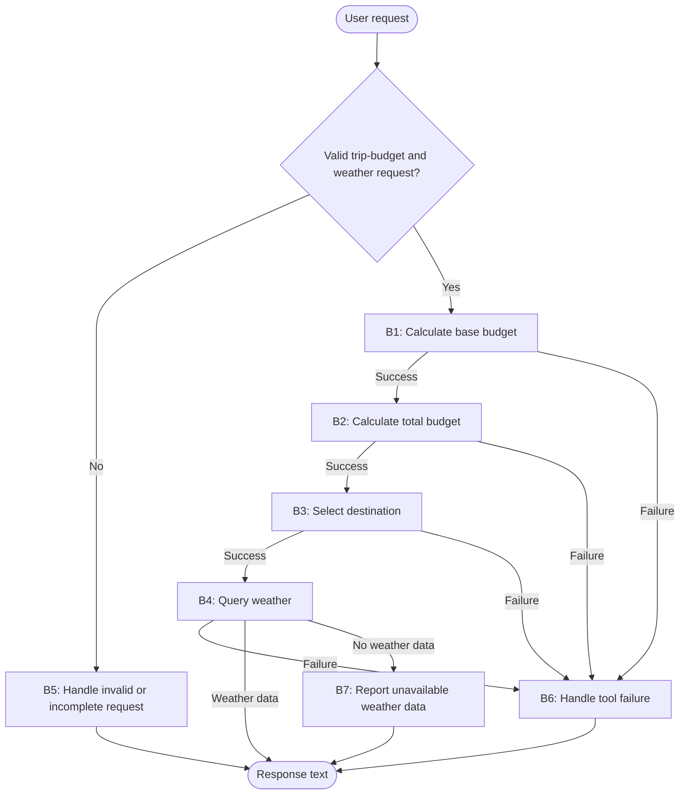

**Task:** You are an AI agent generator, and below is a specification for an agent. Generate an agent according to the specification. Consider that the agent's tools must be generated alongside the agent's code.

**Context:** An AI agent is an entity that uses an LLM and tools to perform specific tasks autonomously.

**Output:** agent.py, requirements.txt, tests.py

**Benchmark interface contract:**

| Interface requirement | Example |
| --- | --- |
| Model | GPT-4o |
| Framework | LangGraph |
| GenAI Tool | ChatOpenAI |
| Tools | Every tool must be a LangChain tool (@tool, StructuredTool, or obtained from an MCP server via langchain-mcp-adapters) and must be executed exclusively through its interface (invoke/ainvoke, directly or via ToolNode), never by calling its implementation function directly. |
| Entrypoint | agent(user_request: str) -> str |
| Output | Text with the total trip budget, selected destination, and weather response |

**Requirements:**

| Requirement | Meaning | Agent specification | Correctness criterion |
| --- | --- | --- | --- |
| Goal | The agent's objective and main behavior, stated in the active voice | The agent interprets a natural-language trip request, calculates the total budget from a daily budget, trip duration, and optional extra money, selects a destination from that total, and responds with the total budget, selected destination, and weather there. | Does the main behavior state who acts, what they do, and the result? |
| Persona (Optional) | The personality the agent assumes when performing its tasks | An assistant specializing in simple trip-budget and destination-weather inquiries. | Does the specification define a persona and its area of activity? Is the persona appropriate for and consistent with the Goal? |
| Inputs | Information sent to the agent | A natural-language request containing an identifiable daily budget, number of days, optional extra or reserve amount, and a request for the weather at the destination selected from the total budget. | Does the specification define the expected input? |
| Guardrails and Invariants | External rules or conditions the agent must always respect during execution. They may come from laws, regulations, company policies, or domain rules. An invariant must hold before and after any agent behavior. | The base budget, once calculated, equals the return from `multiply` for the daily budget and number of days identified in the request.  The total budget, once calculated, equals the return from `add` using that base-budget return and the identified extra or reserve amount, or zero when no such amount is given.  The selected destination, once determined, is the return from `select_location` for that total budget.  Weather information in the response corresponds to the return from `get_weather` for the selected destination; the destination named in the response is the one used in the weather query. | Does the specification state a relationship, property, or condition of the domain that is (or should be) always true, rather than a permitted/prohibited action? Is the invariant connected to an input, output, event, or piece of data the agent actually handles, rather than domain knowledge irrelevant to its scope? Can the invariant be checked at any point during execution? |
| Quality attributes (non-functional requirements) | Observable characteristics of the agent's behavior during execution that describe neither what it does (Goal/Behavior Requirements) nor what it must never do (Constraints), but how well it does it: consistently, safely, efficiently, and reliably. They directly shape the trust and experience of those who depend on the agent. | Not applicable. | Is the attribute described in observable/measurable behavioral terms, rather than as an implementation characteristic (for example, "use a cache" is an implementation constraint, not a quality attribute)? Is there a verifiable acceptance criterion (a threshold, rate, or test condition), rather than just a vague adjective (such as "must be fast" without defining how fast)? Where attributes involve a trade-off (for example, robustness versus performance), does the specification make the priority explicit? |

**Tools:**

| Name | Purpose | Inputs | Return | Failures |
| --- | --- | --- | --- | --- |
| `multiply` | Calculate the base trip budget. | `a`: identified daily budget; `b`: identified number of days. | Their numeric product. | An inability to complete the calculation is signaled as a tool failure, not as a numeric result. |
| `add` | Calculate the total trip budget. | `a`: base budget returned by `multiply`; `b`: identified extra or reserve amount, or zero if none was given. | Their numeric sum. | An inability to complete the calculation is signaled as a tool failure, not as a numeric result. |
| `select_location` | Select a destination from the calculated total budget. | `total_budget`: value returned by `add`. | Curitiba when the total is below 500; Lisbon when it is from 500 through 1000, inclusive; Tokyo when it is above 1000. | An inability to select a destination is signaled as a tool failure, not as a location. |
| `get_weather` | Obtain deterministic weather information for the selected destination. | `location`: destination returned by `select_location`. | Text with weather information and the queried destination, or an indication that weather data is unavailable there. | An inability to complete the query is signaled distinctly from a valid no-data result. |

**Behaviors:**

| Behavior | Trigger | Input | Tools | Output | Environment effect | Constraints |
| --- | --- | --- | --- | --- | --- | --- |
| B1 — Calculate the base budget | The request is a valid trip-budget and weather inquiry with an identifiable daily budget and number of days. | The request, daily budget, and number of days. | `multiply` | The base budget returned by `multiply` for use in B2. | The base budget is held in the agent's execution state; no external environment is changed. | The agent must pass the identified daily budget and number of days to `multiply` and must not calculate or substitute the product independently. |
| B2 — Calculate the total budget | `multiply` successfully returns the base budget in B1. | The base budget and the extra or reserve amount identified in the request, if any. | `add` | The total budget returned by `add` for use in B3. | The total budget is held in the agent's execution state; no external environment is changed. | The agent must pass the return from `multiply` to `add`, use zero for an omitted extra amount, and must not calculate or substitute the sum independently. |
| B3 — Select the destination | `add` successfully returns the total budget in B2. | The total budget returned by `add`. | `select_location` | The destination returned by `select_location` for use in B4. | The destination is held in the agent's execution state; no external environment is changed. | The agent must pass the return from `add` to `select_location` and must not select or substitute a destination independently. |
| B4 — Query the selected destination's weather and respond | `select_location` successfully returns a destination in B3. | The total budget and destination returned by the preceding tools. | `get_weather` | When weather data is returned, text stating the total budget, selected destination, and weather there. | Read-only weather lookup; no external environment is changed. | The agent must query `get_weather` with the destination returned by `select_location` and must not include weather information from its own knowledge, external sources, or fabricated data. |
| B5 — Handle an invalid or incomplete request | The request is empty, ambiguous, lacks an identifiable daily budget or number of days, or does not ask for the supported trip-budget and destination-weather task. | The request received from the user. | None. | Text explaining that the request cannot be completed and asking for the missing daily budget or number of days when applicable. | No tool is invoked and no external environment is changed. | The agent must not invoke any tool when the required values or task cannot be identified unambiguously. |
| B6 — Handle a tool failure | Any of `multiply`, `add`, `select_location`, or `get_weather` cannot complete its operation. | The selected tool, its input, and its failure. | The failing tool: `multiply`, `add`, `select_location`, or `get_weather`; no subsequent tool invocation. | Text explaining that the requested trip-budget and weather response could not be completed. | No further tool calls or external environment changes occur. | The agent must not fabricate a budget, destination, or weather result or continue the dependency chain after a tool failure. |
| B7 — Report unavailable weather data | `get_weather` returns a valid no-data result for the destination selected in B3. | The total budget, selected destination, and no-data result. | `get_weather` result from B4; no additional invocation. | Text stating the total budget and selected destination and that weather data is unavailable there. | No additional lookup or external environment change. | The agent must not fill unavailable weather information with invented data or data from another source. |

**Behavioral graph:**

| Field | Correctness criterion |
| --- | --- |
| Behavior | Is each behavior specified as an individual, identifiable requirement, separate from the Goal? Is each requirement atomic enough to test in isolation (given X, the agent must do Y)? Does the specification explicitly cover invalid input, tool call failure, ambiguity, and missing required information? Together, are the requirements sufficient to achieve the declared Goal, with no essential behavior left implicit? |
| Trigger | Is the condition or event that starts the behavior explicitly defined and observable? |
| Input | Does the specification define the expected input? |
| Tools | Are the required tools identified and their intended use defined? |
| Expected Outcome | Does the specification define the expected change in the environment? Is that change observable and verifiable after the behavior runs? |
| Environment effect | Does the specification define which environment the agent changes and how that change is made? |
| Constraints | Do this behavior’s constraints state what the agent must, must not, or may only do under certain conditions? Are the responsible party and conditions clear? Are the constraints verifiable and consistent with this behavior’s other fields and the Goal? |
